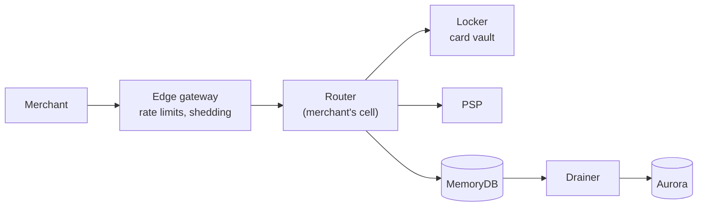

# payments-platform

A multi-tenant payment orchestrator on [Hyperswitch](https://github.com/juspay/hyperswitch), built to run on AWS under PCI DSS. Merchants send payments to one API; the platform stores each payment, picks a payment service provider (PSP), calls it and reports the result back. Card numbers live only in an isolated card vault (the locker).

This repository holds everything needed to build, deploy and operate the platform: infrastructure as code, Kubernetes delivery, security policy, observability, tests and documentation.

## What is inside

| Area | What it does | Where |
|---|---|---|
| Cells | Four copies of the payment stack (`cell-0` to `cell-3`) plus a spare. Each merchant lives in one cell, so a bad release or an overloaded database affects at most a quarter of the merchants. | `infra/live/<env>/eu-central-1/cell-*`, `deploy/charts/payments-cell` |
| Locker | The card vault: its own database, key and network path, reachable only from the router. | `deploy/charts/payments-locker`, `vendor/card-vault` |
| Edge | One public entry on the Kubernetes Gateway API (Istio) in its own cluster: TLS, request classes, local and global rate limits, load shedding, routing to the merchant's cell over mutual TLS. | `deploy/charts/payments-edge`, `deploy/platform/ratelimit`, `infra/modules/cell-endpoint` |
| Infrastructure | AWS Organization, accounts, network with egress firewall, EKS 1.36 with Karpenter, Aurora, MemoryDB, DynamoDB, MSK, ClickHouse, OpenSearch, Vault, backups; two regions (eu-central-1 writes, us-east-1 hot standby for prod). | `infra/` (Terraform modules, Terragrunt live trees) |
| Delivery | Argo CD ApplicationSets, canary rollouts, smoke tests after every sync, promotion dev → stage → prod. | `deploy/`, `.github/workflows/` |
| Security | Service control policies, Kyverno and OPA policies, Semgrep rules, IAM boundaries, secrets in Vault, image signing. | `policy/`, `docs/security/` |
| Observability | Metrics (VictoriaMetrics), traces (Tempo), logs in one central OpenSearch through Logstash with Dashboards behind Okta, errors in Sentry with high and critical issues in Slack; SLOs, alerts with one runbook each, a slow-requests view. | `observability/`, `deploy/platform/logstash`, `docs/runbooks/` |
| Tests | Unit, component, integration, contract, smoke, load (k6) and chaos tests. | `tests/` |

## How a payment flows



The router keeps hot payment state in MemoryDB; the drainer writes it to Aurora in the background; the scheduler runs retries, status syncs and webhooks. The full picture is in the [architecture overview](docs/architecture/README.md).

## Run it locally

The whole stack runs on a local [kind](https://kind.sigs.k8s.io/) cluster from the released images in GitHub Packages.

```sh
make bootstrap   # install the pinned tools from mise.toml and the git hooks
make prereqs     # check Docker, tools, free memory and disk
make up          # create the cluster and deploy the platform (VERSION=vX.Y.Z to pin a release, BUILD=1 to build images locally)
make demo        # create a sample merchant and send a payment through the local edge
make status      # nodes, releases, pods and edge health
make down        # delete the cluster
```

Requirements:

| | Released images (`make up`) | Local build (`make up BUILD=1`) |
|---|---|---|
| Tools | Docker 24+, kind, kubectl, helm with helm-diff, helmfile (`make bootstrap` installs the pinned versions) | the same plus `docker buildx` |
| Free memory | 8 GiB (the stack requests about 3.9 GiB and is limited to about 8 GiB) | 12 GiB (a Rust release build needs up to 10 GiB) |
| Free disk | 20 GiB | 60 GiB |

Details are in [scripts/kind/README.md](scripts/kind/README.md).

## Deploy to AWS

[docs/architecture/operations/deploy.md](docs/architecture/operations/deploy.md) walks through a deployment from an empty AWS Organization to the first payment: what to fill in `config/platform.yaml`, the order of Terraform applies, the Vault secrets, the Argo CD bootstrap and the promotion to prod. Day-2 operations (adding a cell, rotating secrets, upgrading clusters) are in [docs/architecture/operations/day-2.md](docs/architecture/operations/day-2.md).

Environments:

| Environment | Purpose | Size |
|---|---|---|
| dev | `cell-0` and `spare` with every workload, stopped outside working hours; eu-central-1 only | Smallest |
| stage | Production topology in eu-central-1 for release checks; production size only in booked test windows | Dev size by default, Spot nodes outside the CDE |
| prod | Live traffic; a hot standby in `us-east-1` at full size takes the whole load at any moment | Full, Savings Plans |

Costs per environment and the FinOps decisions are in [docs/architecture/cost/](docs/architecture/cost/README.md).

## Development workflow

Every change is its own short-lived branch and pull request to `main`. The pipeline runs in three stages, each gated on the one before:

1. **Pull request:** lint, commit-message and spec checks, DevSecOps scans (Semgrep, Checkov, Trivy, zizmor, cargo-deny, pip-audit, gitleaks, licenses), unit and component tests. It runs only the checks the changed paths need.
2. **Commit to `main`:** rootless image builds, signing and SBOM, then integration tests on an ephemeral kind cluster.
3. **Deploy:** Argo CD syncs, a smoke test runs after each sync, and a green stage promotes to prod.

See [CONTRIBUTING.md](.github/CONTRIBUTING.md) for branches, commit messages and specifications, and [tests/README.md](tests/README.md) for what each stage runs.

## Releases

Releases are `v*` tags. Each release publishes multi-arch images to GitHub Packages (`ghcr.io`), signed with cosign and shipped with an SBOM. The local stack pulls the latest release by default.

## Documentation

Start at [docs/README.md](docs/README.md). It has reading orders for newcomers, engineers, operators and auditors. Readers new to card payments should begin with [Payments in 10 minutes](docs/architecture/domain/README.md) and the [glossary](docs/glossary.md).

## Repository layout

| Directory | Contents |
|---|---|
| `config/` | Values that differ per installation and per environment: accounts, domains, regions, sizes |
| `infra/` | Terraform modules, Terragrunt live trees, state bootstrap, GitHub repository settings as code |
| `deploy/` | Helm charts, platform add-ons, per-environment values, Argo CD |
| `docker/` | Service Dockerfiles |
| `policy/` | Kyverno, OPA, SCP, Semgrep, tagging and security scanner settings |
| `observability/` | Alerts, dashboards, SLOs, collectors |
| `tests/` | The platform's own test suites |
| `scripts/` | Operations scripts: cells, DR, local cluster |
| `tools/` | Linters, config generators, CI helpers |
| `specs/` | Change specifications and their progress |
| `docs/` | Architecture, operations, security, DR, runbooks, ADRs, requirements |
| `vendor/` | Upstream Hyperswitch, card vault and end-to-end tests |
| `AGENTS.md`, `manifests/` | Rules and compact project context for AI coding agents |

## Security

Report vulnerabilities privately as described in [SECURITY.md](SECURITY.md). Never include card data or secrets in a report or an issue.

## License

Original work is licensed under the Apache License 2.0 (see `LICENSE`), the same license as the upstream Hyperswitch code. Third-party code in `vendor/` keeps its own licenses (see `vendor/README.md`).
