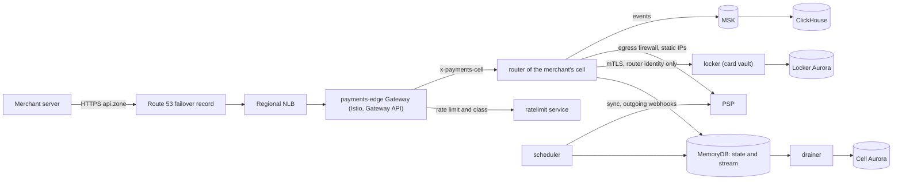

# Architecture overview

The payments platform is a multi-tenant payment orchestrator built on Hyperswitch. A merchant sends a payment to one API; the platform stores it, picks a PSP, calls it and reports the result back. Terms follow [the glossary](../glossary.md).

## The request path in one picture

1. The merchant calls `api.<zone>`. Route 53 answers with the ingress name of the working region (Frankfurt, `eu-central-1`) while its health check passes, and with us-east-1 only when that check fails and the us-east-1 ingress passes its own check (prod only).
2. A network load balancer passes the TCP connection to the `payments-edge` Gateway. Its Envoy proxies terminate TLS, give the request a request class (payments, read or list), apply the local and global rate limits and send the request to the router of the cell named in the `x-payments-cell` header. A request whose cell header is missing or unknown gets 503. The router of that cell authenticates the merchant's API key against its own database.
3. The router keeps the payment state in MemoryDB and appends it to a Redis stream. It never writes PostgreSQL on the hot path (write-behind).
4. When the payment carries card data, the router asks the locker for a token. The locker is the only place a PAN lives.
5. The router calls the PSP through the egress path: transit gateway, Network Firewall that admits only PSP domains, NAT with static Elastic IPs that the PSPs allowlist.
6. A PSP timeout puts the payment in the unknown state; the scheduler settles it by sync. A charge is never repeated automatically.
7. The drainer reads the stream and writes rows to the cell Aurora in batches. The time this takes is the drain lag (SLO p99 under 5 s).
8. Payment events go to MSK and from there to ClickHouse and OpenSearch, so analytics never reads the payment databases.

## Building blocks

| Block | What it is | Page |
|---|---|---|
| Cells | Four working copies of the stack (`cell-0` to `cell-3`) plus a `spare`, each with its own EKS cluster, router, drainer, scheduler, MemoryDB and Aurora. A merchant lives in one cell (DynamoDB map `merchant_id -> cell`), so a bad rollout or an exhausted database touches at most a quarter of the merchants. | [Services](runtime/services-secrets.md) |
| Locker | The card vault, shared by all cells because a card token belongs to the customer, not to the merchant. Own Aurora cluster, own KMS key, reachable only from the router. | [Services](runtime/services-secrets.md) |
| Edge | Gateway API `Gateway` served by Istio, local and global rate limits, overload manager. | [Edge](runtime/edge.md), [Rate limiting](runtime/rate-limiting.md) |
| Data | MemoryDB (hot state), Aurora PostgreSQL (cells and locker), DynamoDB (cell map), S3 (backups and event archive). | [Data and backups](foundation/data-backups.md) |
| Analytics | MSK, ClickHouse and OpenSearch on their own cluster outside the CDE. | [Data and backups](foundation/data-backups.md) |
| Control center | The merchant dashboard and the browser payment SDK, behind CloudFront and AWS WAF. | [Edge](runtime/edge.md) |
| Admin entry | Argo CD, Vault, Grafana, Alertmanager, VictoriaMetrics, Prometheus and Sentry behind one internal Gateway, a private DNS zone and Okta sign-in. | [Edge](runtime/edge.md) |
| Central observability | Metrics, logs, traces, alerts and error tracking in the shared-services account. | [Observability](runtime/observability.md) |

## Regions

- `eu-central-1` is the working region and the only one that writes. It runs in three Availability Zones, so losing one zone loses no data.
- The platform has two regions. `us-east-1` is the hot standby of prod: its cells run at the working size all the time, with one Aurora instance per global secondary, and take the whole load at any moment. A switch fences Frankfurt, promotes Aurora, warms the cache and moves traffic within the 60-minute RTO ([ADR-0019](../adr/0019-hot-standby-recovery-region.md)). See [disaster recovery](../dr/README.md).
- Stage and dev run in eu-central-1 alone. dev runs `cell-0` and the spare. In both, us-east-1 holds only the panel edge and its KMS keys.

## Pages

Domain (start here if card payments are new to you):

- [Payments in 10 minutes](domain/README.md)
- [Payment lifecycle](domain/payment-lifecycle.md)
- [Cards and compliance](domain/cards-and-compliance.md)
- [Platform concepts](domain/platform-concepts.md)

Foundation:

- [AWS accounts and network](foundation/aws-accounts-network.md)
- [Kubernetes and Argo CD delivery](foundation/kubernetes-delivery.md)
- [Data stores and backups](foundation/data-backups.md)
- [Configuration and generators](foundation/configuration.md)

Runtime:

- [Services, configuration and secrets](runtime/services-secrets.md)
- [Edge with Gateway API](runtime/edge.md)
- [Rate limiting and load shedding](runtime/rate-limiting.md)
- [Observability and alerting](runtime/observability.md)

Delivery and verification:

- [CI/CD stages and security scans](delivery/cicd-security.md)
- [AI review and the admin AI agent](delivery/ai.md)
- [Chaos and load testing](delivery/chaos-load.md)

Related: [cost and FinOps](cost/README.md), [security controls](../security/README.md), [threat model](../security/threat-model.md), [disaster recovery](../dr/README.md).

## Where in the repo

| Path | Holds |
|---|---|
| `infra/modules/`, `infra/live/<env>/<region>/<component>/` | Terraform modules and the Terragrunt stacks that use them |
| `deploy/charts/`, `deploy/envs/`, `deploy/platform/`, `deploy/argocd/` | Helm charts, per-environment values, add-ons, Argo CD ApplicationSets |
| `observability/` | SLOs, alerts, dashboards, exporters, OpenTelemetry collector config |
| `policy/` | SCPs, OPA, Kyverno, Semgrep, AWS Config pack, tagging, scanner thresholds |
| `config/platform.yaml`, `config/environments/` | Every deployment-specific value and the sizing per environment |
| `tools/`, `scripts/`, `tests/` | Generators and linters, operations scripts (failover, cell moves), the platform's own tests |
| `vendor/` | Upstream Hyperswitch and card vault code |
