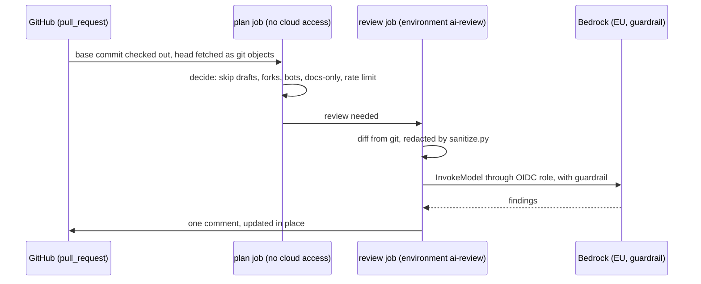

# AI review and the admin AI agent

Two tools use Claude models on Amazon Bedrock in an EU region. Neither can approve a change or touch card data.

## AI review of pull requests

### What it is

An advisory review of each pull request: one comment, updated in place. It never approves, never blocks and is never a required check.

### Why

A second reader on every change catches obvious mistakes early and costs little. Humans keep the decision.

### How it works

- The code that runs (`tools/ai`, `config`, `policy`) comes from the base commit. The head is read only through `git diff` and `git show`; it is never checked out, imported or run.
- `sanitize.py` removes card numbers, keys, tokens, secret assignments, Kubernetes Secret data and secret-looking base64 before the model sees the diff.
- The review job is the only job with `id-token: write`. Its role trusts only the subject `repo:<org>/<repo>:environment:ai-review` and may invoke only the configured EU inference profile, with the Bedrock guardrail that blocks card numbers, CVV and AWS keys and filters prompt attacks.
- Fork pull requests are skipped before any credential is requested. A monthly Bedrock budget and a token alarm watch the cost.
- Settings: `config/ai-review.yaml` (model, trigger, size limits, at most 8 findings).

## Admin AI agent

### What it is

A command-line assistant for administrators: `python3 -m tools.ai.admin_agent --env <env>`. It reads logs, metrics, alerts and Kubernetes objects, explains what it sees, and may propose a named runbook action that runs only after a human confirms.

### Why

During an incident it is faster to ask a question than to write five queries. Fixed tools and confirmed actions keep that speed safe.

### How it works

- Read tools only: Loki logs, VictoriaMetrics metrics from an allow list, Alertmanager alerts, `kubectl get` on an allow list of kinds. Secrets are never read; ConfigMap and environment values with secret-like names are blocked.
- The model supplies values, never selectors or queries. Results are capped by lines, points and tokens per tool and per session.
- Actions: `restart-pod` and `scale-deployment` (1 to 10 replicas), run as SSM Automation documents. Dry-run is the default; the admin types the action id to confirm, and in prod also retypes the environment name.
- CDE scope is refused everywhere: router, drainer, scheduler, locker and the CDE namespaces are denied in arguments, and the credentials of CDE accounts are refused. While `prod_in_cde_scope` is true the agent serves dev and stage only.
- Every AWS client uses the role of the chosen environment; the agent checks the account id before the first call.
- Bedrock is called through a private VPC endpoint; the admin role may invoke only listed models, only through that endpoint, and is denied writes, secrets, KMS and CDE log groups.
- Audit lines (metadata only, no arguments or model text) go to a local file readable by the owner and optionally to CloudWatch Logs.

## Where in the repo

| Path | What |
|---|---|
| `tools/ai/review.py`, `tools/ai/sanitize.py`, `.github/workflows/ai-review.yml` | PR review |
| `tools/ai/admin_agent/` | Admin agent |
| `config/ai-review.yaml`, `config/admin-agent.yaml` | Settings |
| `infra/modules/bedrock-access` | Roles, guardrail, VPC endpoint, budget, EU-only SCP document |
