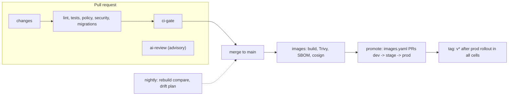

# CI/CD stages and security scans

## What it is

GitHub Actions workflows check every pull request, build images once per merge, promote them through the environments by pull request and tag what runs in prod. Security scanners run inside the same pipeline.

## Why

A change reaches prod only through reviewed pull requests and the same checks every time. Scans close to the change are cheaper than findings after a rollout.

## How it works

### Workflows

| Workflow | Trigger | What it does |
|---|---|---|
| `ci.yml` | pull request, merge group | `changes` picks the areas touched from `tools/ci/areas.yaml` (what each change runs is in [tests/README.md](../../../tests/README.md#what-a-change-runs); label `ci:full` runs everything); then `lint-fast`, `commitlint`, `spec-gate`, `python`, `rust`, `terraform` (fmt, validate, `terraform test` with mock providers), `helm` (lint, kubeconform, helm-unittest), `policy` (OPA, Kyverno tests), `docker`, `migrations`, `promotion` and `hotfix-guard`; calls `security.yml`. `ci-gate` and `spec-gate` are the required checks of the `main` ruleset. |
| `security.yml` | called by CI per area; a daily schedule scans everything | See the scan table below. |
| `codeql.yml` | pull request, push, schedule | CodeQL static analysis. |
| `ai-review.yml` | pull request | Advisory AI review, see [AI](ai.md). |
| `images.yml` | push to `main` | Builds changed service images once, Trivy blocks critical findings, Syft SBOM attached with `cosign attest`, `cosign sign` by digest, pushes through the ECR push role. |
| `promote.yml` | after images, smoke green, or by hand | Opens the PR that writes digests into `deploy/envs/<env>/images.yaml`. |
| `tag.yml` | `prod-rollout-complete` event or by hand | Next SemVer from the commits, evidence, `v*` tag. A tag builds nothing. |
| `tag-deployed.yml` | merge that changes an `images.yaml` | Tags the promoted image digests in the registry. |
| `hotfix.yml` | hotfix label or by hand | Creates a `release/*` branch, builds, runs full CI, backports to `main`. |
| `nightly.yml` | schedule | Reproducible rebuild and digest compare, alert-rule graph, Terraform drift plan with the read-only plan role, GitHub settings drift; the daily run tests every area except Rust, a weekly run on Sunday checks both Rust workspaces in full. |

### Security scans

| Scan | Tool | Blocks on |
|---|---|---|
| Secrets | gitleaks | any finding |
| Code | Semgrep (registry rules and the repo's `no-pan-logging` rules), CodeQL | repo rules and ERROR registry rules |
| Infrastructure as code | Checkov, Trivy config on Terraform and rendered charts | high or critical |
| Dependencies | Trivy vulnerabilities, cargo-deny, dependency review | high or critical with a fix available |
| Licenses | license lists in `policy/security/deps/` | a denied license |
| Workflows | zizmor, actionlint, OPA rules for GitHub (`id-token` only for AWS, no untrusted interpolation, permissions per job) | high |
| Images | Trivy image | critical |
| Running app | OWASP ZAP baseline against the stage router | per rules file |
| Repository | OpenSSF Scorecard (scheduled) | reported only |

Everything that does not block goes to code scanning and the job summary. Every waiver carries a reason, and a test enforces it.

### Pipeline hygiene

- Every workflow starts with `permissions: {}` and grants per job; actions are pinned by commit SHA.
- Pull request jobs run on the `ci-pr` runner pool and request no cloud credentials. A `ci-pr` instance has no Docker, never holds a GitHub App key, runs one job and is terminated, and reaches only allowlisted domains. Builds, image pushes and plans run on trusted pools and assume narrow roles through GitHub OIDC. See the [threat model](../../security/threat-model.md#ci-pull-request-perimeter).
- Terraform roles: a read-only plan role per account that trusts only `main` (nightly drift check), and one apply role per component that trusts only `main` and `release/*`, with a one-hour session and a permissions boundary.
- Commits follow Conventional Commits; `spec-gate` requires a spec reference or a named exemption.

## Where in the repo

| Path | What |
|---|---|
| `.github/workflows/` | Workflows |
| `policy/security/` | Scanner thresholds and waivers |
| `policy/opa/github`, `policy/semgrep/` | Own workflow and code rules |
| `tools/ci/` | Image selection, promotion, digest compare, versioning, migration checks |
| `infra/modules/ci-runners`, `ci-oidc-roles`, `ecr` | Runners, OIDC roles, registries |
| `infra/github/` | Repository settings, rulesets and environments as code |
