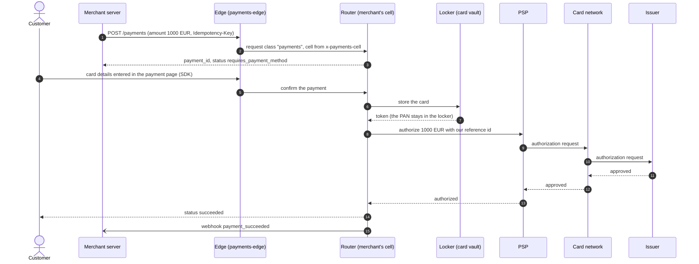

# Payments in 10 minutes

This page is for readers who have never worked with card payments. It explains who takes part in one card payment and what this platform does in the middle. The other pages of this directory go one level deeper:

- [Payment lifecycle](payment-lifecycle.md): what happens to a payment from creation to refund or dispute, and the statuses the API returns.
- [Cards and compliance](cards-and-compliance.md): what card data is, where it may live and what PCI DSS asks of us.
- [Platform concepts](platform-concepts.md): merchants, profiles, connectors, routing, cells, the edge and the SLOs.

Terms in **bold** are listed in the [glossary](../../glossary.md).

## Who is who

A card payment looks like one click to the person paying, but up to six parties take part.

| Party | Who it is | Example on this platform |
|---|---|---|
| **customer** (cardholder) | The person who pays with a card they own. | Someone paying 10.00 EUR for a concert ticket on a merchant's site. |
| **merchant** | The business that sells something and wants to be paid. A merchant is a tenant of this platform: it signs up, gets API keys and sends its payments here. | The ticket seller, identified by its `merchant_id` and placed in one cell, for example `cell-2`. |
| **payment orchestrator** | A layer between the merchant and many payment providers. The merchant integrates once; the orchestrator stores the payment, picks a provider, calls it and reports the result. | This platform, built on the open-source Hyperswitch router. |
| **PSP** (payment service provider, also called a payment processor) | A company that accepts payments on behalf of merchants and connects them to the card system. This platform talks to each PSP through a **connector**. | A real PSP in prod; the dummy connector (`fauxpay`, `pretendpay` and similar) in smoke tests. |
| **acquirer** | The bank that holds the merchant's account and receives the money for it. Some PSPs are acquirers themselves; others work with one. | The bank behind the PSP that the ticket seller uses. |
| **card network** (card scheme) | The rules and the wires between acquirers and issuers. It carries the request from the acquirer side to the bank that issued the card. | Visa, Mastercard. |
| **issuer** | The customer's bank, which issued the card. It decides whether to approve the payment: enough funds, card not blocked, no fraud signals. | The bank whose logo is on the customer's card. |

The platform never talks to the acquirer, the card network or the issuer directly. It talks to PSPs; everything to the right of the PSP happens inside the card system.

## One card payment through the platform

The customer pays 10.00 EUR. Amounts travel in minor units, so the API carries `"amount": 1000, "currency": "EUR"`.

1. The merchant's server creates a **payment intent**: "this customer is going to pay 10.00 EUR". The router answers with a `payment_id` and the status `requires_payment_method`: the payment exists, but nobody has said yet how it will be paid.
2. The customer types the card details into the payment page. The page is the Hyperswitch payment SDK served by this platform, so the card details go to the platform and never pass through the merchant's servers.
3. The router hands the card to the locker and gets a **token** back. From here on only the token moves around inside the platform; see [tokenization](cards-and-compliance.md#tokenization-and-the-locker).
4. The router chooses a PSP ([routing](platform-concepts.md#routing)) and asks it to **authorize** the amount. The request goes through the PSP, the acquirer and the card network to the issuer, which approves or declines it. The answer comes back the same way, usually within a second or two.
5. With automatic capture, an approved payment ends as `succeeded`. The router tells the customer's page at once and sends the merchant a **webhook**, so the merchant can release the ticket without asking again.
6. Days later the money actually moves: the issuer pays the network, the network pays the acquirer, the acquirer pays the merchant. This is **settlement**; see [settlement](payment-lifecycle.md#settlement).

Every request in this diagram passes the [edge](platform-concepts.md#the-edge-and-request-classes) first and lands on the router of the one [cell](platform-concepts.md#cells) the merchant lives in.

## What the platform adds

A merchant could integrate with one PSP directly. It comes to this platform for what sits around that call:

- **One API for many PSPs.** Adding or switching a PSP is configuration, not a new integration.
- **Routing.** Each payment goes to the PSP that suits it; when a PSP breaks, traffic moves to another one.
- **Card storage.** The locker keeps cards so a returning customer can pay with a saved card, and the merchant keeps card data off its own systems.
- **Safety around money.** Every write carries an idempotency key, a charge is never repeated automatically, and a payment whose outcome is unclear is settled by asking the PSP; see [idempotency keys](payment-lifecycle.md#idempotency-keys).
- **One view of all payments.** Statuses, refunds, disputes and reports for every PSP in one dashboard, the control center.

## Read next

- [Architecture overview](../README.md): the same request path drawn as infrastructure.
- [Glossary](../../glossary.md): every term on this page with its canonical name.
