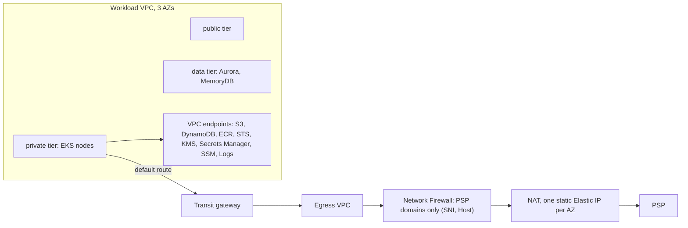

# AWS accounts and network

## What it is

An AWS Organization under Control Tower, split into organizational units (OUs) by purpose, and one three-AZ network per environment and region with a single, filtered way out to the PSPs.

## Why

Keeping card data in few, well-fenced places keeps the PCI DSS scope small. Analytics, the dashboard, CI and monitoring stay outside the cardholder data environment (CDE).

## How it works

### Accounts

New accounts are pull requests to `infra/aft-account-requests/accounts/` (Account Factory for Terraform), one YAML file per OU.

The organization layout:

| OU | Accounts | Purpose |
|---|---|---|
| Root | management | Organizations, billing, SCPs, IAM Identity Center; no workloads |
| Security | log-archive, audit | Organization trail, AWS Config and flow logs in an Object Lock bucket; delegated admin of GuardDuty, Security Hub, Inspector, Macie |
| Infrastructure | network, shared-services, backup | Transit gateway and egress, ECR, CI runners, central observability, Vault snapshots, locked backup vaults |
| Workloads/CDE | cde-dev, cde-stage, cde-prod | Router, locker, drainer, scheduler and their data stores |
| Workloads/NonCDE | platform-dev, platform-stage, platform-prod | Control center, analytics |
| Sandbox | sandbox-preview | Short-lived preview environments without card data |

Each live stack reads its account from `infra/live/<env>/env.hcl`, which takes the ids from `config/platform.yaml` (`accounts`): one workload account per environment holds that environment's cells, locker and analytics stacks. Inside it the CDE boundary is enforced per component: a cluster per cell, the tainted `cde` node pool, the locker pod security group, `pci-scope` tags, transit gateway blackhole routes and mesh policies. People sign in through IAM Identity Center with Okta as identity provider; see [security controls](../../security/README.md).

### Guardrails on every account

- Service control policies in `policy/scp/`: allowed regions only, CloudTrail, Config and GuardDuty cannot be turned off, IMDSv2 with hop limit 1, no IAM users or access keys, no public S3 ACLs, protected tags, and no DynamoDB writes in recovery regions except replication.
- A resource control policy on the CDE OU denies S3, KMS and Secrets Manager to principals outside the organization.
- Tag policies and the tag schema in `policy/tagging/`: every resource carries `environment`, `team`, `owner`, `cost-center`, `cell`, `component`, `pci-scope`, `data-class`, `backup-tier`, `managed-by`, `repo`.

### Network

- Every VPC has public, private and data tiers in three AZs, a locked default security group and no internet gateway unless a stack asks for one. AWS API calls stay inside through endpoints. Flow logs go to the log archive in Parquet.
- CIDRs come from `config/platform.yaml` (`network`): one `/16` per environment and region, one `/20` per egress VPC.
- Outbound traffic goes through the transit gateway to the egress VPC. Network Firewall drops everything that is not a PSP domain in `dns.psp_domains`. The static Elastic IPs are registered with every PSP and are protected from deletion.
- Transit gateway route tables are explicit: no default association or propagation, and static blackhole routes cut paths that must not exist (for example CDE to platform).
- Each region with workloads has its own egress path, so PSP traffic never crosses regions.
- Data stores admit connections only from the node security groups of the listed clusters; Aurora admits only its RDS Proxy. In a recovery region the client lists are empty until the switch.
- The locker pods get their own pod security group, the only one that reaches the locker Aurora proxy.

## Where in the repo

| Path | What |
|---|---|
| `infra/aft-account-requests/` | Account requests per OU |
| `infra/modules/org-policies`, `org-config`, `org-trail`, `org-security-services`, `log-archive`, `identity-center` | Organization controls |
| `infra/modules/vpc`, `transit-gateway`, `network-firewall`, `data-access` | Network |
| `infra/live/<env>/<region>/vpc`, `tgw`, `egress-vpc`, `firewall` | Network stacks per environment and region |
| `policy/scp/`, `policy/tagging/` | SCPs, tag and backup policies, tag schema |
