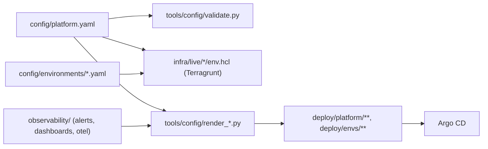

# Configuration and generators

## What it is

All deployment-specific values live in two places: `config/platform.yaml` (accounts, regions, networks, domains, endpoints, access groups) and `config/environments/<env>.yaml` (sizes). Terraform reads them directly. Python generators turn them into the Helm values and manifests that Argo CD applies.

## Why

A value written in one place cannot drift between Terraform, Helm and dashboards. A fork of the platform changes these files and nothing else.

## How it works

- `validate.py` checks required keys, 12-digit account ids, CIDRs and regions; it runs in CI.
- Sizes: `prod.yaml` is the reference. `stage.yaml` repeats it (prod size and topology, Spot where allowed). `dev.yaml` lists only what dev lowers. Each `env.hcl` merges its file over `prod.yaml` one level deep.
- Generators write files into `deploy/`. Each one has a `--check` mode that fails when a committed file differs from what it would write. `make lint-repo` runs every check, so a hand edit of a generated file fails CI.

| Generator | Writes |
|---|---|
| `render_standby.py` | `deploy/envs/<env>/<standby region>/**` from the working region's cell list |
| `render_vault.py` | Vault and External Secrets values per environment and region |
| `render_central.py` | Alertmanager values from `observability/alertmanager` |
| `render_grafana.py` | Grafana, Loki and Tempo files, dashboards ConfigMaps, organizations from `access.grafana_orgs` |
| `render_victoria.py`, `render/render_vmalert.py` | Metrics store storage, backups and rule loading |
| `render_otel.py` | OpenTelemetry collector values from the tested `observability/otel/collector.yaml` |
| `render_exporters.py` | Exporter manifests from `observability/exporters` |
| `render_sentry.py` | Sentry ExternalSecret |
| `render/render_admin_gateway.py`, `render/render_admin_sso.py` | Admin Gateway routes and the Okta sign-in of each admin tool |
| `argocd-values.py` | Values of `deploy/argocd` |

Observability has its own generators: `observability/lib/build.py` (dashboards), `observability/slo/generate.py` (SLO rules) and `observability/lib/gen_resilience.py` (resilience alerts from `policy/resilience`).

## Where in the repo

| Path | What |
|---|---|
| `config/platform.yaml` | Deployment values |
| `config/environments/` | Sizing per environment |
| `config/ai-review.yaml`, `config/admin-agent.yaml` | AI review and admin agent settings |
| `tools/config/` | Validator and generators with tests |
| `infra/live/<env>/env.hcl` | Where Terraform reads the config |
| `Makefile` (`lint-repo`) | All `--check` runs |
