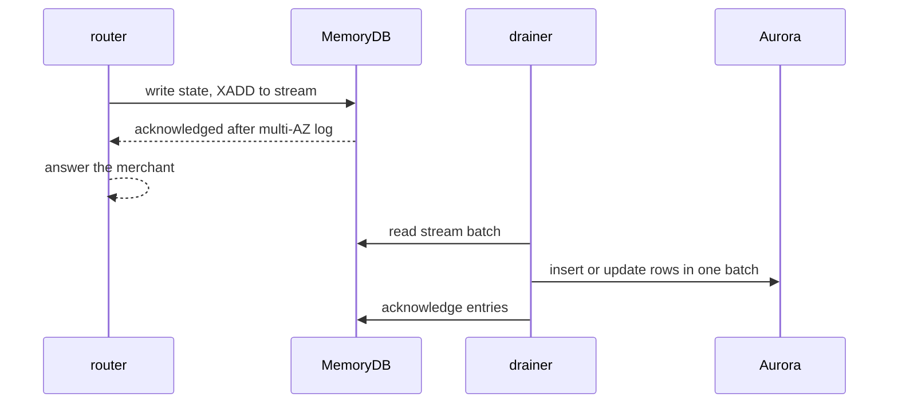

# Data stores and backups

## What it is

Each cell has its own MemoryDB and Aurora PostgreSQL. The locker has its own Aurora. A DynamoDB global table maps merchants to cells. Analytics runs on MSK, ClickHouse and OpenSearch. Every stateful resource has a backup plan, and restores are tested every day.

## Why

The hot path must not wait for PostgreSQL, so the router writes to MemoryDB and the drainer moves the data to Aurora later. Backups protect against the failures replication cannot fix: a bad migration, a wrong delete, a compromised account.

## How it works

### Stores

| Store | Role | Shape |
|---|---|---|
| MemoryDB (Redis OSS API) | Payment state and the Redis stream of a cell | 2 shards x (1 primary + 2 replicas) over three AZs in prod, TLS, ACL users, `noeviction`. A write is acknowledged only after the multi-AZ transaction log has it. |
| Aurora PostgreSQL 16 | Payment rows of a cell; card vault rows of the locker | Writer and readers on I/O-Optimized storage in the working cells and on Standard storage for the spare and the locker; RDS Proxy, TLS only, pgaudit. In prod, a global database with a secondary in us-east-1 that runs one instance at the writer class (hot standby). Stage and dev have no secondaries; dev and stops its clusters outside the working window. |
| DynamoDB global table | `merchant_id -> cell` | In prod, a replica in us-east-1, written only from Frankfurt (an IAM policy and an SCP deny writes there until a switch). |
| MSK | Payment events | 9 brokers in prod, replication factor 3, `min.insync.replicas=2`, IAM auth only. An S3 sink keeps every event in the archive bucket. |
| ClickHouse | Analytics | Runs on the analytics cluster (4 shards x 2 replicas in prod), fed from MSK. |
| OpenSearch | Log search (central domain in shared-services, not on the analytics cluster) | One domain for every environment, VPC only, three dedicated masters, hot nodes over three AZs, UltraWarm. Application logs 7 days hot and 30 days in total, the audit trail 30 days hot and 365 in total ([Logging](../runtime/logging.md)). |
| S3 | Backups, audit logs, event archive, Terraform state | Versioned, KMS, Object Lock, replicated with Replication Time Control. |

### Write-behind

The drain lag SLO is p99 under 5 s; an alert fires when a stream holds more than 50,000 entries.

### Backups and restore

| Data | How | Kept |
|---|---|---|
| Aurora (cells, locker), DynamoDB | Continuous backup with point-in-time recovery to any second, plus hourly snapshots, copied to us-east-1 in prod | 35 days; monthly copy 7 years |
| MemoryDB, ClickHouse | Hourly snapshots (ClickHouse with `clickhouse-backup`, zstd level 1) | 35 days |
| Before every schema change | Snapshot taken by the migration Job | 35 days |
| Vault | Hourly Raft snapshot to a locked bucket, replicated to us-east-1 in prod | per bucket policy |
| S3 objects | Glacier Instant Retrieval at 7 days, Glacier at 14; monthly archive to Deep Archive | 35 days; archive 7 years |

- AWS Backup selects resources by the `backup-tier` tag (`gold`, `silver`, `bronze`). Vaults use Vault Lock in compliance mode and accept copies only from listed accounts.
- A stateful resource without a backup plan fails the OPA check `no-stateful-without-backup`.
- Every day a restore test restores Aurora and DynamoDB, runs a validator and publishes `RestoreDurationSeconds` and `RestoreSuccess`. Alerts fire when a test fails, when a restore takes more than 80% of the 30-minute target, or when the latest restorable time lags more than 5 minutes for 10 minutes.
- After a region switch, the running us-east-1 MemoryDB warms from Aurora; MSK is rebuilt from the S3 event archive; ClickHouse restores its last backup and replays the archive after it.

Targets: payment data loss at most 5 minutes for a logical error, restore into prepared capacity in 30 minutes, analytics RPO 15 minutes and RTO 4 hours. Region targets are on the [disaster recovery](../../dr/README.md) page.

### Database credentials

Router, drainer and scheduler share the Aurora login `hs_app` through RDS Proxy; MemoryDB has one password user per service and cell. Both passwords are static values in Vault, because RDS Proxy authenticates clients only against secrets it holds. Rotation procedures are in the READMEs of `infra/modules/aurora-global` and `infra/modules/memorydb`.

## Where in the repo

| Path | What |
|---|---|
| `infra/modules/memorydb`, `aurora-global`, `dynamodb-global`, `msk`, `clickhouse` | Store modules |
| `infra/modules/opensearch`, `opensearch-indices`, `infra/live/shared-services/eu-central-1/logs/` | Central log domain |
| `infra/modules/backup`, `s3-backup`, `restore-automation`, `secrets-replica` | Backups, archives, restore tests, replicated secrets |
| `infra/live/<env>/<region>/<cell>/aurora`, `memorydb`, `data-access` | Per-cell data stacks |
| `infra/live/<env>/eu-central-1/analytics/` | Analytics cluster and stores |
| `deploy/charts/migrations`, `scripts/schema/` | Migration Job and the pre-migration snapshot |
| `observability/alerts/backup-dr/`, `docs/runbooks/backup-dr/` | Backup and restore alerts and their runbooks |
| `scripts/cells/migrate-merchant.py` | Moving a merchant between cells |
