# Kubernetes and Argo CD delivery

## What it is

Every cell, the analytics stack and the central observability stack run on their own Amazon EKS cluster. Argo CD installs everything on them from Git: the payment services, the platform add-ons and the policies.

## Why

One cluster per cell keeps failures and rollouts inside one cell. Git as the only source of truth means every change is reviewed, repeatable and visible in history; nobody changes a cluster by hand.

## How it works

### Clusters

- EKS with a private API endpoint only, secrets encrypted with a customer managed key, access entries instead of the `aws-auth` ConfigMap and five control-plane log types.
- A small Bottlerocket bootstrap node group runs CoreDNS and Karpenter. Karpenter adds all other nodes from NodePools:
  - `payments` for the services, `stateful` for stateful add-ons, `workers` (Spot allowed, tainted) and `cde` (On-Demand only, tainted).
  - CDE pools are never Spot in any environment. Prod uses On-Demand nodes; stage uses Spot for the pools that allow it.
- Nodes: Bottlerocket pinned by version, IMDSv2 with hop limit 1, encrypted gp3, no public IP.
- Workloads reach AWS through EKS Pod Identity roles, one per service and cell, each under a permissions boundary and naming its resources.
- People get view-only access (`SRE-View`); Argo CD gets admin rights only in the platform namespaces, never cluster-admin.

### Delivery flow

```mermaid
flowchart LR
  PR["Pull request"] --> CI["CI checks"] --> MAIN["main"]
  MAIN --> IMG["images: build once, scan, SBOM, sign"]
  IMG --> DEV["PR: deploy/envs/dev/images.yaml"]
  DEV -->|"auto sync, smoke green"| STAGE["PR: deploy/envs/stage/images.yaml"]
  STAGE -->|"approval, smoke green"| PROD["PR: deploy/envs/prod/images.yaml"]
  PROD -->|"release tag, manual sync per cell"| CELLS["cell-0, cell-1, cell-2, cell-3"]
```

- An image is built once per merge and identified by its digest. Promotion is a pull request that changes `deploy/envs/<env>/images.yaml`; the next environment runs the same bytes.
- dev and stage sync automatically. The `payments-cells` ApplicationSet uses a RollingSync: `cell-0` first, so a bad migration stops there, then `cell-1`, `cell-2`, `cell-3`, and the spare last on its own (dev has `cell-0` and the spare only). The prod hot standby in us-east-1 has its own cell Applications, synced from `deploy/envs/prod/us-east-1/`.
- After a sync, a PostSync smoke Job makes a synthetic payment through the dummy connector. Green on the last cell sends `smoke-green-<env>` to GitHub, which opens the next promotion.
- Production Applications (`applicationset-gated`) are pinned to one release tag and have no automated sync. A merge to `main` changes nothing in prod until the tag moves and each cell is synced, one at a time.
- A `v*` SemVer tag is created only by the tagging workflow after a prod rollout in all cells.

### Values layering

For a cell release Argo CD stacks these files, later ones win:

1. chart defaults (`deploy/charts/<chart>/values.yaml`)
2. `deploy/envs/<env>/values.yaml`
3. `deploy/envs/<env>/<region>/values.yaml`
4. `deploy/envs/<env>/<region>/<cell>/values.yaml`
5. `deploy/envs/<env>/images.yaml` (digests, written by CI only)

Each chart has a `values.schema.json`; `tests/contracts` checks the merged values against it.

### Migrations

Schema changes run as a Kubernetes Job from the `migrations` chart, part of the `payments-cell` and `payments-locker` umbrellas. Migrations are expand-contract only, a snapshot is taken before every schema change (Kyverno `require-migration-snapshot`), and `down.sql` never runs in prod.

### Admission policies

Kyverno enforces: signed images, images by digest only, no `latest` tag, allowed registries, probes, PodDisruptionBudgets, no `Ingress` objects (Gateway API only), no `exec` into CDE pods, and the migration snapshot.

## Where in the repo

| Path | What |
|---|---|
| `infra/modules/eks`, `karpenter`, `iam-workloads` | Clusters, node pools, workload roles |
| `infra/live/<env>/<region>/<cell>/eks`, `karpenter`, `iam-workloads` | Per-cell stacks |
| `deploy/argocd/` | AppProjects and ApplicationSets (cells, shared, gated, add-ons) |
| `deploy/charts/` | `payments-cell`, `payments-locker`, `payments-edge`, `control-center`, service charts, `platform-common` library |
| `deploy/envs/<env>/` | Values and `images.yaml` |
| `deploy/platform/` | Add-ons: Istio, cert-manager, External Secrets, Vault, Karpenter, Kyverno, observability agents, smoke, k6 |
| `policy/kyverno/` | Admission policies with tests |
| `.github/workflows/promote.yml`, `tag.yml`, `tag-deployed.yml` | Promotion and tagging |
