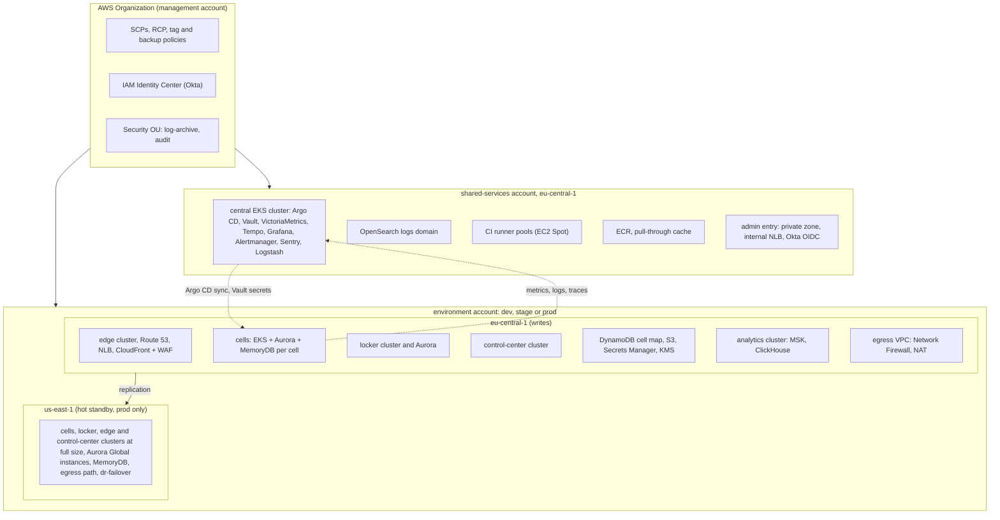

# Infrastructure

This section describes the AWS infrastructure of the payments platform: what is built, how it is wired, which tools build it and how to change it. Every fact on these pages can be checked in the code; each page names the paths.

For the reasons behind the design, read the [architecture overview](../README.md) first. These pages cover the "what" and the "how".

## The map

## Pages

| Area | Page | What it covers |
|---|---|---|
| Base | [Infrastructure as code](base/iac.md) | Terraform, Terragrunt, state and locking, generated providers, default tags, module tests, plan and apply |
| Base | [Organization and accounts](base/organization.md) | AWS Organization, OUs, AFT, Identity Center, SCP and RCP, CloudTrail, Config, GuardDuty, Security Hub, Inspector, Macie |
| Base | [Network](base/network.md) | VPC tiers, CIDR plan, transit gateway, egress VPC, Network Firewall, NAT, endpoints, DNS |
| Base | [Module catalogue](base/modules.md) | Every module in `infra/modules/` in one table |
| Platform | [Compute](platform/compute.md) | EKS, Bottlerocket, Karpenter pools, the CDE pool, add-ons, Istio, Gateway API, cross-cluster paths |
| Platform | [Data](platform/data.md) | Aurora Global, MemoryDB, DynamoDB, S3, MSK, ClickHouse, KMS, AWS Backup |
| Platform | [Edge](platform/edge.md) | Route 53 failover, NLB, Global Accelerator, CloudFront, WAF, the admin entry |
| Platform | [Secrets](platform/secrets.md) | Vault, External Secrets, Secrets Manager, RDS Proxy logins, rotation |
| Support | [Observability](support/observability.md) | The central stack, logs in OpenSearch, retention and storage |
| Support | [CI runners and images](support/ci-runners.md) | EC2 Spot runner pools, the untrusted pool, BuildKit, ECR, signing |
| Support | [Regions and disaster recovery](support/dr.md) | Two regions, the prod hot standby, replication, failover automation |

## How to read this section

1. Start with [Infrastructure as code](base/iac.md). It explains the folder layout, so every other page reads faster.
2. Read [Organization](base/organization.md) and [Network](base/network.md) next. Everything else sits inside them.
3. Then read the page of the area you need. Each page has the same parts: what is built and why, services and versions, wiring, security controls, sizes per environment, modules and live units, how to change it.
4. Use the [module catalogue](base/modules.md) as an index when you open a pull request in `infra/modules/`.

## Where the numbers come from

| Kind of value | Source |
|---|---|
| Accounts, CIDRs, zones, PSP domains, runner version | `config/platform.yaml` |
| Sizes per environment | `config/environments/prod.yaml` (reference), `dev.yaml` and `stage.yaml` (overrides) |
| Kubernetes and Bottlerocket versions, cells, KMS keys, analytics defaults | `infra/live/<env>/env.hcl` |
| Settings shared by every stack of a component | `infra/live/_envcommon/<group>/<component>.hcl` |
| Module defaults | `infra/modules/<name>/variables.tf` |
| Chart versions | `deploy/argocd/templates/addons/**` |
| Tool versions | `mise.toml` |

`infra/live/<env>/env.hcl` merges `config/environments/<env>.yaml` over `prod.yaml` one level deep. A section named in the environment file replaces only the keys it lists.

## Environments at a glance

| | dev | stage | prod |
|---|---|---|---|
| Cells in eu-central-1 | `cell-0`, `spare` | `cell-0` to `cell-3`, `spare` | `cell-0` to `cell-3`, `spare` |
| us-east-1 | edge only (`kms` with the `logs` key, `panel-edge`, `waf-edge`) | edge only (`kms` with the `logs` key, `panel-edge`, `waf-edge`) | hot standby at full size |
| Payment node pools on Spot | `payments`, `stateful`, `workers` | `payments`, `stateful`, `workers` | none |
| Aurora stopped outside working hours | yes (`aurora-schedule`) | no | no |

Source: `infra/live/<env>/env.hcl`, `config/environments/*.yaml`, `infra/live/README.md`.
