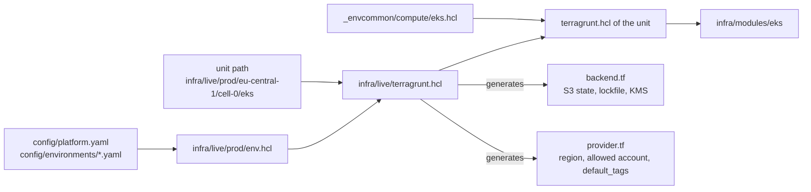

# Infrastructure as code

Every AWS resource of the platform is described in Terraform. Terragrunt wires the modules to accounts, regions and cells. This page explains the layout, the state, the provider settings, the tests and the path from a pull request to a change in AWS.

## What is built and why

| Piece | Path | Purpose |
|---|---|---|
| Modules | `infra/modules/<name>/` | 43 reusable modules, one concern each; see the [module catalogue](modules.md) |
| Live stacks | `infra/live/<env>/<region>[/<cell>]/<component>/terragrunt.hcl` | One Terragrunt unit per deployed component; holds only wiring |
| Shared component settings | `infra/live/_envcommon/<group>/<component>.hcl` | Module source and the inputs that every unit of a component shares |
| Environment settings | `infra/live/<env>/env.hcl` | Account, versions, cells, KMS keys, sizing merged from `config/environments/` |
| Root settings | `infra/live/terragrunt.hcl` | Remote state, generated provider, default tags, common inputs |
| Bootstrap | `infra/bootstrap/` | State bucket, its KMS key, replicas, GitHub OIDC plan and apply roles |
| Accounts | `infra/aft-account-requests/` | One YAML file per OU; Account Factory for Terraform creates the accounts |
| GitHub | `infra/github/` | Repository settings, rulesets and environments as code |

Why this layout:

- Environments are directories, never branches. A change to prod is a change under `infra/live/prod/`.
- A module never knows which environment it runs in. The path and `env.hcl` decide that.
- Sizes live in data files (`config/environments/`), so a size change does not touch Terraform code.

## Tools and versions

| Tool | Version | Source |
|---|---|---|
| Terraform | 1.17.0 (modules accept `>= 1.9`) | `mise.toml`, `infra/modules/*/versions.tf` |
| Terragrunt | 0.93.0 | `mise.toml` |
| TFLint | 0.66.0 | `mise.toml` |
| AWS provider `hashicorp/aws` | 6.x (`~> 6.0` or `>= 6.0, < 7.0`) | `infra/modules/*/versions.tf` |
| `hashicorp/random` | `>= 3.6, < 4.0` | `memorydb`, `central-secrets` |
| `hashicorp/archive` | `>= 2.4, < 3.0` | `dr-failover` |
| `okta/okta` | `>= 5.0, < 6.0` | `okta-sso` |

`make bootstrap` installs the pinned tools from `mise.toml`. CI installs the same versions with `jdx/mise-action`.

## How it is wired



### The path is the configuration

`infra/live/terragrunt.hcl` splits the unit path:

| Path segment | Becomes |
|---|---|
| first | `environment` (dev, stage, prod, management, security, shared-services) |
| second | `region`, and `region_short` (`euc1`, `use1`, `use2`) |
| third, only in four-part paths | `cell` (`cell-0` to `cell-3`, `spare`, `locker`, `edge`, `control-center`, `analytics`, `central`, `logs`); otherwise `shared` |
| last | `component` |

The account comes from `<env>/env.hcl`, because the path has no account segment. Names follow `pay-<env>-<region-short>-<component>`.

### Units, envcommon and dependencies

A unit includes two files: the root (`include "root"`) and one `_envcommon` file (`include "envcommon"`). The unit then adds what only it knows: the CIDR of its region, the writer AZ of its Aurora cluster, the KMS key of its cell.

Units read each other's outputs with `dependency` blocks (for example `cell-0/eks` reads `../../vpc` and `../../kms`). Each dependency has `mock_outputs` for `init`, `validate` and `plan`, so a plan works before the dependency exists.

### State and locking

| Setting | Value |
|---|---|
| Backend | S3, generated as `backend.tf` |
| Bucket | one per state root (`management`, `security`, `shared-services`, `dev`, `stage`, `prod`): `pay-<root>-euc1-tf-state-<shared-services account id>`, in eu-central-1 |
| Key | the unit path relative to `infra/live`, plus `/terraform.tfstate` |
| Encryption | SSE-KMS with the multi-Region state key of the root (`storage.state_kms_key_arns.<root>`) |
| Failover | `PAY_STATE_REGION=us-east-1` switches every unit to the replica `pay-<root>-use1-tf-state-<shared-services account id>` and the us-east-1 replica of the state key; an unknown region fails instead of naming a new bucket |
| Locking | native S3 lockfile (`use_lockfile = true`); no DynamoDB table |

`infra/bootstrap` builds the bucket: versioning, Object Lock in governance mode, TLS only, Block Public Access, and a replica with Replication Time Control in us-east-1. It is applied once with local state by a person with a temporary admin role, then migrated into the bucket. The failback from the replica is a written procedure in `infra/bootstrap/README.md`.

### Generated provider and default tags

The root generates `provider.tf` for every unit:

- `region` from the path.
- `allowed_account_ids` with the one account of `env.hcl`. A unit can never act on the wrong account; the management and security placeholders refuse every call until the real id is set.
- `default_tags` with six tags the path can fill: `environment`, `cell`, `component`, `cost-center`, `managed-by = terraform`, `repo = infra/live/<path>`.

The other five tags of the tagging schema (`team`, `owner`, `pci-scope`, `data-class`, `backup-tier`) are required module inputs. Each `_envcommon` file sets them for its component. The organization tag policy (`policy/scp/tag-policies/required-tags.json`) checks them on the AWS side, and `deny-tag-edit` keeps people from changing them by hand.

### Common inputs

The root passes one set of inputs to every module: `environment`, `env`, `region`, `region_name`, `region_short`, `primary_region`, `name_prefix`, `account_id`. Terraform ignores the names a module does not declare. Data modules take `env` and `region_short`; foundation modules take `environment` and `region` (`manifests/infrastructure.yaml`, `known_inconsistency`).

## Module tests

Every module has a `tests/` directory with `.tftest.hcl` files that use `mock_provider "aws"`. Tests run offline, with no credentials and no AWS account:

```sh
cd infra/modules/<name>
terraform init -backend=false && terraform test
```

Tests assert names, tags, policies and the validations that reject unsafe input (for example, `backup` refuses an unlocked vault in prod and `ci-runners` refuses an untrusted pool with a role).

## Checks in CI

| Check | Where | What it runs |
|---|---|---|
| Format and tests | `.github/workflows/ci.yml`, job `terraform` | `terraform fmt -check -recursive infra`, `make test-terraform` |
| Validate | `ci.yml`, job `terraform-validate` | `make lint-terraform` (`terraform init -backend=false` and `terraform validate` per module) |
| Lint | `ci.yml`, job `lint-report` | `tflint` with the pinned AWS ruleset |
| Drift | `.github/workflows/nightly.yml`, job `drift` | `terragrunt run -- plan -detailed-exitcode -lock=false` for every unit outside `cde-*`, with the plan role; exit code 2 fails the job and opens a drift alert |

The jobs run only when the change touches Terraform (`area_terraform` from the `changes` job).

## Plan and apply

| Role | Name | Trust | Rights |
|---|---|---|---|
| Plan | `pay-<env>-glob-tf-plan` | GitHub OIDC, pull requests of this repository (`plan_refs` adds `main` for the nightly drift plan) | Reads metadata and the state of its environment, writes only `.tflock` files; no secret or object reads |
| Apply | `pay-<env>-glob-tf-apply-<component>` | GitHub OIDC, `refs/heads/main` and `refs/heads/release/*` only | Named actions on named resources, its own state prefix `<env>/<component>/`, 1 hour session, the permissions boundary, a deny on roles created without that boundary |

Source: `infra/modules/ci-oidc-roles`. The module rejects `*`, `iam:*` and wildcard resources in an apply role.

GitHub Environments (`infra/github/modules/environments`) gate the deployments: `dev`, `stage`, `prod` and `cde-prod`, each deployable only from `main`. In organization mode `prod` needs an SRE reviewer and `cde-prod` needs SRE and security reviewers. Locally, `make plan ENV=<env>` runs `terragrunt run --all -- plan -lock=false` with the credentials of the plan role.

Agents never run `apply`. Stacks with people or IdP data (`identity-center`, `okta-sso`) are applied only by the owner.

## Security controls

- State is encrypted with a customer managed key, versioned, locked against deletion and replicated to us-east-1.
- No static AWS keys in CI: plan and apply use GitHub OIDC with trust pinned to the repository and the ref.
- Each apply role reaches only its own component; a compromised apply job cannot rewrite another component's state.
- `allowed_account_ids` in the generated provider stops a unit from acting on another account.
- The SCP `security-baseline` denies IAM users and access keys in member accounts, so no long-lived key can replace OIDC.

## How to change it

- **A setting of one unit**: edit that unit's `terragrunt.hcl`, open a pull request, read the plan.
- **A setting of every unit of a component**: edit `infra/live/_envcommon/<group>/<component>.hcl`.
- **A size**: edit `config/environments/<env>.yaml`; `prod.yaml` is the reference, so a new key there reaches every environment unless the environment file overrides it.
- **A module**: change `infra/modules/<name>/`, update its README (at most 10 lines) and its tests, run `terraform test`.
- **A new component**: add a module with `versions.tf`, `variables.tf`, `main.tf`, `outputs.tf`, a README and `tests/`; add an `_envcommon` file; add one unit per environment and region.
- **First apply of an environment**: apply `tgw`, then set the transit gateway id (`transit_gateway_id` in `env.hcl`, or `deploy.<env>.transit_gateway_ids` in `config/platform.yaml` for stage and prod) so that `vpc` routes through it (`infra/live/README.md`).
