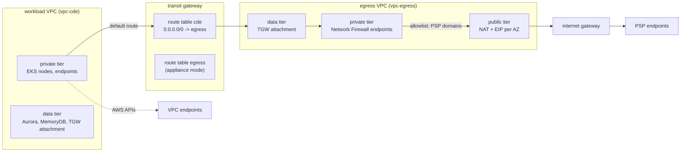

# Network

Each environment has one workload VPC and one egress VPC per region it runs in: eu-central-1 everywhere, plus us-east-1 for the prod hot standby. Workloads have no internet gateway. The only way out is the transit gateway, then AWS Network Firewall, then a NAT gateway with a static IP that the PSPs allowlist. AWS APIs are reached through VPC endpoints.

The reasons are in [AWS accounts and network](../../foundation/aws-accounts-network.md).

## What is built and why

| Piece | Why |
|---|---|
| Workload VPC with public, private and data tiers in three AZs | One AZ loss leaves two; data stores sit in their own tier with their own route tables |
| Egress VPC per region | PSP traffic leaves from known IPs and passes the firewall; no cross-region path |
| Transit gateway with named route tables | The CDE route table sends `0.0.0.0/0` to egress only; nothing else is reachable |
| Network Firewall with a domain allowlist | Only PSP domains (TLS SNI and HTTP host) are allowed out; everything else is dropped |
| NAT gateway and Elastic IP per AZ | Static source addresses registered with every PSP |
| Gateway and interface endpoints | AWS API calls never cross the internet |
| VPC Flow Logs | Parquet files in the log archive bucket |

## Services and tools

| Service | Module | Notes |
|---|---|---|
| Amazon VPC | `vpc` | Three AZs, one route table per AZ for private and data tiers, locked default security group, no internet gateway unless `enable_internet_gateway` |
| AWS Transit Gateway | `transit-gateway` | Default association and propagation off; each attachment uses one named route table; RAM sharing with the organization |
| AWS Network Firewall | `network-firewall` | Strict rule order; default action drop established and alert |
| NAT gateway, Elastic IP | `network-firewall` | One per AZ; EIPs have `prevent_destroy` |
| VPC endpoints | `vpc` | Gateway: `s3`, `dynamodb`. Interface: `ecr.api`, `ecr.dkr`, `sts`, `kms`, `secretsmanager`, `ssm`, `ssmmessages`, `ec2messages`, `logs` |
| Route 53 | `dns-certs`, `dns-routing`, `admin-edge` | Public zone per environment, failover records, private admin zone |

## How it is wired

The transit gateway attaches the workload VPC from its data subnets (route table `cde`, propagates to `egress`) and the egress VPC from its data subnets (route table `egress`, appliance mode on). The static route `cde 0.0.0.0/0 -> egress` is set in `infra/live/_envcommon/foundation/tgw.hcl`.

The firewall policy has two stateful rule groups:

1. `pay-<env>-<rs>-psp-fence` (priority 1): a placeholder that matches nothing. At a failover, `scripts/dr/failover.py` appends a drop rule to fence the region and removes it at failback. Terraform ignores changes to it.
2. `<name>-psp-allowlist` (priority 2): `ALLOWLIST` of `psp_domains` on `TLS_SNI` and `HTTP_HOST`.

Anything that matches neither is dropped and alerted.

## CIDR plan

Source: `config/platform.yaml` (`network`). Subnets are computed in the `vpc` units with `cidrsubnet`.

| Environment | eu-central-1 | us-east-1 | Egress eu-central-1 | Egress us-east-1 |
|---|---|---|---|---|
| dev | 10.120.0.0/16 | none | 10.123.0.0/20 | none |
| stage | 10.130.0.0/16 | none | 10.133.0.0/20 | none |
| prod | 10.150.0.0/16 | 10.151.0.0/16 | 10.153.0.0/20 | 10.154.0.0/20 |
| shared-services | 10.140.0.0/16 | none | 10.143.0.0/20 | none |

Subnets of a workload VPC (example prod eu-central-1, `10.150.0.0/16`):

| Tier | Rule | Subnets |
|---|---|---|
| private | `cidrsubnet(cidr, 3, i)` | 10.150.0.0/19, 10.150.32.0/19, 10.150.64.0/19 |
| data | `cidrsubnet(cidr, 8, 96 + i)` | 10.150.96.0/24, 10.150.97.0/24, 10.150.98.0/24 |
| public | `cidrsubnet(cidr, 8, 99 + i)` | 10.150.99.0/24, 10.150.100.0/24, 10.150.101.0/24 |

Subnets of an egress VPC (example prod, `10.153.0.0/20`), from `infra/live/_envcommon/foundation/egress-vpc.hcl`:

| Tier | Holds | Rule | Subnets |
|---|---|---|---|
| public | NAT gateways | `cidrsubnet(cidr, 6, i)` | 10.153.0.0/26, 10.153.0.64/26, 10.153.0.128/26 |
| private | firewall endpoints | `cidrsubnet(cidr, 8, 16 + i)` | 10.153.1.0/28, 10.153.1.16/28, 10.153.1.32/28 |
| data | transit gateway attachments | `cidrsubnet(cidr, 8, 32 + i)` | 10.153.2.0/28, 10.153.2.16/28, 10.153.2.32/28 |

The egress VPC has an internet gateway and no endpoints.

## Network per environment and region

| | dev | stage | prod | shared-services |
|---|---|---|---|---|
| eu-central-1 | `vpc`, `egress-vpc`, `tgw`, `firewall` | same | same | same |
| us-east-1 | none (edge only) | none (edge only) | `vpc`, `egress-vpc`, `tgw`, `firewall` (hot standby) | none |
| Firewall endpoints | one (first AZ); every AZ routes to it | three | three per region | three |
| NAT gateways and EIPs | three | three | three per region | three |

The transit gateway of each environment also reaches the shared-services VPC, where the central cluster serves Vault (`vault.payments.internal`) to every cluster (`config/platform.yaml`, `vault`).

## DNS

| Zone | Type | Source | Purpose |
|---|---|---|---|
| `dev.pay.example.com`, `stage.pay.example.com`, `pay.example.com` | public | `dns-certs` (unit `edge-dns`) | API, panel and SDK names; ACM certificates (EC P-256) validated by DNS; CAA records allow ACM and Let's Encrypt only; DNSSEC optional |
| `api.<zone>` | failover CNAME | `dns-routing` (unit `edge-dns-routing`, prod) | Primary record to the eu-central-1 ingress, secondary to us-east-1; HTTPS health check on `/health/deep` |
| `payments.internal` | private | `admin-edge` | Admin tools; attached only to the listed VPCs |
| `<cell>.<cluster_domain>`, `locker.<cluster_domain>` | private | `cell-endpoint`, `locker-endpoint` | Cross-cluster hosts `router.payments.svc.<cell>.<cluster_domain>` (edge to cell) and `locker.payments.svc.locker.<cluster_domain>` (cells to locker), each an alias of an internal NLB |

Zone names: `config/platform.yaml` (`dns`). Edge routing is described on the [Edge](../platform/edge.md) page.

## Security controls

- No internet gateway in workload VPCs; the private tier reaches the internet only through the transit gateway route.
- Egress allowlist by domain at the firewall; a fence rule group lets the failover cut a region off from the PSPs.
- The default security group of every VPC is locked (no rules).
- AWS APIs through endpoints; interface endpoints live in the private tier.
- Flow logs of every VPC go to the log-archive bucket (Object Lock).
- Data stores accept connections only from named node security groups (`data-access`); see [Data](../platform/data.md).
- SCP `region-allow-list` keeps every regional resource in eu-central-1 and us-east-1.

## Modules and live units

| Module | Units |
|---|---|
| `vpc` | `infra/live/<env>/<region>/vpc`, `infra/live/<env>/<region>/egress-vpc`, `infra/live/shared-services/eu-central-1/vpc` |
| `transit-gateway` | `infra/live/<env>/<region>/tgw` |
| `network-firewall` | `infra/live/<env>/<region>/firewall` |
| `dns-certs` | `infra/live/<env>/eu-central-1/edge-dns` |
| `dns-routing` | `infra/live/prod/eu-central-1/edge-dns-routing` |
| `cell-endpoint` | `infra/live/<env>/<region>/<cell>/endpoint` |
| `locker-endpoint` | `infra/live/<env>/<region>/locker/endpoint` |
| `admin-edge` | `infra/live/shared-services/eu-central-1/admin-edge` |

Shared settings: `infra/live/_envcommon/foundation/{vpc,egress-vpc,tgw,firewall}.hcl`.

## How to change it

- **Add a PSP domain**: add it to `dns.psp_domains` in `config/platform.yaml`. The firewall of every environment picks it up on the next apply.
- **Add an endpoint**: set `interface_endpoint_services` in the `vpc` unit, or change the module default to reach every VPC.
- **New region**: add its CIDRs to `config/platform.yaml`, allow it in `region-allow-list.json`, add `vpc`, `egress-vpc`, `tgw` and `firewall` units.
- **First apply**: apply `tgw` before routing `vpc` through it; then record the transit gateway id (`transit_gateway_id` in `env.hcl` for dev, `deploy.<env>.transit_gateway_ids` in `config/platform.yaml` for stage and prod).
- Never destroy `firewall` casually: the EIPs carry `prevent_destroy`, and a new IP must be registered with every PSP.
