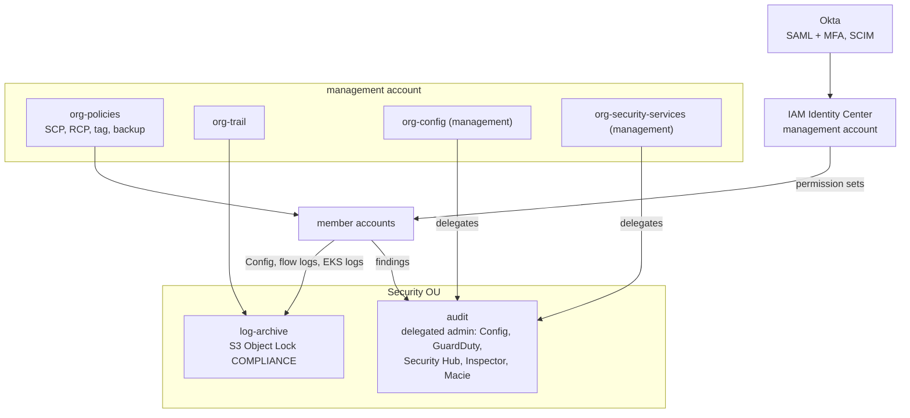

# Organization and accounts

All accounts of the platform belong to one AWS Organization. The organization holds the guardrails that no account can switch off: service control policies, a resource control policy, tag and backup policies, an organization trail and the security services. People reach AWS only through IAM Identity Center with Okta.

The reasons for the account split are in [AWS accounts and network](../../foundation/aws-accounts-network.md). The controls are mapped to PCI DSS in [Security controls](../../../security/README.md).

## What is built and why

| Piece | Purpose |
|---|---|
| Organization and OUs | Group accounts by risk, so a policy attached to an OU covers every account in it |
| Account Factory for Terraform (AFT) | A new account is one YAML entry and a pull request |
| IAM Identity Center | One sign-in for people, short sessions, no IAM users |
| SCPs and RCP | Guardrails that even an account administrator cannot bypass |
| Organization CloudTrail | Every API call of every account into one immutable bucket |
| AWS Config | Recorded configuration and the PCI DSS conformance pack in every account |
| GuardDuty, Security Hub, Inspector, Macie | Threat detection, posture, vulnerability scans, sensitive data discovery |

## OUs and accounts

| OU | Accounts (`infra/aft-account-requests/accounts/`) | `pci-scope` |
|---|---|---|
| Security | `log-archive`, `audit` (created by Control Tower) | connected |
| Infrastructure | `network`, `shared-services`, `backup` | connected |
| Workloads/CDE | `cde-dev`, `cde-stage`, `cde-prod` | cde |
| Workloads/NonCDE | `platform-dev`, `platform-stage`, `platform-prod` | connected |
| Sandbox | `sandbox-preview` | out-of-scope |

`management` is the organization root and runs no workloads.

Today each environment runs in one account: `config/platform.yaml` (`accounts`) lists `shared_services`, `dev`, `stage` and `prod`, and the Terragrunt environments `management` and `security` take their account ids from the same file. Inside one environment account the CDE and non-CDE parts are separated by VPC, security group, KMS key and IAM boundary. The AFT requests above describe the split into CDE and non-CDE accounts; `pci-scope = cde` is accepted only in `workloads-cde.yaml`.

## Services and tools

| Service | Where it runs | Module | Live unit |
|---|---|---|---|
| AWS Organizations policies | management | `org-policies` | `infra/live/management/eu-central-1/org-policies` |
| IAM Identity Center | management | `identity-center` | `infra/live/management/eu-central-1/identity-center` |
| CloudTrail (organization trail) | management | `org-trail` | `infra/live/management/eu-central-1/org-trail` |
| Log archive bucket | log-archive | `log-archive` | `infra/live/security/eu-central-1/log-archive` |
| AWS Config | management (`mode = management`), audit (`mode = admin`) | `org-config` | `infra/live/management/eu-central-1/org-config`, `infra/live/security/eu-central-1/org-config` |
| GuardDuty, Security Hub, Inspector, Macie | management and audit | `org-security-services` | `infra/live/management/eu-central-1/org-security-services`, `infra/live/security/eu-central-1/org-security-services` |
| AFT account requests | AFT management account | `infra/aft-account-requests` | one YAML per OU |
| Okta | IdP for Identity Center and the admin tools | `okta-sso` | `infra/live/shared-services/eu-central-1/okta-sso` |

Shared ids (organization, root, OU ids, trail name, log bucket name) come from `infra/live/_envcommon/security/org/baseline.hcl`, which reads `config/platform.yaml`.

## How it is wired

## Identity Center

Okta is the identity provider: SAML sign-in with MFA, users and groups pushed by SCIM. The module resolves names and never creates people.

| Permission set | Where | Notes |
|---|---|---|
| `Admin` | management only | session `PT1H` |
| `PlatformAdmin` | member accounts | cannot tamper with audit services |
| `SRE-View` | every account | EKS access entries map `AWSReservedSSO_SRE-View` to the view policy |
| `ReadOnly` | member accounts | no data-plane reads |
| `Billing` | as assigned | |
| `SRE-CDE` | CDE accounts, just in time only | PowerUser with an audit deny, `PT1H`, never standing |

Just-in-time CDE access: a pull request adds a grant to `config/access/cde-jit-grants.yaml` (no file means no grants) with an expiry at most one hour after the plan. A second SRE approves; the merge apply assigns `SRE-CDE`. The revocation run applies the stack with `CDE_JIT_REVOCATION_RUN=true`, which destroys expired assignments instead of failing the plan; the module README sets its interval at 15 minutes (`infra/modules/identity-center/README.md`). Validations reject `Admin` outside management and any standing `SRE-CDE`.

## Organization policies

`org-policies` reads every document in `policy/scp/` as it is and attaches it by name. A document without a target fails the plan.

| Document | Type | Attached to | What it does |
|---|---|---|---|
| `security-baseline.json` | SCP | Infrastructure, Workloads/CDE, Workloads/NonCDE, Sandbox | Denies stopping CloudTrail, Config and GuardDuty; denies leaving the organization; requires IMDSv2 with hop limit 1; denies IAM users and access keys; denies public S3 ACLs and public access block changes |
| `region-allow-list.json` | SCP | root | Denies regional actions outside eu-central-1 and us-east-1; global services (IAM, CloudFront, Global Accelerator, billing and others) are exempt |
| `deny-tag-edit.json` | SCP | Infrastructure, Workloads/CDE, Workloads/NonCDE | Denies editing protected tags except by automation |
| `deny-dynamodb-writes-recovery-regions.json` | SCP | Workloads/CDE, Workloads/NonCDE | Denies DynamoDB writes in us-east-1 except replication |
| `tag-policies/required-tags.json` | tag policy | Infrastructure, Workloads/CDE, Workloads/NonCDE | Required tag keys and values |
| `backup-policies/backup-tiers.json` | backup policy | Infrastructure, Workloads/CDE, Workloads/NonCDE | Organization backup plans by `backup-tier` |
| RCP (built in the module) | resource control policy | Workloads/CDE | Denies S3, KMS and Secrets Manager access to principals outside the organization; AWS service principals are exempt |

`security-baseline` stays off the Security OU, because it denies `guardduty:UpdateDetector` and conformance pack deletes that the audit stacks need. Default targets are in `infra/live/management/eu-central-1/org-policies/terragrunt.hcl`; `config/platform.yaml` may override them (`organization.policy_targets`, `organization.rcp_targets`).

Prerequisite: SCP, tag policy, backup policy and resource control policy types are enabled on the root.

## Security baseline

| Control | Settings | Module |
|---|---|---|
| CloudTrail | Organization trail, every account and region, global service events, log file validation, SSE-KMS with the log-archive key; all management events plus S3 object-level events of buckets whose names start with `cde_s3_bucket_prefixes`; a copy in CloudWatch Logs for metric filters | `org-trail` |
| Log archive | Object Lock COMPLIANCE 365 days, versioning, own rotated KMS key, deletes denied to everyone; writes only from CloudTrail, Config, VPC Flow Logs and organization roles named `*-log-export`; Glacier after 90 days, expiry after 400 days | `log-archive` |
| AWS Config | Organization aggregator; recorder and delivery channel in every account and region by a service-managed StackSet; conformance pack `policy/config/pci-dss-pack/pci-dss-v4.yaml` in every region | `org-config` |
| GuardDuty | Every member auto-enabled with S3, EKS audit logs, EBS malware protection, RDS login events, Lambda network logs and Runtime Monitoring with the EKS add-on | `org-security-services` |
| Security Hub | Central configuration, finding aggregator in eu-central-1; standards PCI DSS v4.0.1, AWS FSBP, CIS v3.0.0 on the root | `org-security-services` |
| Inspector | EC2, ECR, Lambda and Lambda code auto-enabled | `org-security-services` |
| Macie | Auto-enable for new accounts, daily job over the S3 buckets of the CDE accounts | `org-security-services` |

The management account delegates Config, GuardDuty, Security Hub, Inspector and Macie to the audit account in every region of `regions.working` and `regions.recovery`. The log-archive stack applies before the trail stack, because the bucket policy names the trail ARN.

## Sizes per environment

The organization layer has no per-environment size. It covers every account in the three allowed regions (`config/platform.yaml`, `regions`).

## Security controls in one list

- People: Okta MFA, Identity Center sessions of at most one hour for admin sets, no standing CDE access.
- Machines: no IAM users or access keys (SCP); CI uses OIDC roles.
- Audit: CloudTrail and Config cannot be stopped (SCP); logs are immutable for a year (Object Lock COMPLIANCE).
- Data perimeter: the RCP keeps principals outside the organization away from CDE data in S3, KMS and Secrets Manager.
- Instances: IMDSv2 with hop limit 1 is enforced at the organization level.

## How to change it

- **New account**: add an entry to `infra/aft-account-requests/accounts/<ou>.yaml`; the apply of a `cde-prod` request needs two approvals.
- **New SCP**: add a JSON file to `policy/scp/`, add its tests to `policy/scp/tests/test_scp.py`, and add its targets to `default_targets` in the `org-policies` unit. The plan fails until the document has a target.
- **Permission set or standing assignment**: change the `identity-center` inputs; the owner applies this stack.
- **JIT CDE access**: a pull request to `config/access/cde-jit-grants.yaml`.
- **Allowed regions**: change `region-allow-list.json` and `regions` in `config/platform.yaml` together.
