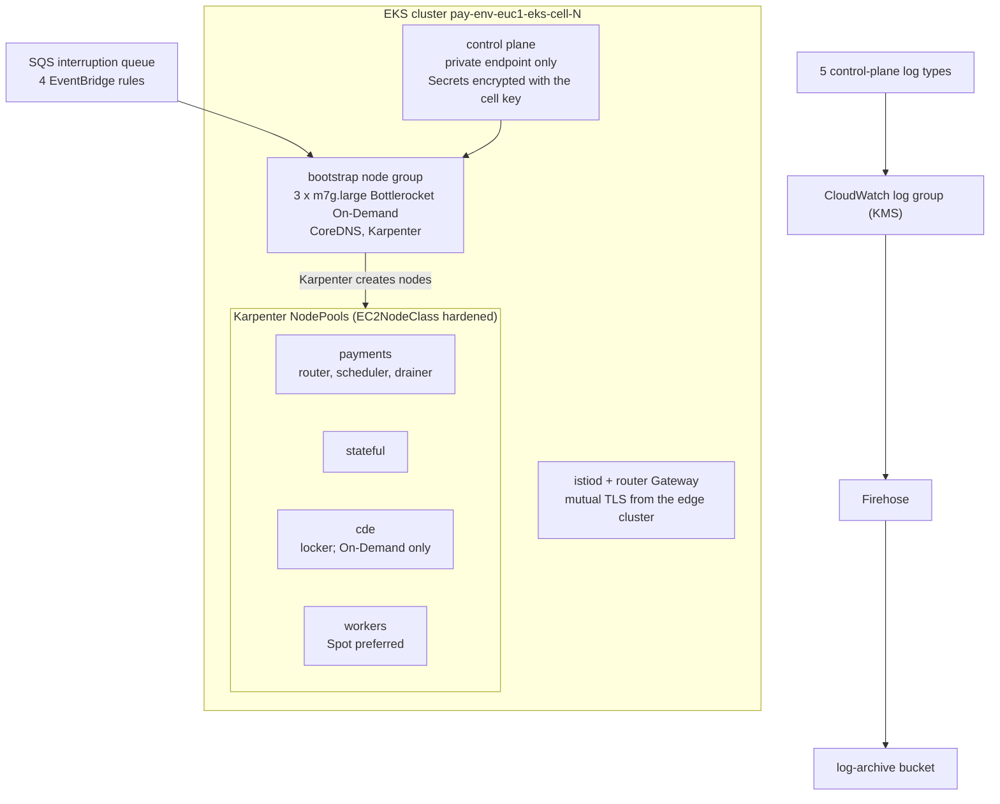

# Compute

All workloads run on Amazon EKS. Each cell has its own cluster; the locker, the edge, the control center and the analytics stores have one cluster each per environment; one central cluster in shared-services runs Argo CD, Vault and the observability stack. Nodes run Bottlerocket with no SSH and the admin container off. Karpenter creates every node except a small bootstrap group. Argo CD installs the add-ons, Istio and the Gateway API resources.

Delivery to the clusters is described in [Kubernetes and Argo CD delivery](../../foundation/kubernetes-delivery.md).

## What is built and why

| Cluster | Where | Why |
|---|---|---|
| One per cell (`eks-cell-0` ... `eks-cell-3`, `eks-spare`) | environment account, eu-central-1 | A cell failure or a bad rollout stays inside one cell |
| `locker` | environment account, eu-central-1 | The card vault on its own `cde` nodes, shared by every cell |
| `edge` | environment account, eu-central-1 | The public API Gateway in front of the cells |
| `control-center` | environment account, eu-central-1 | The merchant dashboard, outside the CDE |
| `analytics` | environment account, eu-central-1 | ClickHouse and analytics workers stay outside the CDE |
| `central` | shared-services, eu-central-1 | Argo CD, Vault, metrics, traces, Grafana, Alertmanager, Sentry, Logstash for every environment |
| Every cluster except `analytics` in us-east-1 | prod | Hot standby at full size, see [Regions and disaster recovery](../support/dr.md) |

## Services, tools and versions

| Item | Version | Source |
|---|---|---|
| EKS (Kubernetes) | 1.36, standard support (the newest version cert-manager, KEDA and the other pinned add-ons support) | `kubernetes_version` in `infra/live/<env>/env.hcl`; `support_type = "STANDARD"` in `infra/modules/eks/main.tf` |
| Bottlerocket | v1.70.0 | `bottlerocket_version` in `env.hcl` |
| Karpenter chart | 1.15.3 | `deploy/argocd/templates/addons/scaling/karpenter.yaml` |
| KEDA chart | 2.21.1 | `deploy/argocd/templates/addons/scaling/keda.yaml` |
| Istio charts (`base`, `istiod`, `gateway`) | 1.31.4 | `deploy/argocd/templates/addons/istio.yaml` |
| Gateway API CRDs | v1.3.0, standard channel | `deploy/platform/gateway-api-crds/standard-install.yaml` |
| cert-manager | v1.21.3 | `deploy/argocd/templates/addons/cert-manager.yaml` |
| Kyverno chart | 3.10.0 | `deploy/argocd/templates/addons/kyverno.yaml` |
| External Secrets chart | 2.15.0 | `deploy/argocd/templates/addons/external-secrets.yaml` |
| Argo CD chart | 10.18.2 | `deploy/argocd/templates/addons/argocd.yaml` |
| AWS Load Balancer Controller chart | 3.6.3 | `deploy/argocd/templates/addons/gateway/aws-load-balancer-controller.yaml` |
| EKS managed add-ons | default version of 1.36 unless pinned in `addon_versions` | `vpc-cni`, `kube-proxy`, `eks-pod-identity-agent`, `coredns`, `aws-ebs-csi-driver` |

## How it is wired

### EKS cluster (`infra/modules/eks`)

- Name `pay-<env>-<region-short>-<component>`, for example `pay-prod-euc1-eks-cell-0`.
- API endpoint private only (`endpoint_public_access = false`).
- Kubernetes Secrets envelope-encrypted with the cell's KMS key (`secrets_kms_key_arn = key_arns["<cell>"]`).
- Authentication mode API with access entries; the creator gets no admin. People get `AmazonEKSViewPolicy` through `AWSReservedSSO_SRE-View`; the Argo CD controller role gets `AmazonEKSAdminPolicy` limited to named namespaces (`access_entries` in `env.hcl`).
- Control-plane logs `api`, `audit`, `authenticator`, `controllerManager`, `scheduler` go to an encrypted log group. In eu-central-1 a Firehose stream copies them into the log archive (Object Lock), so CloudWatch keeps them for `eks.log_retention_days`. Without that export the retention is at least 365 days.
- `vpc-cni` runs with prefix delegation and pod ENIs (`ENABLE_PREFIX_DELEGATION`, `ENABLE_POD_ENI`); locker pods use a security group of their own with egress to 443 (endpoints), 5432 (locker database), DNS and istiod 15012 only.
- Bootstrap group: `BOTTLEROCKET_ARM_64`, `m7g.large`, 3 nodes (one per AZ), IMDSv2 with hop limit 1, encrypted gp3. It hosts CoreDNS and Karpenter, which cannot start on nodes they create.

### Karpenter (`infra/modules/karpenter`)

Terraform creates the AWS side: the controller role (Pod Identity), the node role with an `EC2_LINUX` access entry, and an SQS interruption queue fed by four EventBridge rules (Spot interruption warning, rebalance recommendation, instance state change, AWS Health event). The module outputs the Karpenter manifests; Argo CD applies them, so a plan works offline and compute can be created at a switch.

EC2NodeClass `hardened`:

- Bottlerocket pinned by alias `bottlerocket@v1.70.0`.
- Kernel lockdown `integrity`; admin host container off, control container on (SSM is the only shell path).
- IMDSv2 required, hop limit 1, no public IP, `maxPods` 110.
- Two encrypted gp3 volumes with the `ebs-nodes` key: 4 GiB OS, 80 GiB data.

NodePools:

| Pool | Taint `workload=` | Instance families | Capacity type | Expire after | Consolidation |
|---|---|---|---|---|---|
| `payments` | `payments` | m7g, m6g, m7i, m6i | On-Demand; Spot added only where listed in `spot_pools` | 336h | `WhenEmpty` |
| `stateful` | `stateful` | r7g, r6g, r7i, r6i | On-Demand; Spot added only where listed in `spot_pools` | 336h | `WhenEmpty` |
| `cde` | `cde` | m7g, m6g, m7i, m6i | On-Demand only, in every environment | 336h | `WhenEmpty` |
| `workers` | `workers` | m6g, m7g, m8g, c7g, c8g, r7g, m7i, c7i | Spot and On-Demand in every environment | 168h | `WhenEmptyOrUnderutilized` |

Every pool accepts arm64 and amd64 and excludes `metal`, `nano`, `micro` and `small` sizes. Several families and both architectures keep capacity available when one family runs short.

Disruption budgets: at most 10% of nodes at a time. Between 06:00 and 02:00 UTC (a 20-hour window from `0 6 * * *`) no node is replaced for drift, under-use or emptiness; only expiry may replace one. Consolidation waits 5 minutes.

Spot rules:

- The `cde` pool is never Spot (`manifests/environment.yaml`, rules).
- prod lists no Spot pools (`spot_pools: []` in `config/environments/prod.yaml`): an interrupted pod in the middle of a PSP call leaves the payment in the unknown state.
- dev and stage list `payments`, `stateful` and `workers`.
- Managed data stores never use Spot; Spot applies only to EKS nodes and CI runners.

### Add-ons, Istio and Gateway API

Argo CD installs the add-ons on every cluster labelled `payments-platform/addons: enabled`: Istio, cert-manager, External Secrets, Karpenter, KEDA, kube-prometheus, Kyverno, the OpenTelemetry Collector and the rate-limit service. Every cluster (`payments-platform/gateway: enabled`) also gets the Gateway API CRDs; the AWS Load Balancer Controller goes to clusters that also carry `payments-platform/vpc-id`. The central cluster (`payments-platform/central: enabled`) gets the AWS Private CA issuer and the admin gateway.

Istio: `base` and `istiod` into `istio-system`, then the `gateway` chart into `istio-ingress`. The public API entry is the Gateway API resource `payments-edge` on the edge cluster (`deploy/charts/payments-edge`, class `istio`); Istio builds its proxy Deployment and Service in namespace `payments-edge`. The rate-limit `EnvoyFilter` targets that Gateway. All entry points use Gateway API; Kyverno `disallow-ingress` reports any `Ingress` object.

Kyverno policies (`policy/kyverno/`): `cde-no-exec`, `disallow-ingress`, `disallow-latest-tag`, `require-image-digest`, `require-migration-snapshot`, `require-pdb`, `require-probes`, `require-signed-images`, `restrict-registries`. Each policy starts in `Audit` and moves to `Deny` after seven days without unexplained violations.

## Security controls

- Private API endpoint; access entries instead of `aws-auth`; no cluster-admin for people or Argo CD.
- Secrets encrypted with a per-cell customer managed key; node volumes with the `ebs-nodes` key.
- Bottlerocket: read-only root, kernel lockdown, no SSH, IMDSv2 hop limit 1 (also enforced by SCP).
- The `cde` pool is tainted and On-Demand only; CDE pods are scheduled only there.
- Workload IAM by EKS Pod Identity (`infra/modules/iam-workloads`): trust limited to the account and the cluster ARN, the workload permissions boundary, the `deny_recovery_writes` DynamoDB policy, and no `*` except the CloudWatch read role of `yace`.
- GuardDuty Runtime Monitoring with the EKS add-on in every account (`org-security-services`).

## Sizes per environment

Karpenter CPU limits per cell cluster (vCPU), from `config/environments/` through `env.hcl`:

| Pool | dev | stage (scheduled) | stage (`prod-size` window) | prod | prod us-east-1 (hot standby) |
|---|---|---|---|---|---|
| `payments` | 32 | 32 | 400 | 400 | 400 |
| `stateful` | 16 | 16 | 100 | 100 | 100 |
| `cde` | 16 | 16 | 200 | 200 | 200 |
| `workers` | 32 | 32 | 400 | 400 | 400 |
| Spot pools | payments, stateful, workers | payments, stateful, workers | payments, stateful, workers | none | none |

The us-east-1 caps come from `standby.node_pool_cpu_limits` in `config/environments/prod.yaml`, the same values as the working region, so the standby takes the whole load at once.

Other clusters:

| Cluster | Pools | CPU limits | Spot | Log retention |
|---|---|---|---|---|
| analytics, dev | stateful, workers | stateful 16, workers 8 | stateful, workers | 30 days |
| analytics, stage | stateful, workers | 16 and 8; 48 and 32 in a `prod-size` window | stateful, workers | 365 days |
| analytics, prod | stateful, workers | stateful 48, workers 32 | workers | 365 days |
| central (shared-services) | workers, stateful | 200 each | workers | 90 days |

| locker | cde, workers | cde as cells, workers up to 32 | none | as cells |
| edge | payments, workers | payments as cells, workers up to 32 | none | as cells |
| control-center | workers | up to 32 | workers | as cells |

The locker, edge and control-center profiles are in `infra/live/_envcommon/shared-clusters/profile.hcl`; `<cluster>_eks.cpu_limits` in `config/environments/<env>.yaml` overrides a cluster.

Clusters per environment: dev has `cell-0`, `spare`, `locker`, `edge`, `control-center` and `analytics`; stage and prod have `cell-0` to `cell-3`, `spare`, `locker`, `edge`, `control-center` and `analytics`; prod repeats every cluster except `analytics` in us-east-1.

### Cross-cluster paths

Clusters talk to each other only through internal NLBs and mutual TLS at a Gateway API listener:

| Path | Infrastructure | Gateway and certificates |
|---|---|---|
| edge to each cell | `infra/modules/cell-endpoint` (unit `<cell>/endpoint`): internal NLB, private zone `<cell>.<cluster_domain>`, record `router.payments.svc.<cell>.<cluster_domain>`; only the edge node security group reaches it | Router gateway of the cell (`deploy/charts/payments-cell`, `routerGateway`, port 8443), certificate from Vault mesh PKI role `cell-gateway`; admits only the edge SPIFFE ID. The edge proxy presents the `edge-client` certificate (`deploy/charts/payments-edge`, `edgeClient`). |
| router to locker | `infra/modules/locker-endpoint` (unit `locker/endpoint`): internal NLB, private zone `locker.<cluster_domain>`, alias `locker.payments.svc.locker.<cluster_domain>`; only the cell node groups reach it | Locker gateway (`deploy/charts/payments-locker`), certificate from Vault mesh PKI role `locker-gateway`; the router presents a `router-client` certificate |

The load balancer controller of the target cluster registers the gateway pods through a TargetGroupBinding.

## Modules and live units

| Module | Units |
|---|---|
| `eks` | `infra/live/<env>/<region>/<cluster>/eks` for every cell, `locker`, `edge`, `control-center` and `analytics`; `infra/live/shared-services/eu-central-1/central/eks` |
| `karpenter` | `.../<cluster>/karpenter`, `.../central/karpenter` |
| `argocd-registration` | `infra/live/<env>/<region>/<cluster>/argocd-registration`, next to every `eks` unit |
| `cell-endpoint`, `locker-endpoint` | `infra/live/<env>/<region>/<cell>/endpoint`, `infra/live/<env>/<region>/locker/endpoint` |
| `iam-workloads` | `infra/live/<env>/<region>/<cluster>/iam-workloads` for cells, `locker`, `edge`, `control-center` |
| `fis-prereqs`, `fis-experiments` | `infra/live/{stage,prod}/eu-central-1/fis-prereqs`, `.../fis-experiments` |

Shared settings: `infra/live/_envcommon/compute/{eks,karpenter,iam-workloads,argocd-registration,cell-endpoint}.hcl`, `_envcommon/shared-clusters/*.hcl`, `_envcommon/analytics/{eks,karpenter}.hcl`, `_envcommon/observability/{eks,karpenter}.hcl`. Add-on Applications: `deploy/argocd/templates/addons/`; values: `deploy/platform/<add-on>/`.

## How to change it

- **Kubernetes version**: set `kubernetes_version` in each `infra/live/<env>/env.hcl`, dev first. The bootstrap group and unpinned managed add-ons follow the control plane.
- **Bottlerocket version**: set `bottlerocket_version` in `env.hcl`; Karpenter replaces nodes as drift, inside the disruption budget window.
- **Pool size**: change `eks.cpu_limits` in `config/environments/<env>.yaml`.
- **Spot**: change `eks.spot_pools`; the `cde` pool ignores it.
- **Instance families**: override `instance_families` in the Karpenter unit or change the module default.
- **Add-on version**: change `targetRevision` in `deploy/argocd/templates/addons/<add-on>.yaml`.
