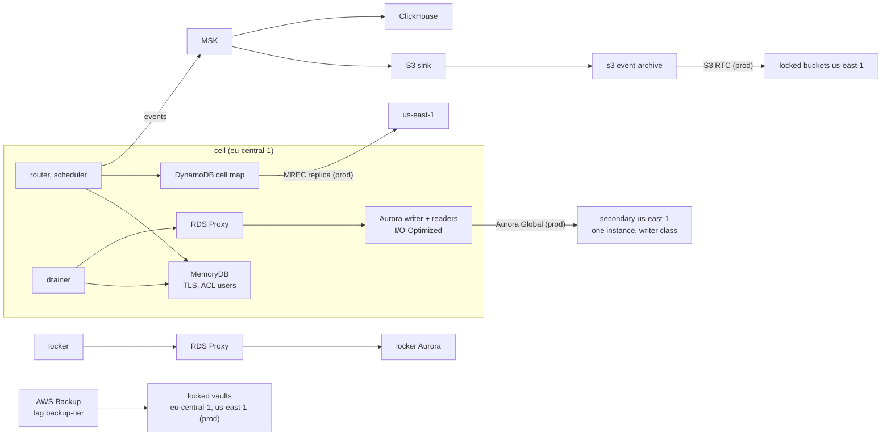

# Data

Each cell owns an Aurora PostgreSQL global cluster and a MemoryDB cluster. The locker owns its own Aurora cluster. One DynamoDB global table maps merchants to cells. S3 holds backups, the event archive and snapshots. The analytics stores (MSK, ClickHouse) sit outside the CDE. Logs live in the central OpenSearch domain of shared-services ([Logging](../../runtime/logging.md)). Every store is encrypted with a customer managed KMS key and joins an AWS Backup plan by its `backup-tier` tag.

Data flow and backup rules are explained in [Data stores and backups](../../foundation/data-backups.md).

## What is built and why

| Store | Owner | Why |
|---|---|---|
| Aurora PostgreSQL global cluster | each cell, the locker | System of record; storage-level replication to the prod hot standby in us-east-1 |
| RDS Proxy | each Aurora cluster | Connection pooling; the only client Aurora accepts |
| MemoryDB (Redis OSS API) | each cell | Hot state and the Redis stream that the drainer writes to Aurora |
| DynamoDB global table | environment | Merchant-to-cell map, readable in every region |
| S3 (`s3-backup` module) | environment | Object backups, event archive, Vault snapshots, with Object Lock and cross-region replication |
| Amazon MSK | analytics | Event stream; an S3 sink keeps the archive |
| ClickHouse on EKS | analytics | Analytics queries |
| AWS KMS | environment | One key per purpose and per cell; multi-Region primaries with replicas |
| AWS Backup | environment, prod us-east-1 | Plans by tier, locked vaults, copies, daily restore tests |

## Services and versions

| Service | Version or engine | Source |
|---|---|---|
| Aurora PostgreSQL | 16.8, family `aurora-postgresql16` | `infra/modules/aurora-global/variables.tf` |
| MemoryDB | Redis OSS 7.1, family `memorydb_redis7` | `infra/modules/memorydb/variables.tf` |
| MSK | Kafka 3.9.x | `infra/modules/msk/variables.tf` |
| ClickHouse | self-managed on the analytics EKS cluster; the AWS side (role, backup settings, alarms) is `infra/modules/clickhouse` | `infra/live/<env>/eu-central-1/analytics/clickhouse` |

## How it is wired

### Aurora (`aurora-global`)

- `region_role = working`: global cluster, writer in `writer_az`, readers, RDS Proxy, PITR 35 days (`backup_retention_days = 35`).
- `region_role = recovery` (prod us-east-1): a cluster that joins the global cluster with `standby.reader_count` (1) instance of the writer class of its working cluster, so the promotion has a running writer.
- Writers rotate over AZs: cell-0 in `a`, spare in `b`, locker in `c`, so one AZ loss never takes every writer.
- Parameters: `rds.force_ssl`, TLS 1.3, `pg_stat_statements`, pgaudit. `rds.global_db_rpo` is never set.
- Alarm when replication lag to a secondary exceeds 5 seconds.
- RDS Proxy logins: `hs_app` for cells (router, drainer and scheduler share it) and `locker_app` for the locker; see [Secrets](secrets.md).

### MemoryDB (`memorydb`)

- `num_replicas_per_shard = 2`: one primary and two replicas per shard over three AZs.
- TLS, ACL with IAM-authenticated users and password users. Router, drainer and scheduler use password users named `<cell>-<service>`.
- `maxmemory-policy noeviction` protects the payment streams.
- Native snapshots daily, 35 days; hourly snapshots and copies come from AWS Backup (tier `silver`).
- No multi-Region cluster: the prod us-east-1 cells run their own MemoryDB at full size; after a switch it is warmed from Aurora before the cell takes traffic (D8).

### DynamoDB (`dynamodb-global`)

- One global table, on-demand capacity, streams on, PITR 35 days on the table and every replica.
- MREC replica in us-east-1 with that region's replica key (prod only).
- `deny_recovery_writes` is an IAM policy attached to every workload role; with the SCP `deny-dynamodb-writes-recovery-regions` it keeps writes in eu-central-1. The switch shrinks the list.

### S3 (`s3-backup`)

| Bucket (unit) | Content |
|---|---|
| `s3-backup` (component `backup`) | Object backups, ClickHouse backups |
| `s3-event-archive` (component `event-archive`) | Events from the MSK S3 sink |
| `vault-snapshots` (shared-services) | Raft snapshots of the central Vault |

Each bucket: versioning, SSE-KMS, Object Lock on every copy. In prod and shared-services it replicates to locked buckets in us-east-1 with Replication Time Control (15 minutes) and a latency alarm. Lifecycle: Glacier Instant Retrieval at 7 days, Glacier at 14, expiry at 35; `archive/monthly/` goes to Deep Archive for 7 years.

### Analytics stores

- **MSK**: brokers over three AZs, replication factor 3, `min.insync.replicas = 2`, IAM authentication only (SASL/OAUTHBEARER, port 9098), TLS in transit and inside the cluster, topic auto-creation off. Router and scheduler roles get the producer policy. Broker logs to `/aws/msk/<name>` with the logs key.
- **ClickHouse**: self-managed on the analytics cluster, sized for the `stateful` pool. The module has no EC2 or EKS resources; it creates the Pod Identity role, backup settings and alarms. `clickhouse-backup` runs hourly with zstd level 1 into the `s3-backup` bucket; restore loads the latest backup and replays the event archive. RPO 15 minutes and RTO 4 hours are validated inputs.
- `msk-access` creates the security group that admits the cell and analytics nodes.

### KMS (`kms`, `kms-set`)

Keys per environment and region (`kms_keys` in `infra/live/<env>/env.hcl`):

| Key | Used by |
|---|---|
| `ebs-nodes` | Node volumes (the Auto Scaling service-linked role is a user) |
| `logs` | CloudWatch log groups, WAF and CloudFront logs |
| `shared` | DynamoDB, S3 buckets, Secrets Manager, Vault snapshots |
| `locker` | Locker Aurora; the locker workload role may use it |
| `backup` | AWS Backup vaults |
| one per cell (`cell-0`, ..., `spare`) | That cell's Aurora, MemoryDB and EKS Secrets |

Primaries in eu-central-1 are multi-Region keys with yearly rotation. `infra/live/prod/us-east-1/kms` creates replicas with the same purposes; in dev and stage `infra/live/<env>/us-east-1/kms` replicates only the `logs` key, which the edge there uses. Other keys: the Vault unseal key (`vault-platform`, single-region), the state key (`infra/bootstrap`), the log-archive key, the `dr-failover` SNS key.

### AWS Backup (`backup`)

| Tier | Rules | Members (tag `backup-tier`) |
|---|---|---|
| `gold` | hourly, 35 days, copies to us-east-1 (prod); continuous 35 days; monthly, 7 years | Aurora clusters, DynamoDB table, S3 buckets |
| `silver` | hourly, 35 days, with copies | MemoryDB, Secrets Manager replicas |
| `bronze` | daily, 7 days | |

- Vaults in eu-central-1 and, in prod, us-east-1, encrypted with the backup key; the vault policy admits only `CopyIntoBackupVault` from the source accounts.
- Vault Lock in compliance mode (minimum 7, maximum 2555 days, 3-day cooling-off). The module refuses an unlocked vault in prod (`vault_lock_enabled` validation); the switch is `protection.vault_lock_enabled` in `config/environments/`.
- Daily restore test of the `gold` Aurora clusters and DynamoDB table. `restore-automation` (unit `restore-test` in prod us-east-1) runs an SSM Automation document after each restore job and publishes `RestoreDurationSeconds`, `RestoreTargetSeconds` (1800) and `RestoreSuccess`.

## Security controls

- Encryption at rest everywhere with customer managed keys; a separate key per cell and for the locker limits the blast radius.
- TLS in transit enforced: `rds.force_ssl`, MemoryDB TLS, MSK TLS only.
- Network: `data-access` creates one security group per store with ingress only from the named node security groups; Aurora admits only its RDS Proxy. In prod us-east-1 the groups admit the node security group of the standby cluster in the same region.
- No passwords in state for MemoryDB and RDS Proxy logins; values are set out of band (see [Secrets](secrets.md)).
- Backups are immutable: Object Lock on buckets, Vault Lock on vaults, copies in us-east-1 for prod.
- Macie runs a daily job over the S3 buckets of the CDE accounts (see [Organization](../base/organization.md)).

## Sizes per environment

Source: `config/environments/*.yaml` and `infra/live/<env>/env.hcl`. stage uses dev sizes for Aurora, MemoryDB and node pools unless `size_window = "prod-size"` in `stage/env.hcl`.

| Store | dev | stage (scheduled) | prod |
|---|---|---|---|
| Aurora cell writer | db.r7g.large | db.r7g.large | db.r7g.12xlarge, I/O-Optimized |
| Aurora cell readers | 0 | 0 | 1 x db.r7g.4xlarge |
| Aurora spare | env classes, Standard storage | env classes, Standard storage | db.r7g.2xlarge writer and reader, Standard storage |
| Aurora locker | env classes, Standard storage | env classes, Standard storage | db.r7g.4xlarge writer, readers as cells, Standard storage |
| Aurora in us-east-1 | none | none | 1 instance per cluster, writer class of the working cluster |
| Aurora schedule | stopped 20:00 to 08:00 and weekends (Europe/Berlin) | always on | always on |
| MemoryDB cell | db.t4g.small, 1 shard, 2 replicas | db.t4g.small, 1 shard | db.r7g.xlarge, 2 shards, 2 replicas each |
| MemoryDB spare | as cells | as cells | 1 shard |
| MSK | 3 x kafka.m7g.large, 100 GB, monitoring `DEFAULT` | 3 x kafka.m7g.large, 500 GB | 3 x kafka.m7g.large, 1000 GB, `PER_TOPIC_PER_PARTITION` |
| ClickHouse | 1 shard, 1 replica | as dev; `prod-size`: as prod | 2 shards x 2 replicas on r7g.2xlarge, 3 Keeper nodes |
| DynamoDB replicas | none | none | us-east-1 |
| Deletion protection | off | as prod | on |

The prod MSK sizes are the defaults in `infra/live/prod/env.hcl` (about 4 TB of events a month, 7 days at replication factor 3). A `msk` section in `config/environments/<env>.yaml` overrides them.

## Modules and live units

| Module | Units |
|---|---|
| `aurora-global` | `infra/live/<env>/<region>/<cell or locker>/aurora` |
| `data-access` | `infra/live/<env>/<region>/<cell or locker>/data-access`, `.../analytics/msk-access` |
| `aurora-schedule` | `infra/live/dev/eu-central-1/aurora-schedule` |
| `memorydb` | `infra/live/<env>/<region>/<cell>/memorydb` |
| `dynamodb-global` | `infra/live/<env>/eu-central-1/dynamodb` |
| `s3-backup` | `infra/live/<env>/eu-central-1/{s3-backup,s3-event-archive}`, `infra/live/shared-services/eu-central-1/vault-snapshots` |
| `backup` | `infra/live/<env>/eu-central-1/backup` |
| `restore-automation` | `infra/live/prod/us-east-1/restore-test` |
| `msk`, `clickhouse` | `infra/live/<env>/eu-central-1/analytics/{msk,clickhouse}` |
| `kms-set` (calls `kms`) | `infra/live/<env>/<region>/kms`, `infra/live/shared-services/eu-central-1/kms` |
| `secrets-replica` | `infra/live/<env>/eu-central-1/secrets` |

Shared settings: `infra/live/_envcommon/data/*.hcl`, `_envcommon/analytics/*.hcl`.

## How to change it

- **Instance class or reader count**: `aurora` in `config/environments/<env>.yaml`; one cluster only: `writer_instance_class` in its unit.
- **MemoryDB shards**: `memorydb.shards`; resharding is online, plan it in a quiet window.
- **New KMS purpose**: add it to `kms_keys` in every `env.hcl`; the prod us-east-1 `kms` unit creates its replica.
- **New store**: give it a `backup-tier` tag; a stateful resource without a backup plan breaks D2 in `manifests/constraints.yaml`.
- **Retention**: `backup` module rules and `s3-backup` lifecycle; a compliance-mode vault cannot shorten retention after the cooling-off period.
