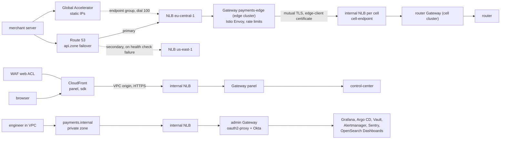

# Edge

The platform has three kinds of entry points:

| Entry | Clients | Path |
|---|---|---|
| Payments API | merchant servers | Route 53 failover record or Global Accelerator, then a Network Load Balancer, then the Istio Gateway `payments-edge` on the edge cluster, then the mutual-TLS router Gateway of the cell |
| Panel and payment SDK | browsers | CloudFront with AWS WAF, then a VPC origin to an internal NLB, then the `panel` Gateway |
| Admin tools | engineers | Private zone `payments.internal`, internal NLB, Gateway with oauth2-proxy and Okta sign-in |

The request-level design (TLS, rate limits, routes) is in [Edge with Gateway API](../../runtime/edge.md) and [Rate limiting](../../runtime/rate-limiting.md).

## What is built and why

- **Route 53 failover** (prod) sends the API name to the working region while its health check passes, and to the us-east-1 hot standby only when it fails. Clients keep one name across a region switch.
- **Global Accelerator** gives static anycast IPs for merchants that allowlist IPs. Only the eu-central-1 endpoint group takes traffic; each group finds the edge NLB of its region by the tags the load balancer controller of the edge cluster sets.
- **NLB** passes TCP to Envoy. The server-to-server API cannot carry a WAF; it is protected by Envoy rate limits and a TLS floor that an EnvoyFilter sets on every listener of the Gateway.
- **CloudFront and WAF** protect the browser entries against bots, credential stuffing and common web attacks.
- **The admin entry** is reachable only inside the VPCs and requires Okta sign-in with two factors.

## Services and tools

| Service | Module | Settings |
|---|---|---|
| Route 53 public zone, ACM | `dns-certs` | Zone per environment; CAA for ACM and Let's Encrypt; EC P-256 certificates validated by DNS; DNSSEC optional |
| Route 53 failover | `dns-routing` | CNAME `api.<zone>`; primary eu-central-1; HTTPS health check on `/health/deep` for each endpoint |
| Global Accelerator | `global-accelerator` | Accelerator `pay-<env>-glob-edge`, TCP 443; eu-central-1 group active; in prod a us-east-1 group inactive until the switch; each group finds the edge NLB of its region by tag (`pay.io/edge-entry`); a validation rejects two active groups |
| CloudFront | `panel-edge` | Entries `panel` and `sdk`; HTTP/2 and HTTP/3; `TLSv1.2_2021`; SNI; IPv6; VPC origin over HTTPS; price class `PriceClass_100` |
| AWS WAF | `waf-edge` | Scope `CLOUDFRONT`, in us-east-1; one web ACL per entry |
| AWS Private CA | `admin-edge` | Root CA for the admin entry; short-lived certificates renewed by cert-manager |
| oauth2-proxy | `deploy/platform/admin-gateway` | v7.15.6, pinned by digest; in front of Alertmanager, VictoriaMetrics UI and Prometheus |
| Okta | `okta-sso` | OIDC with PKCE for Grafana, Argo CD, Vault, the oauth2-proxy and Sentry |

## How it is wired

### WAF rules (`waf-edge`)

| Rule | panel | sdk |
|---|---|---|
| AWS managed: Core rule set, Known Bad Inputs, SQL injection, IP reputation | yes | yes |
| Bot Control | yes | no |
| Account Takeover Prevention on `login_path` (`/login`) | yes | no |
| Rate limit per IP | 2000 | 2000 |
| Rate limit per API key header | 1000 | 1000 |
| Stricter rate limit per IP on `/login`, `/auth/` | 100 | 100 |

Rate rules answer 429 with `Retry-After`. `mode` switches managed groups and rate rules together between `count` and `block`; the default is `count`, and `waf.mode.<env>` in `config/platform.yaml` sets it per environment. Logs go to `aws-waf-logs-<name>-<entry>` (KMS, 30 days) with `authorization`, `cookie` and `x-api-key` redacted.

### CloudFront behaviour (`panel-edge`)

- API paths and the default behaviour are not cached; static paths use a TTL.
- Response headers: HSTS, `nosniff`, referrer policy, a CSP per entry, `X-Frame-Options: DENY` for the panel (the SDK runs in an iframe, so `frame_deny = false`).
- The origin NLB is internal and its security group admits only the CloudFront VPC origin ENIs, so traffic cannot bypass the WAF.
- Access logs (standard logging v2) exclude query strings and cookies.
- The stack runs in us-east-1; it finds the NLB in eu-central-1 by the tag `service.k8s.aws/stack`. It applies in two steps: certificates and policies first, distributions after the Gateway has its load balancer (`nlb_lookup_enabled`).

### Admin entry (`admin-edge`, `okta-sso`)

- Private hosted zone `payments.internal` attached to the listed VPCs; nothing outside them resolves it.
- Wildcard alias `*.payments.internal` to the internal NLB that the AWS Load Balancer Controller builds from the admin Gateway.
- AWS Private CA root; cert-manager with the `aws-privateca-issuer` issues the Gateway certificate.
- Okta: six groups (admin, sre, security, engineering, finance, audit), one sign-in policy `admin-tools`: two factors on every sign-in; for administrators a phishing-resistant factor and re-authentication every 2 hours, 12 hours for others.
- OIDC client secrets are stored in Secrets Manager as `pay/shared-services/<tool>/oidc` and read by External Secrets.

## Security controls

- TLS everywhere; CloudFront minimum `TLSv1.2_2021`; ACM certificates only from ACM or Let's Encrypt (CAA).
- WAF on every browser entry; no direct path to the panel origin.
- The API edge has rate limits in Envoy and an identity set at the edge, not by the client.
- Admin tools are private, behind Okta MFA, and have no public DNS name.
- Health checks never return a dead standby: the secondary is also checked.

## Sizes per environment

| | dev | stage | prod |
|---|---|---|---|
| Public zone | `dev.pay.example.com` | `stage.pay.example.com` | `pay.example.com` |
| `edge-dns` (zone, `api` certificate) | yes | yes | yes |
| `edge-dns-routing` (failover record) | no | no | yes |
| `edge-accelerator` | yes, eu-central-1 group | yes, eu-central-1 group | yes, eu-central-1 and us-east-1 groups |
| `panel-edge`, `waf-edge` (us-east-1) | yes | yes | yes |
| Admin entry | shared-services, one for all environments | | |

Sources: `config/platform.yaml` (`dns`, `deploy.<env>.ingress_endpoints`), `infra/live/<env>/`.

## Modules and live units

| Module | Units |
|---|---|
| `dns-certs` | `infra/live/<env>/eu-central-1/edge-dns` |
| `dns-routing` | `infra/live/prod/eu-central-1/edge-dns-routing` |
| `global-accelerator` | `infra/live/<env>/eu-central-1/edge-accelerator` |
| `waf-edge` | `infra/live/<env>/us-east-1/waf-edge` |
| `panel-edge` | `infra/live/<env>/us-east-1/panel-edge` |
| `admin-edge` | `infra/live/shared-services/eu-central-1/admin-edge` |
| `okta-sso` | `infra/live/shared-services/eu-central-1/okta-sso` |

Shared settings: `infra/live/_envcommon/edge/*.hcl`, `_envcommon/observability/{admin-edge,okta-sso}.hcl`. Kubernetes side: `deploy/charts/payments-edge`, `deploy/platform/admin-gateway`, `deploy/platform/istio`.

## How to change it

- **WAF from count to block**: set `waf.mode.<env>: block` in `config/platform.yaml` after reviewing the counted requests.
- **Rate limit values**: `waf.rate_limit_ip`, `waf.rate_limit_api_key`, `waf.rate_limit_auth` in `config/platform.yaml`.
- **New browser entry**: add an entry to both `waf-edge` and `panel-edge` inputs.
- **New admin tool**: add an app to `okta-sso`, a route to `deploy/platform/admin-gateway/manifests/routes.yaml`, and its secret to `central-secrets` if it needs one.
- **Switch regions**: see [Regions and disaster recovery](../support/dr.md); Route 53 moves the API by itself, the Global Accelerator group is flipped by the switch runbook.
