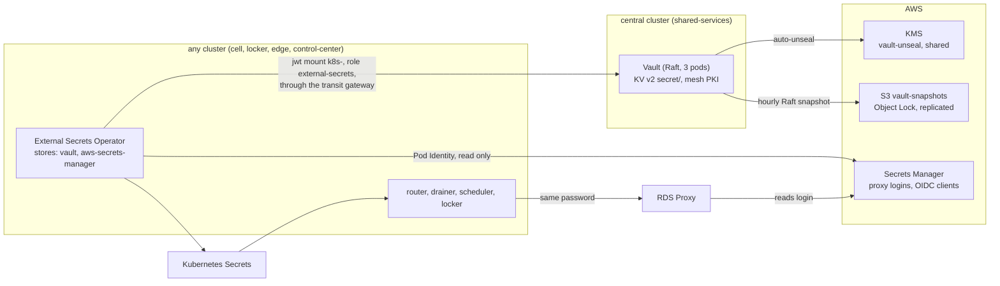

# Secrets

No secret value lives in Git or in Terraform state for the workloads. Application secrets live in HashiCorp Vault (KV v2). AWS-side secrets (RDS Proxy logins, OIDC clients of the admin tools, runner GitHub Apps) live in AWS Secrets Manager. External Secrets Operator copies both into Kubernetes Secrets, and pods read them as variables at start.

The service view is in [Services, configuration and secrets](../../runtime/services-secrets.md).

## What is built and why

| Piece | Why |
|---|---|
| One Vault on the central cluster, Raft storage, AWS KMS auto-unseal | One store for the application secrets of every environment, with per-environment policies, audit, short tokens and no human standing access |
| Secrets Manager containers with multi-Region replicas | Values the AWS services need (RDS Proxy) and that must survive a region loss |
| External Secrets Operator | Kubernetes reads secrets by name; no secret value in Helm values |
| EKS Pod Identity roles | Every reader has its own role, limited to named secrets |

## Services and versions

| Item | Version | Source |
|---|---|---|
| Vault server | 2.0.4, pinned by digest | `deploy/platform/vault/values.yaml` |
| Vault Helm chart | 0.34.1 | `deploy/argocd/templates/addons/vault.yaml` |
| External Secrets chart | 2.15.0 | `deploy/argocd/templates/addons/external-secrets.yaml` |
| AWS Secrets Manager | | `secrets-replica`, `central-secrets`, `aurora-global`, `ci-runners` |
| AWS KMS | | `vault-platform` (unseal key), `kms-set` (`shared` key) |

## How it is wired

### Vault

- One Vault serves every environment. It runs on the central cluster of shared-services (`infra/live/shared-services/eu-central-1/vault`); every cluster reaches it at `vault.host` (`vault.payments.internal`) through the transit gateway and trusts it through `vault.ca_bundle` in `config/platform.yaml`.
- `vault-platform` creates the single-region unseal key `alias/pay-shared-services-euc1-vault-unseal` (rotated) and three Pod Identity roles: `vault-server` (unseal), `vault-snapshot` (writes `raft/` in the snapshot bucket, cannot read or delete), `vault-bootstrap` (writes only `pay/shared-services/vault/*` secrets).
- Bootstrap Job (Argo CD PostSync hook): `vault operator init` with 5 recovery shares and a threshold of 3; stores only the recovery keys in Secrets Manager `pay/shared-services/vault/init`; enables the audit device, KV v2 at `secret/`, Raft autopilot, the per-environment read policies, the mesh PKI and one jwt auth mount per cluster; then revokes the root token.
- One jwt auth mount per cluster, `k8s-<cluster name>`, configured from the cluster's Argo CD registration secret. `tools/config/render_vault.py` takes the cluster list from the live tree (`tools/config/render/clusters.py`), so every `eks` unit gets its mount.
- Workload paths: `secret/<env>/<cell>/{router,drainer,scheduler}/{database,redis}` and `secret/<env>/<cell>/shared/{app,locker}`. Each cell service has a read-only policy `pay-<env>-<cell>-<service>`, and External Secrets of each cluster gets `pay-<env>-external-secrets`, so a cluster reads only its own environment.
- Mesh PKI `pki-mesh` issues the certificates of the cross-cluster paths: roles `cell-gateway` (router gateway of each cell), `edge-client` (edge proxy), `locker-gateway` (locker gateway) and `router-client` (router to locker) ([Compute](compute.md#cross-cluster-paths)).
- Break-glass: no standing human access; access through Okta with MFA, a second approver, a policy with a TTL of at most one hour. Without OIDC, two custodians generate a root token from the recovery keys for one session.

### External Secrets Operator

- Two replicas, two ClusterSecretStores: `vault` (jwt auth mount of the cluster, role `external-secrets`) and `aws-secrets-manager` (Pod Identity role, no static keys).
- In the central cluster only `aws-secrets-manager` exists, limited to the namespaces `monitoring`, `argocd` and `sentry`.
- NetworkPolicies default deny; the store may be limited to namespaces with `namespaceSelector`.

### Secrets Manager

| Secret | Module | Value set by |
|---|---|---|
| `pay-<env>-<rs>-{router,locker,drainer,scheduler,control-center}`, with a replica in us-east-1 in prod | `secrets-replica` (unit `secrets`) | Owner, out of band; replicas are read-only until promoted |
| `<cluster>/proxy/hs_app`, `<cluster>/proxy/locker_app` | `aurora-global` | Owner, out of band; RDS Proxy reads them |
| `pay/shared-services/<name>` (15 admin tool secrets) | `central-secrets` | Owner; optional `generated_secrets` for Grafana admin and Sentry keys |
| `pay/shared-services/<tool>/oidc` | `okta-sso` | Terraform, from the Okta application |
| `pay/shared-services/vault/init` | Vault bootstrap Job | The Job (recovery keys only) |
| Runner GitHub App credentials | `ci-runners` | Owner (names only in Terraform) |

`secrets-replica` creates containers only: no `aws_secretsmanager_secret_version`, so no value enters state.

## RDS Proxy logins

RDS Proxy authenticates clients only against users whose secret it holds, so Vault dynamic database credentials cannot pass it. Passwords are static and rotated by procedure.

| Login | Used by | Proxy secret | Vault path |
|---|---|---|---|
| `hs_app` | router, drainer, scheduler of a cell | `<cluster>/proxy/hs_app` | `secret/<env>/<cell>/{router,drainer,scheduler}/database` (one value) |
| `locker_app` | locker | `<cluster>/proxy/locker_app` | `secret/<env>/locker/database` |

The PostgreSQL roles are created by the database bootstrap, not by Terraform.

## Rotation

| Secret | How | Downtime |
|---|---|---|
| Aurora `hs_app` / `locker_app` | `\password` as master (sends only the SCRAM verifier), `put-secret-value` on the proxy secret, write Vault, restart the deployments | New connections with the old value fail between the steps; run per cell in a quiet window |
| MemoryDB password users | `update-user` with old and new passwords, write Vault, restart, then `update-user` with only the new one | None (two passwords per user) |
| Vault KV values | Write a new version; ExternalSecret refresh; restart the pods | Restart only |
| KMS keys | Automatic yearly rotation | None |
| Admin tool secrets (`central-secrets`) | Owner procedure; no rotation configured | Depends on the tool |

Full steps: `infra/modules/aurora-global/README.md`, `infra/modules/memorydb/README.md`. Keep values off the command line: use files on tmpfs.

## Security controls

- No secret values in Git, Helm values or Terraform state for workloads; the exceptions (Okta client secrets, generated admin passwords) sit in a KMS-encrypted state.
- Every reader role is read-only, limited to named secrets and `kms:Decrypt` through Secrets Manager (`kms:ViaService`), with an explicit deny on writes.
- Vault root token revoked after bootstrap; every login and read goes to the audit device.
- Secrets replicas in us-east-1 (prod) are encrypted with the replica key of that region.
- The RCP on the CDE OU denies Secrets Manager and KMS access to principals outside the organization.

## Sizes per environment

| Item | Where it is defined |
|---|---|
| Vault (3 pods, Raft) | shared-services eu-central-1, central cluster, one for all environments |
| Vault snapshot bucket `vault-snapshots` | shared-services eu-central-1, replicated to us-east-1 |
| Secrets Manager replicas (`secrets`) | prod: us-east-1; dev and stage: none |
| Admin tool secrets (`central-secrets`) | shared-services, one set for all environments |

## Modules and live units

| Module | Units |
|---|---|
| `vault-platform` | `infra/live/shared-services/eu-central-1/vault` |
| `s3-backup` (snapshots) | `infra/live/shared-services/eu-central-1/vault-snapshots` |
| `secrets-replica` | `infra/live/<env>/eu-central-1/secrets` |
| `central-secrets` | `infra/live/shared-services/eu-central-1/central-secrets` |
| `iam-workloads` | `infra/live/<env>/<region>/<cluster>/iam-workloads` (External Secrets role per cluster) |

Kubernetes side: `deploy/platform/vault`, `deploy/platform/external-secrets`. Per-environment values are generated by `tools/config/render_vault.py` from `config/platform.yaml`.

## How to change it

- **New application secret**: write it to Vault under the cell path; add an `ExternalSecret` that names the key in the service chart.
- **New AWS-side secret**: add it to the `secrets` map in `infra/live/_envcommon/data/secrets.hcl`; enter the value with `aws secretsmanager put-secret-value`.
- **New admin tool secret**: add its name to `central-secrets` and the consumer to the table in its README.
- **New cluster**: add its `eks` and `argocd-registration` units; `tools/config/render_vault.py` adds its jwt mount, then a break-glass session runs `sh /workloads/workloads.sh` on Vault.
