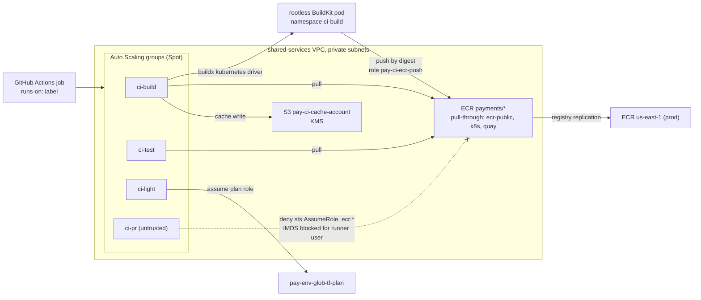

# CI runners and images

GitHub Actions jobs run on self-hosted runners in the shared-services account: one Auto Scaling group of EC2 Spot instances per kind of job, arm64, no Kubernetes. Pull request code runs in a separate pool whose instance role carries explicit denies on role assumption and the registry. Images are built with rootless BuildKit, pushed to Amazon ECR by digest, scanned, given an SBOM and provenance, and signed with cosign.

The pipeline stages and scans are described in [CI/CD stages and security scans](../../delivery/cicd-security.md).

## What is built and why

| Piece | Why |
|---|---|
| Runner pools by kind of job | A build needs a large disk and cache write; a lint job needs neither. Rights follow the kind of job, never priority |
| Spot with several instance types | CI is restartable; price-capacity-optimized Spot keeps it cheap |
| Untrusted pool `ci-pr` | Code from a pull request must not reach roles, the registry or instance credentials |
| Build cache bucket | Shared layer cache for trusted builds |
| ECR with pull-through cache | Images close to the nodes; an upstream registry outage does not stop CI |
| cosign signatures, SBOM, provenance | Clusters admit only images built by this repository's workflow |

## Services, tools and versions

| Item | Version or setting | Source |
|---|---|---|
| GitHub Actions runner | 2.329.0, checked against a pinned SHA-256 at boot | `config/platform.yaml` (`runners`) |
| Runner OS | Amazon Linux 2023 arm64, from the SSM parameter `/aws/service/ami-amazon-linux-latest/al2023-ami-kernel-default-arm64` | `infra/modules/ci-runners/variables.tf` |
| EC2 Auto Scaling | mixed instances policy, Spot `price-capacity-optimized`, On-Demand base 0 | `infra/modules/ci-runners/pools.tf` |
| BuildKit | rootless, buildx `kubernetes` driver, image pinned in `tools/ci/buildkit/buildkit.env` | `.github/actions/setup-buildkit` |
| Signing and attestations | cosign (keyless, GitHub OIDC), syft CycloneDX SBOM, `actions/attest-build-provenance` v2.4.0 | `.github/workflows/images.yml` |
| Image scan | Trivy (fails on fixable CRITICAL), ECR enhanced continuous scanning, Inspector | `images.yml`, `infra/modules/ecr` |
| Registry | Amazon ECR | `infra/modules/ecr` |

## How it is wired

### Runner pools

Source: `ci_pools` in `infra/live/shared-services/env.hcl`.

| Pool | Label | Instance types | min / warm / max | Root volume | Cache write | ECR pull | Plan role | Untrusted |
|---|---|---|---|---|---|---|---|---|
| `ci-build` | `build` | c7gd.4xlarge, c6gd.4xlarge, m7gd.4xlarge | 0 / 1 / 8 | 30 GB | yes | yes | no | no |
| `ci-test` | `test` | m7g.2xlarge, m6g.2xlarge, c7g.2xlarge | 0 / 1 / 16 | 40 GB | no | yes | no | no |
| `ci-light` | `light` | m7g.large, m6g.large, c7g.large | 0 / 1 / 20 | 30 GB | no | no | yes | no |
| `ci-pr` | `pr` | c7g.2xlarge, m7g.2xlarge, c6g.2xlarge | 0 / 1 / 20 | 40 GB | no | no | no | yes |

- Scaling: target tracking on average CPU 50%. Scheduled actions raise each pool to `warm_size` at 07:00 and lower it to `min_size` at 19:00, Monday to Friday, UTC.
- Boot: the instance installs the pinned runner, verifies its checksum, gets a registration token through the GitHub App of its pool (credentials read once from Secrets Manager `pay/ci/github-app/<pool>` and then unset), registers with its labels and runs as a systemd service.
- Local NVMe, where the type has one (the `*gd` types), holds the work directory and Docker data.
- A root service protects the instance from scale-in while `Runner.Worker` runs, so a job is never cut off by a scale-in.
- Instances are stateless: Spot or a new AMI replaces them.
- Workflows select a pool through repository variables (`RUNNER_PR`, `RUNNER_LIGHT`, `RUNNER_BUILD`, ...); jobs that run pull request code with Docker service containers use GitHub-hosted runners, never the trusted pools.

### Untrusted pool

- The module rejects an untrusted pool with cache write, ECR pull or a plan role (variable validation).
- Its instance role has an explicit deny on `sts:AssumeRole` and `ecr:*`.
- An `iptables` rule rejects traffic from the `runner` user to the instance metadata address, so pull request code cannot read the instance credentials; containers are stopped by the hop limit of 1.
- `untrusted_subnet_ids` puts the pool in its own subnets without routes to other networks.

### Images and registry

- Repositories `payments/<name>`: immutable tags, scan on push, KMS encryption, lifecycle (untagged images expire after 14 days, the last 50 tagged images are kept). Enhanced continuous scanning is set registry-wide.
- Registry replication from eu-central-1 to us-east-1 in prod (`replication_regions` of the `ecr` unit); creation templates give the replicas the same settings and the replica KMS key.
- Pull-through cache rules for `public.ecr.aws`, `registry.k8s.io` and `quay.io` in shared-services.
- Builds: `setup-buildkit` starts a rootless BuildKit Deployment through the buildx `kubernetes` driver in namespace `ci-build` of the cluster named by its `eks-cluster` input, on nodes labelled `pay.io/pool=ci-build`, with 8 CPU requested.
- Push: only the role `pay-ci-ecr-push`, trusted for `refs/heads/main` and `refs/heads/release/*`. Read: `pay-<env>-glob-ecr-read` from `ci-oidc-roles`, main only.
- `images.yml` builds once per merge, pushes by digest, scans with Trivy, runs container-structure-test, attaches a CycloneDX SBOM (`cosign attest`) and build provenance, then signs with `cosign sign` last; the signature's presence proves the earlier steps ran.
- Promotion changes only the digest in `deploy/envs/<env>/images.yaml`. Kyverno `require-image-digest`, `require-signed-images`, `restrict-registries` and `disallow-latest-tag` check it in the clusters.
- Platform images are built into and pulled from ECR. The pull-through cache covers `public.ecr.aws`, `registry.k8s.io` and `quay.io`; Kyverno `restrict-registries` reports images from other registries.

## Security controls

- No long-lived credentials: GitHub OIDC for push and plan roles; GitHub App keys in Secrets Manager with their own KMS key.
- IMDSv2 required with hop limit 1 on every runner (launch template and SCP).
- The cache bucket: KMS, public access blocked, bucket owner enforced, objects expire, incomplete uploads aborted after one day.
- Trust split: only `ci-build` may write the cache; only `ci-light` may assume a plan role; the untrusted pool may do neither.
- Every image is signed and carries an SBOM and provenance; clusters admit only signed images by digest.

## Sizes per environment

The runner pools exist once, in shared-services, and serve every environment. ECR repositories exist in shared-services and in each environment account (`infra/live/<env>/<region>/ecr`).

## Modules and live units

| Module | Unit |
|---|---|
| `ci-runners` | `infra/live/shared-services/eu-central-1/ci-runners` |
| `ecr` | `infra/live/shared-services/eu-central-1/ecr`, `infra/live/<env>/<region>/ecr` |
| `ci-oidc-roles` | `infra/live/shared-services/eu-central-1/ci-oidc-roles`, `infra/live/<env>/eu-central-1/ci-oidc-roles` |
| `bedrock-access` | `infra/live/shared-services/eu-central-1/bedrock-access` (AI review role for CI) |

## How to change it

- **Pool size or types**: edit `ci_pools` in `infra/live/shared-services/env.hcl`.
- **Runner version**: set `runners.version` and `runners.sha256` in `config/platform.yaml`; instances pick it up when they are replaced.
- **New pool**: add an entry to `ci_pools` with a new label; give it the smallest set of rights.
- **Working hours**: `work_start_cron`, `work_end_cron` and `time_zone` of the module.
- **BuildKit image**: update `tools/ci/buildkit/buildkit.env`; `buildkit_pin_check.py --strict` fails on a placeholder digest.
