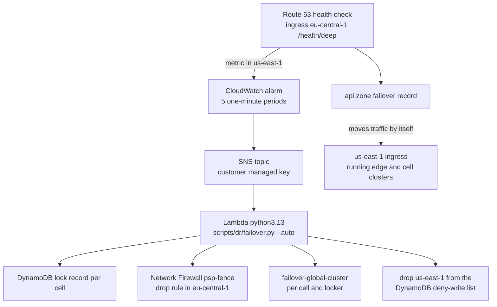

# Regions and disaster recovery

The platform uses two regions. eu-central-1 is the only region that writes. In prod, us-east-1 is a hot standby at full production size: the cell, spare, locker, edge and control-center clusters, their node pools, MemoryDB and one Aurora instance per cluster run there all the time, so the region can take the whole load at any moment. A switch promotes Aurora and moves DNS; it builds nothing. Stage and dev run in eu-central-1 alone. This page describes the infrastructure that makes a switch possible. The procedures, objectives and drills are in [Disaster recovery](../../../dr/README.md), [Failover and failback](../../../dr/failover.md) and [Drills](../../../dr/drills.md).

The owner decisions behind this layout are D6 and D7 in `manifests/constraints.yaml`.

## What is built and why

| Region | Role | What runs there |
|---|---|---|
| eu-central-1 | working | Everything: cells, locker, edge, control-center, analytics, all writes |
| us-east-1 (prod) | hot standby | Clusters of `cell-0` to `cell-3`, `spare`, `locker`, `edge` and `control-center` at the working size, MemoryDB per cell, one Aurora Global instance per cluster with its writer class, VPC, egress VPC, transit gateway, Network Firewall, KMS replicas, ECR replicas, `dr-failover`, `argocd-standby`, `restore-test`, `panel-edge` and `waf-edge` |
| us-east-1 (dev, stage) | edge only | `panel-edge`, `waf-edge` and a `kms` unit with the `logs` key |

The analytics cluster is not duplicated: MSK is rebuilt from the S3 event archive after a switch.

## Replication

Replication runs in prod; dev and stage have no replica region.

| Data | Mechanism | Target | Module |
|---|---|---|---|
| Aurora (cells, spare, locker) | Aurora Global Database, storage-level; one instance per secondary cluster with the writer class | us-east-1 | `aurora-global` |
| DynamoDB cell map | Global table, MREC replica; writes denied outside eu-central-1 | us-east-1 | `dynamodb-global` |
| S3 backups, event archive, Vault snapshots | Cross-region replication with Replication Time Control (15 minutes) into locked buckets | us-east-1 | `s3-backup` |
| Backup recovery points | AWS Backup copy actions into locked vaults | us-east-1 | `backup` |
| Secrets | Secrets Manager multi-Region replicas | us-east-1 | `secrets-replica` |
| Images | ECR registry replication | us-east-1 | `ecr` |
| KMS keys | Multi-Region primaries with replicas | us-east-1 | `kms-set` |
| MemoryDB | not replicated; the standby clusters run and are warmed from Aurora before they take traffic | | `memorydb` |
| MSK | not replicated; rebuilt from the S3 event archive | | `msk` |
| Terraform state | S3 replication with RTC, one replica bucket per state root | us-east-1 | `infra/bootstrap` |

## How it is wired



### Failover automation (`dr-failover`)

- Runs in us-east-1 of prod, where Route 53 publishes its health check metrics.
- The alarm fires after `alarm_evaluation_periods` (5) minutes of failed health checks. Missing data never starts a failover.
- The Lambda function runs `scripts/dr/failover.py --auto` for every cell and the locker:
  1. takes a DynamoDB lock record for the cell, so a second alarm cannot promote twice (one concurrent run);
  2. fences what is reachable: a drop rule in the `pay-<env>-euc1-psp-fence` rule group stops PSP traffic from the old region;
  3. runs `failover-global-cluster`, which promotes the running us-east-1 instance of each global cluster;
  4. removes the standby region from the DynamoDB deny-write policy.
- Route 53 moves the API traffic by itself. The switch runbook flips the active Global Accelerator endpoint group.
- `switch_writer_instance_classes` and `compute_build` of the module stay unset: the standby already runs its Aurora instances and its compute. `.github/workflows/dr-compute-build.yml` remains a manual workflow.

### Standby compute

The per-cell `eks`, `karpenter`, `iam-workloads` and `memorydb` units in prod us-east-1 are applied with every plan. They keep an `exclude` block only as a fallback switch:

```hcl
exclude {
  if                   = !local.env_cfg.standby_compute_enabled
  actions              = ["all"]
  exclude_dependencies = false
}
```

`standby_compute_enabled` follows `standby.compute_enabled` in `config/environments/prod.yaml` (true). Excluding a unit never destroys it.

### Control plane during a switch

- Argo CD and Vault run on the central cluster of shared-services in eu-central-1. `argocd-standby` lets Argo CD core run in the first standby cell cluster of us-east-1 when that cluster is gone; it holds a role with an access entry on every standby cluster.
- Terraform: `PAY_STATE_REGION=us-east-1` points every unit at the us-east-1 replica of its state root (see [Infrastructure as code](../base/iac.md)).

## Security controls

- Writes stay in one region: the SCP `deny-dynamodb-writes-recovery-regions` and the IAM `deny_recovery_writes` policy on every workload role.
- Fencing at the firewall keeps the old region from sending PSP calls after the switch.
- Standby data-store security groups admit only the node security group of the cluster in the same region (`data-access`).
- Every replica is encrypted with the replica key of its region; backup copies land in locked vaults.
- The failover SNS topic uses a customer managed key whose policy admits CloudWatch for this alarm only.

## Sizes per environment

| | dev | stage | prod |
|---|---|---|---|
| us-east-1 | edge only | edge only | hot standby |
| Aurora instances per standby cluster | | | 1, writer class of the working cluster |
| Standing compute in us-east-1 | | | full size (`standby.node_pool_cpu_limits`: payments 400, stateful 100, cde 200, workers 400) |
| `dr-failover` | no | no | yes |
| Daily restore test | | | `restore-test` in us-east-1 |

Source: `config/environments/prod.yaml` (`standby`), `infra/live/README.md`, `infra/live/<env>/us-east-1`.

## Modules and live units

| Module | Units |
|---|---|
| `dr-failover` | `infra/live/prod/us-east-1/dr-failover` |
| `aurora-global` (recovery) | `infra/live/prod/us-east-1/<cell or locker>/aurora` |
| `data-access` (recovery) | `infra/live/prod/us-east-1/<cell or locker>/data-access` |
| `eks`, `karpenter`, `iam-workloads`, `memorydb` | `infra/live/prod/us-east-1/<cell>/...` |
| `argocd-standby` | `infra/live/prod/us-east-1/argocd-standby` |
| `global-accelerator` | `infra/live/<env>/eu-central-1/edge-accelerator` (us-east-1 endpoint group in prod only) |
| `dns-routing` | `infra/live/prod/eu-central-1/edge-dns-routing` |
| `restore-automation` | `infra/live/prod/us-east-1/restore-test` |
| `fis-prereqs`, `fis-experiments` | `infra/live/{stage,prod}/eu-central-1/` (chaos drills, at most one AZ or one cell) |

Shared settings: `infra/live/_envcommon/data/dr-failover.hcl`. Script: `scripts/dr/failover.py`.

## How to change it

- **Standby size**: `standby` in `config/environments/prod.yaml` (`node_pool_cpu_limits`, `reader_count`, `reader_class`); keep it equal to the working size so the standby takes the whole load.
- **Alarm sensitivity**: `alarm_evaluation_periods` of `dr-failover`.
- **Rehearse**: run the drills in [Drills](../../../dr/drills.md).
