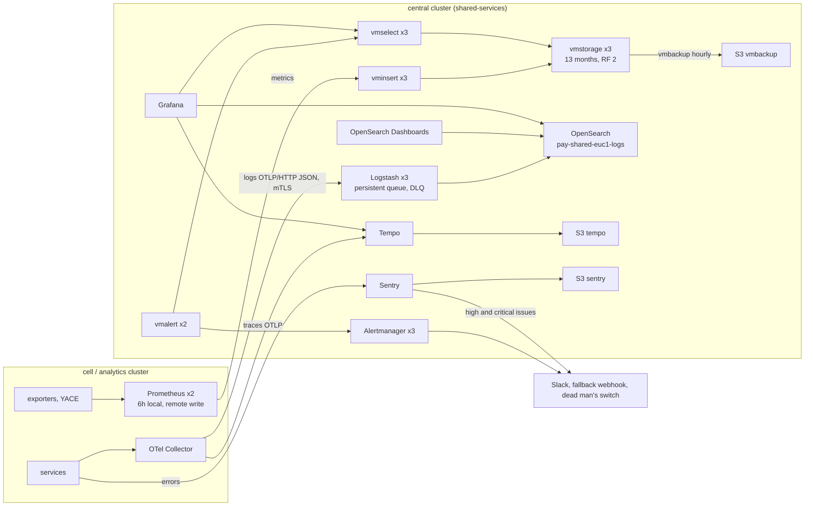

# Observability

Every cluster runs a local collection layer: a Prometheus pair (kube-prometheus-stack), the OpenTelemetry Collector and exporters. They ship to one central stack in the shared-services account: VictoriaMetrics for metrics, Logstash and one OpenSearch domain for logs, Tempo for traces, Grafana, Alertmanager, vmalert and Sentry. The central cluster is outside the CDE.

SLOs, alerts and dashboards are described in [Observability and alerting](../../runtime/observability.md). The log pipeline, shards and retention are in [Logging](../../runtime/logging.md).

## What is built and why

| Piece | Why |
|---|---|
| Central cluster `central` in shared-services | One place to query every environment; outside the CDE, so card data rules stay simple |
| VictoriaMetrics cluster | 13 months of metrics at full resolution, replicated |
| OpenSearch domain `pay-shared-euc1-logs` with Logstash | Full-text log search for every environment and the audit trail, with a second PAN mask and a persistent queue |
| Tempo on S3 | Cheap object storage with a short hot path |
| vmalert and Alertmanager | Rules evaluated centrally; one routing tree |
| Sentry | Application errors with PII scrubbing; high and critical issues go to Slack |
| YACE exporter | CloudWatch metrics of AWS services as Prometheus metrics |

## Services, tools and versions

Chart versions from `deploy/argocd/templates/addons/`:

| Component | Chart | Version | Runs in |
|---|---|---|---|
| VictoriaMetrics | `victoria-metrics-cluster` | 0.56.0 | central |
| vmalert | `victoria-metrics-alert` | 0.54.0 | central |
| Logstash | `deploy/platform/logstash` (repository chart, 3 pods) | | central |
| OpenSearch Dashboards | `deploy/platform/opensearch-dashboards` (repository chart) | | central |
| Tempo | `tempo-distributed` | 1.61.3 | central |
| Grafana | `grafana` | 10.5.15 | central |
| Alertmanager | `alertmanager` | 2.5.1 | central |
| Sentry | `sentry` | 36.1.0 (with `clickhouse` 9.4.4 for Snuba) | central |
| Prometheus | `kube-prometheus-stack` | 93.6.1 | every cluster |
| OpenTelemetry Collector | `opentelemetry-collector` | 0.182.0 | every cluster |
| OpenSearch exporter | `prometheus-elasticsearch-exporter` | 8.2.0 | central |
| Exporters | `prometheus-yet-another-cloudwatch-exporter` 0.50.0, `prometheus-postgres-exporter` 8.3.0, `prometheus-redis-exporter` 6.38.0, `prometheus-kafka-exporter` 4.1.2, `prometheus-blackbox-exporter` 11.22.0 | | cell and analytics clusters |

## How it is wired

Endpoints come from `config/platform.yaml` (`central`): metrics remote write, Alertmanager, Sentry, logs (`central.logs_otlp_endpoint`, the Logstash HTTP input on port 8443, client certificate required) and traces OTLP (port 4317).

The environment clusters reach the central cluster through the transit gateway hub and resolve the hosts in the private zone `payments.internal`, which every environment VPC shares. Two internal NLBs take their traffic:

| Host | Gateway | What passes |
|---|---|---|
| `metrics-ingest` | `istio-ingress-admin/ingest` | `POST /insert/0/prometheus/api/v1/write` to vminsert |
| `alertmanager-ingest` | `istio-ingress-admin/ingest` | `POST /api/v2/alerts` to Alertmanager |
| `tempo-ingest` (port 4317) | `istio-ingress-admin/ingest` | gRPC `TraceService/Export` to the Tempo distributor |
| `logs-ingest` (port 8443) | `monitoring/logs` | TLS passthrough to Logstash, which checks the client certificate itself |

The ingest Gateway terminates TLS with the wildcard certificate of the zone and requires a client certificate signed by `central.ingest_client_ca`, the CA of the client identity that Prometheus and the node collectors mount (`deploy/platform/central-tls`). Its NLB admits only the VPC ranges of the environments (`network` in `config/platform.yaml`), and its routes match only the write calls above: any other path or method returns 404. The admin tools stay on the separate `admin` Gateway. `tools/config/render/render_admin_gateway.py` writes both Gateways; `infra/modules/admin-edge` adds the DNS records of the ingest hosts (`ingest_records`) in its second apply step. The two Prometheus replicas scrape the same targets; VictoriaMetrics drops duplicates with `dedup.minScrapeInterval` = `central.dedup_interval` (30s).

## Retention and storage

| Store | Retention | Storage | Source |
|---|---|---|---|
| VictoriaMetrics | 13 months | 3 vmstorage nodes, 500 GiB encrypted gp3 each (`gp3-encrypted`, reclaim `Retain`, online expansion), replication factor 2; read-only below 10 GB free | `deploy/platform/victoria-metrics/values.yaml` |
| vmbackup | no age expiry (incremental parts stay referenced) | S3 `pay-shared-services-euc1-vmbackup`, Intelligent-Tiering; hourly per vmstorage node at minutes 7, 17, 27 | `deploy/platform/victoria-metrics/manifests/vmbackup.yaml`, `observability-storage` |
| Prometheus (local) | 6 hours, at most 16 GB | per cluster | `deploy/platform/kube-prometheus/values.yaml` |
| OpenSearch `logs-app-<env>` | hot 7 days, UltraWarm until day 30, then deleted; prod drops debug and trace records | data stream, 3 primaries and 1 replica, rollover at 30 GB per primary shard or 1 day | `infra/modules/opensearch-indices` |
| OpenSearch `logs-audit` | hot 30 days, UltraWarm until day 365 | data stream, rollover at 10 GB per primary shard or 1 day; the log archive bucket stays the source of truth | `infra/modules/opensearch-indices`, `log-ingestion` |
| Logstash queue | about an hour of the busiest hour of all environments | persistent queue 24 GB per pod, dead letter queue | `deploy/platform/logstash` |
| Tempo | 14 days (`336h`) | S3 `tempo` bucket, objects expire after 14 days; ingesters 3 x 20 GiB; block format vParquet4 | `deploy/platform/tempo/values.yaml`, `observability-storage` |
| Sentry | events 30 days (nightly cleanup) | S3 `sentry` bucket 90 days, Intelligent-Tiering; file store volume 100 GiB | `deploy/platform/sentry/values.yaml`, `observability-storage` |
| Alertmanager | silences and notification log | 3 replicas, 2 GiB each | `deploy/platform/alertmanager/values.yaml` |
| EKS control-plane logs | dev 30 days, stage and prod 365 days, central 90 days in CloudWatch; one year in the log archive | CloudWatch with the logs key, Firehose to the log archive | `config/environments/*.yaml`, `infra/live/shared-services/env.hcl` |
| WAF logs | 30 days | CloudWatch, us-east-1 | `infra/modules/waf-edge` |
| Container logs on nodes | rotated at 50 MiB, 5 files kept | kubelet | `infra/modules/eks`, `infra/modules/karpenter` |

Every CloudWatch log group has a retention and every bucket with `log` in its name has a lifecycle expiration; `infra/tests/log-retention` fails a change that drops either.

## Security controls

- The central cluster is outside the CDE; card data never reaches logs, traces, metric labels or fixtures (`manifests/constraints.yaml`). The collector deletes card attributes and masks PAN-like digit runs; Logstash masks Luhn-valid 13 to 19 digit numbers a second time; Sentry has a PII configuration (`deploy/platform/sentry/pii-config.json`).
- Buckets: SSE-KMS with the shared key, public access blocked, TLS only, versioning, multipart uploads aborted after one day.
- One Pod Identity role per bucket (`<bucket>-pod`) with the permissions boundary: list one bucket, read and write its objects, `kms:Decrypt` and `GenerateDataKey` bound to the bucket by encryption context.
- OpenSearch is VPC only, with KMS at rest, node-to-node TLS and fine-grained access control; Okta groups map to the roles `logs_sre`, `logs_security` and `logs_engineering` (application logs only).
- People sign in to Grafana, Alertmanager, VictoriaMetrics UI, Prometheus, Sentry and OpenSearch Dashboards (`logs.payments.internal`) only through the admin entry with Okta (see [Edge](../platform/edge.md)). Grafana has four organizations (Main, Engineering, Finance, Audit) mapped to Okta groups (`config/platform.yaml`, `access.grafana_orgs`).
- Admin tool secrets come from Secrets Manager through External Secrets (`central-secrets`).
- `bedrock-access` denies the admin AI agent any read of CDE account logs and metrics; the agent of each environment reads only `logs-app-<env>` through the VPC endpoint of its environment (`opensearch-endpoint`).

## Sizes per environment

There is one central stack for all environments; its sizes do not vary by environment.

| Component | Replicas |
|---|---|
| vminsert, vmselect, vmstorage | 3 each |
| vmalert | 2 |
| Alertmanager | 3 |
| Tempo ingesters | 3 |
| Logstash | 3 |
| OpenSearch | 3 dedicated masters, hot data nodes over three AZs, UltraWarm |
| Prometheus per cluster | 2 |
| Central cluster Karpenter limits | workers 200 vCPU (Spot preferred), stateful 200 vCPU (On-Demand) |

## Modules and live units

| Module | Unit | Builds |
|---|---|---|
| `eks` | `infra/live/shared-services/eu-central-1/central/eks` | Central cluster |
| `karpenter` | `infra/live/shared-services/eu-central-1/central/karpenter` | Pools `workers`, `stateful` |
| `observability-storage` | `infra/live/shared-services/eu-central-1/observability-storage` | Buckets `tempo`, `sentry`, `vmbackup`; Pod Identity roles; YACE role |
| `opensearch` | `infra/live/shared-services/eu-central-1/logs/opensearch` | The central log domain |
| `log-ingestion` | `infra/live/shared-services/eu-central-1/logs/ingestion` | Logstash, exporter and Grafana roles; audit ingestion pipelines |
| `opensearch-indices` | `infra/live/shared-services/eu-central-1/logs/opensearch-indices` | Data streams, ISM policies, roles and mappings |
| `logs-edge` | `infra/live/shared-services/eu-central-1/logs/edge` | Logstash TLS identity, private name of the log intake |
| `sentry-alerts` | `infra/live/shared-services/eu-central-1/sentry` | Sentry issue alert rules to `#payments-sentry-critical` |
| `opensearch-endpoint` | `infra/live/<env>/eu-central-1/logs-endpoint` | VPC endpoint of the log domain for the admin agent of each environment |
| `central-secrets` | `infra/live/shared-services/eu-central-1/central-secrets` | 15 secret containers, External Secrets role |
| `admin-edge`, `okta-sso` | `infra/live/shared-services/eu-central-1/{admin-edge,okta-sso}` | Private entry and sign-in |
| `iam-workloads` | cell units | `<cell>-yace` role for CloudWatch reads |

Kubernetes side: `deploy/platform/{victoria-metrics,vmalert,logstash,opensearch-dashboards,tempo,grafana,alertmanager,sentry,kube-prometheus,otel-collector,exporters}`; alert rules in `observability/`.

## How to change it

- **Retention of logs**: change the ISM policies in `infra/modules/opensearch-indices`; shard sizes stay between 10 and 50 GB.
- **Retention of traces**: change both `block_retention` of Tempo and the bucket `retention_days` in `observability-storage`; the bucket must keep objects at least as long as the chart.
- **More metrics storage**: raise the vmstorage volume size; the storage class allows online expansion.
- **New AWS metrics**: add the namespace to the YACE configuration in `deploy/platform/exporters/yace`.
- **New alert route**: add the Slack webhook to `central-secrets` and the route to `deploy/platform/alertmanager/values.yaml`.
