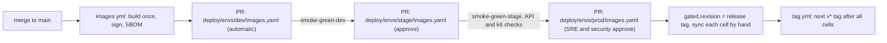

# Deploying the platform from an empty AWS organization

This guide takes you from an empty AWS organization to a live payment in prod. Follow the steps in order: each step needs the outputs of the steps before it.

The order of the Terraform applies comes from the `dependency` blocks of the Terragrunt units under `infra/live/`. The Kubernetes side comes from the Argo CD chart in `deploy/argocd/`. Day-to-day work after the first rollout is in [day-2.md](day-2.md).

## Contents

1. [What you build](#1-what-you-build)
2. [Prerequisites](#2-prerequisites)
3. [Fill in config/platform.yaml](#3-fill-in-configplatformyaml)
4. [How applies run](#4-how-applies-run)
5. [Bootstrap the state buckets](#5-bootstrap-the-state-buckets)
6. [Organization: management and security](#6-organization-management-and-security)
7. [Shared services](#7-shared-services)
8. [One environment, unit by unit](#8-one-environment-unit-by-unit)
9. [Argo CD bootstrap](#9-argo-cd-bootstrap)
10. [Vault bootstrap and secrets](#10-vault-bootstrap-and-secrets)
11. [The first cell](#11-the-first-cell)
12. [Smoke checks and the first payment](#12-smoke-checks-and-the-first-payment)
13. [Promotion: dev, stage, prod](#13-promotion-dev-stage-prod)

## 1. What you build

| Account | What runs there | Terragrunt root |
|---|---|---|
| management | Organizations, IAM Identity Center, SCPs, the organization trail, Config and security services | `infra/live/management/` |
| log-archive, audit | The immutable organization log bucket; delegated administration of Config, GuardDuty, Security Hub, Inspector and Macie | `infra/live/security/` (the account follows the unit) |
| shared-services | Terraform state, CI runners, ECR, the central cluster with Argo CD, Vault and observability, the central OpenSearch logs domain, Okta sign-in for the admin tools | `infra/live/shared-services/` |
| dev, stage, prod | The payment cells, the locker, the edge, the control center, analytics and, in prod, the us-east-1 hot standby | `infra/live/<env>/` |

Inside an environment:

- **eu-central-1** is the working region and the only region that writes. Each cell (`cell-0` to `cell-3`) and the `spare` cell has its own EKS cluster, Aurora and MemoryDB. The `locker`, `edge`, `control-center` and `analytics` clusters are shared by the cells of the environment; the locker has its own Aurora and serves every cell.
- **dev** runs `cell-0` and `spare` only. The `aurora-schedule` unit stops the dev Aurora clusters outside working hours.
- **dev and stage** are single-region. Their us-east-1 holds only `panel-edge`, `waf-edge` and a `kms` unit with the `logs` key.
- **us-east-1 in prod** is a hot standby at full production size: the cell, spare, locker, edge and control-center clusters, their node pools, MemoryDB and one Aurora instance per cluster run all the time, with their own egress path (`egress-vpc`, `firewall`, `tgw`), `dr-failover`, `argocd-standby` and the daily `restore-test`. The DynamoDB, S3, backup and secrets replicas also land there; the eu-central-1 units own them. A region switch promotes Aurora and moves DNS ([Regions and disaster recovery](../infrastructure/support/dr.md)).
- **Stage size window.** `size_window` in `infra/live/stage/env.hcl` picks the stage size:
  - `"scheduled"`: dev sizes for Aurora, MemoryDB and the node pools.
  - `"prod-size"`: a booked load or region switch test window at prod size. Book it with a pull request.
- **Aurora storage.** The spare and locker Aurora clusters use Standard storage (`storage_type = "aurora"`). The cell clusters use I/O-Optimized.
- **Kubernetes.** Every environment runs EKS 1.36, the newest version every pinned add-on supports (cert-manager 1.21 covers Kubernetes up to 1.36) (`kubernetes_version` in each `env.hcl`).

## 2. Prerequisites

### Tools

Install [mise](https://mise.jdx.dev) and run `make bootstrap` at the repository root. It installs every tool pinned in `mise.toml` and enables the git hooks.

| Tool | Version from | Used for |
|---|---|---|
| `terraform`, `terragrunt` | `mise.toml` | every infrastructure apply |
| `helm`, `kubeconform` | `mise.toml` | rendering the Argo CD chart and the add-ons |
| `python` with `pyyaml` | `mise.toml` | the validator and generators in `tools/config/` |
| `opa`, `conftest`, `kyverno` | `mise.toml` | the policy checks of `make lint` and `make test` |
| `cosign`, `crane` | `mise.toml` | checking image signatures and digests |
| `aws` CLI, `kubectl` | your workstation | sign-in, cluster access, writing secret values |

### Access

- **Management account:** a person with administrator access, to enable AWS Control Tower and Account Factory for Terraform (AFT). Control Tower creates the `log-archive` and `audit` accounts itself.
- **State bootstrap:** a temporary administrator role in the shared-services account. The bootstrap never runs from CI.
- **Applies after the bootstrap:** each component's apply role, `<prefix>-<env>-glob-tf-apply-<component>`. Plans use `<prefix>-<env>-glob-tf-plan`. `infra/bootstrap` and `ci-oidc-roles` create both roles.
- **Okta:** an Okta organization with an API token. Export the token as `OKTA_API_TOKEN` in the shell that applies `okta-sso`. Never write it to a file.

### Domains

| Value in `config/platform.yaml` | What it needs |
|---|---|
| `dns.dev_zone`, `dns.stage_zone`, `dns.prod_zone` | A domain you own. `edge-dns` creates the public Route 53 zone. Delegate it from the parent zone with the NS records the zone gets. |
| `dns.admin_zone` | A private zone name for the admin tools (Argo CD, Vault, Grafana, Alertmanager, Sentry, OpenSearch Dashboards). Only the internal gateway reaches it. |
| `dns.psp_domains` | The PSP host names the egress firewall allows. |
| `deploy.<env>.gateway_host`, `deploy.<env>.ingress_endpoints` | The public API host name and one ingress host per region. |

### GitHub

- The repository settings are code in [infra/github](../../../infra/github/README.md). Apply them with a GitHub App key (`TF_VAR_github_app_pem`) or, for a personal account, a token. That README shows the commands.
- The workflows use three GitHub Apps. Install each one on this repository only.

| App | Repository secret and variables | Workflows |
|---|---|---|
| Promotion | `PROMOTE_APP_PRIVATE_KEY`, `PROMOTE_APP_ID` | `promote.yml`, `hotfix.yml` |
| Tagging | `TAGGING_APP_PRIVATE_KEY`, `TAGGING_APP_ID` | `tag.yml` |
| Nightly drift issues | `CHANGEME_GITHUB_APP_PEM`, `CHANGEME_GITHUB_APP_ID`, `CHANGEME_GITHUB_APP_INSTALLATION_ID` | `nightly.yml` |

- The workflows also read these repository variables:
  - AWS: `AWS_REGION`, `AWS_ROLE_TF_PLAN`, `AWS_ROLE_ECR_PUSH`, `AWS_ROLE_ECR_READ`, `ECR_REPO_PREFIX`.
  - Runners and builds: `RUNNER_LIGHT`, `RUNNER_BUILD`, `RUNNER_COMMIT`, `RUNNER_PR`, `SCCACHE_BUCKET`, `BUILDKIT_EKS_CLUSTER`, `BUILDKIT_NAMESPACE`, `BUILDKIT_NODE_SELECTOR`.
  - Other: `AI_REVIEW_ROLE_ARN`, `DRIFT_ENABLED`, `LINT_STRICT`, the `STAGE_*` values of the stage API checks and the `PERF_*` values of the load check.

  Set each role ARN once the unit that creates the role is applied.
- Argo CD notifications send `smoke-green-<env>` to GitHub. They use a fine-grained personal access token limited to this repository, with `Contents: Read and write`. The token goes into the secret `pay/shared-services/argocd/notifications`; see [deploy/platform/smoke](../../../deploy/platform/smoke/README.md).

## 3. Fill in config/platform.yaml

[`config/platform.yaml`](../../../config/platform.yaml) is the one place for the values of your deployment. Terragrunt reads it through each `env.hcl`. The generators in `tools/config/` turn it into Helm values. Replace every example value, and never edit a generated file by hand.

| Section | Keys | Why |
|---|---|---|
| `owner` | `github_org`, `github_repo`, `github_account_type`, `contact_email`, `cost_center_prefix` | OIDC trust of the CI roles, the Argo CD repository URL, the `owner` and `cost-center` tags |
| `naming` | `prefix` | First part of every name: `<prefix>-<env>-<region-short>-<component>` |
| `registry` | `ecr_prefix`, `ecr_repo_prefix` | The image registry. `global.registry` in `deploy/envs/<env>/values.yaml` uses the same host. |
| `accounts` | `management`, `log_archive`, `audit`, `shared_services`, `dev`, `stage`, `prod` | `allowed_account_ids` of the generated provider: a unit can only touch its own account |
| `regions` | `working`, `recovery` | The writing region and the hot-standby region (`us-east-1`) |
| `network` | a `/16` per environment and region, `/20` egress ranges | VPC and egress VPC CIDRs. They must not overlap. |
| `dns` | the zones, `psp_domains`, `grafana_url`, `admin_zone` | Public and admin zones, the firewall allowlist |
| `storage` | `state_bucket_prefix`, `state_kms_key_arns` | The state backend of every unit. `state_kms_key_arns.<root>` is the output `state_kms_key_arn` of the `infra/bootstrap` run of that state root. |
| `access` | `okta_domain`, `admin_user_ids`, `sre_view_permission_set`, `grafana_groups`, `grafana_orgs`, `grafana_bootstrap_image` | Okta sign-in, view-only EKS access, Grafana groups and organizations |
| `deploy.<env>` | `data_cidrs`, `endpoint_cidrs`, `gateway_host`, `cluster_domain`, `rds_suffix`, `memorydb_suffix`, `ingress_endpoints`, `standby`, `transit_gateway_ids` | Network policies, host names, data store endpoints. Fill the suffixes and transit gateway ids once the units that create them are applied. |
| `central` | metrics, Alertmanager, Sentry, logs and traces endpoints | Where every cluster sends its telemetry |
| `vault` | `host`, `ca_bundle` | The one Vault on the central cluster, and the root certificate every cluster trusts it through |
| `runners` | `version`, `sha256` | The GitHub Actions runner on the CI instances |
| `ai` | `review_role_name`, `cde_account_ids`, `budget_subscriber_emails` | The AI review role, the accounts the admin agent may not read, the budget mails |

Sizes live in [`config/environments/`](../../../config/environments/). `prod.yaml` is the reference. `dev.yaml` lists what dev lowers. `stage.yaml` is merged last.

Check the values before any apply:

```sh
python3 tools/config/validate.py
make lint-repo        # runs every generator in --check mode
```

After a change to `config/platform.yaml`, regenerate and commit the generated files:

- Run each generator without `--check`: `tools/config/render_*.py` and `tools/config/render/render_*.py`.
- `tools/config/argocd-values.py` prints the Argo CD values; section 9 uses it.

[Configuration and generators](../foundation/configuration.md) lists what each generator writes.

## 4. How applies run

- A unit is one directory with a `terragrunt.hcl`, for example `infra/live/stage/eu-central-1/cell-0/eks`. The path gives the environment, region, cell and component. `env.hcl` gives the account.
- `terragrunt run --all` from an environment directory runs every unit in dependency order:

```sh
cd infra/live/stage
terragrunt run --all -- plan      # works before anything exists: dependencies return mock outputs
terragrunt run --all -- apply     # mock outputs serve plan only, so apply waits for the real ones
```

- One unit:

```sh
terragrunt run --working-dir infra/live/stage/eu-central-1/vpc -- apply
```

- `make plan ENV=<env>` plans a whole environment with the plan role.
- Start `run --all` from the environment directory, not from a region directory. Some units depend on units in other regions:
  - in prod, the eu-central-1 `backup`, `dynamodb`, `secrets` and `s3-backup` units need the `kms` replica keys of us-east-1;
  - in prod, each us-east-1 Aurora cluster needs the eu-central-1 Aurora of the same cell;
  - the `edge-accelerator` unit writes through the Global Accelerator control plane in us-west-2 and generates its own provider.
- A pull request plans the units it changes. After the merge, the apply runs per environment through GitHub Environments with the apply role of each component. Prod needs approval. The first applies of a new account run from a terminal with the same roles, because the CI runners come later, in section 7.
- Two steps need a person between applies: the transit gateway two-step (section 8) and the order between the management and security roots (section 6).

## 5. Bootstrap the state buckets

[`infra/bootstrap`](../../../infra/bootstrap/README.md) creates, for one state root:

- the state bucket `<prefix>-<root>-euc1-tf-state-<shared_services account>`: versioned, Object Lock, encrypted with a multi-Region KMS key, replicated with Replication Time Control to `<prefix>-<root>-use1-tf-state-<shared_services account>` in us-east-1;
- the GitHub OIDC plan and apply roles.

Locking uses the native S3 lockfile. Every role it creates uses the permissions boundary `workload-boundary`.

Steps for one state root:

1. Apply with local state, as a person with the temporary admin role:

```sh
cd infra/bootstrap
terraform init
terraform apply -var environment=<root> -var account_id=<shared_services account> \
  -var github_repository=<org>/<repo> -var name_prefix=<prefix> \
  -var permissions_boundary_arn=<workload-boundary ARN> -var 'tags={...}'
```

2. Copy `backend.tf.example` to `backend.tf`, then move the state into the new bucket:

```sh
terraform init -migrate-state -backend-config="bucket=<state_bucket output>" -backend-config="kms_key_id=<state_kms_key_arn output>"
```

3. Delete the local state file.
4. Write the `state_kms_key_arn` output into `storage.state_kms_key_arns.<root>` of `config/platform.yaml`.

Repeat for every state root: `shared-services` first, then `management`, `security`, `dev`, `stage` and `prod`. Each root has its own backend: `infra/live/terragrunt.hcl` names the bucket after the root directory.

If eu-central-1 is unavailable, `PAY_STATE_REGION=us-east-1` makes every unit read, write and lock in the us-east-1 replica with the replica of the state key. Failback is in [infra/bootstrap](../../../infra/bootstrap/README.md).

## 6. Organization: management and security

1. Enable Control Tower and AFT in the management account.
2. Request the workload accounts. Each account is one entry in `infra/aft-account-requests/accounts/<ou>.yaml`, added by a pull request (see [infra/aft-account-requests](../../../infra/aft-account-requests/README.md)).
3. Write every account id into `accounts` of `config/platform.yaml`.

Then apply the organization units in this order:

| Step | Unit | What it does |
|---|---|---|
| 1 | `management/eu-central-1/org-policies` | SCPs from `policy/scp` on the root and the OUs |
| 2 | `management/eu-central-1/identity-center` | Human access through IAM Identity Center, with Okta as the IdP |
| 3 | `management/eu-central-1/org-config` | AWS Config for the organization (`mode = management`) |
| 4 | `management/eu-central-1/org-security-services` | GuardDuty, Security Hub, Inspector, Macie (`mode = management`) |
| 5 | `security/eu-central-1/log-archive` | The immutable organization log bucket |
| 6 | `management/eu-central-1/org-trail` | The organization CloudTrail, writing into the log bucket |
| 7 | `security/eu-central-1/org-config` | Config aggregation in the audit account (`mode = admin`) |
| 8 | `security/eu-central-1/org-security-services` | Delegated administration of the security services (`mode = admin`) |

The two roots interleave: `org-trail` (step 6) and `security/org-config` (step 7) both depend on `log-archive` (step 5).

## 7. Shared services

`infra/live/shared-services/eu-central-1/` holds the CI account and the central cluster, which runs Argo CD, the one Vault of the platform and the observability stack. `terragrunt run --all -- apply` from `infra/live/shared-services` takes this order:

| Order | Units | Needs |
|---|---|---|
| 1 | `kms`, `vpc`, `egress-vpc`, `ci-oidc-roles` | nothing |
| 2 | us-east-1 `kms`, `ecr`, `okta-sso` (with `OKTA_API_TOKEN`), `ci-runners`, `bedrock-access`, `tgw`, `firewall`, `central/eks` | `kms`, `vpc` or `egress-vpc` |
| 3 | `vault-snapshots`, `egress-routing`, `central/karpenter`, `argocd-access`, `central-secrets`, `observability-storage`, `admin-edge` | us-east-1 `kms`, `tgw` and `firewall`, or `central/eks` |
| 4 | `vault`, `logs/opensearch`, `logs/edge` | `vault-snapshots`, `central/eks`, `admin-edge` |
| 5 | `logs/ingestion` | `logs/opensearch` |
| 6 | `logs/opensearch-indices` | `logs/opensearch`, `logs/ingestion` |
| 7 | `sentry` (with `SENTRY_AUTH_TOKEN`) | Sentry running on the central cluster (section 9) |

Rows 4 to 6 build the central log store: one OpenSearch domain for every environment, the Logstash TLS identity and the `logs.payments.internal` entry, the Logstash and audit-ingestion roles, then the data streams and ISM policies ([Logging](../runtime/logging.md)). The domain is VPC only, so `logs/opensearch-indices` applies from the in-VPC CI runners. After the first apply of `logs/opensearch`, write its endpoint into `central.opensearch.endpoint` of `config/platform.yaml`. The domain authorizes the accounts of dev, stage and prod for their VPC endpoints, so apply it before the `logs-endpoint` unit of any environment.

Row 7 writes the Sentry issue alert rules. Export a Sentry token as `SENTRY_AUTH_TOKEN` in the shell that applies it, never in a file. The rules post to Slack through Sentry's Slack integration: install it once in Sentry (Settings, Integrations, Slack) and write the workspace id into `central.sentry_slack_workspace_id`.

Then:

- Set the repository variables of the runners (`RUNNER_*`) and the ECR roles (`AWS_ROLE_ECR_PUSH`, `AWS_ROLE_ECR_READ`).
- Enter the values of the admin tool secrets. `central-secrets` creates them as empty shells; the table is in [infra/modules/central-secrets](../../../infra/modules/central-secrets/README.md). `okta-sso` fills the five `*/oidc` secrets itself.

## 8. One environment, unit by unit

Build dev first, then stage, then prod. Each environment has its own account and state bucket.

The table shows the order `terragrunt run --all` takes, derived from the `dependency` blocks. Units in one row do not depend on each other.

| Order | Units (eu-central-1 unless stated) | Depends on |
|---|---|---|
| 1 | `vpc`, `egress-vpc`, `kms`, `edge-dns`, `edge-accelerator`, `ci-oidc-roles`, `fis-prereqs` (stage, prod), `admin-agent` | nothing |
| 2 | `tgw`, `firewall`, `logs-endpoint` (VPC endpoint of the central logs domain) | `vpc`, `egress-vpc` |
| 3 | `vpc` again, now routed through the transit gateway | the transit gateway id |
| 4 | us-east-1 `kms`: replica keys in prod, the `logs` key in dev and stage | eu-central-1 `kms` |
| 5 | `backup`, `dynamodb`, `secrets`, `s3-backup`, `s3-event-archive`, `ecr` | the `kms` units |
| 6 | `eks` of each cell and `spare`, of `locker`, `edge`, `control-center` and `analytics` | `vpc`, `kms` |
| 7 | `karpenter` and `argocd-registration` of every cluster; `<cell>/data-access`, `locker/data-access`, `analytics/msk-access` | the `eks` of the same cluster |
| 8 | `<cell>/endpoint` (edge to cell), `locker/endpoint` (cells to locker) | `vpc`, the `eks` of the cell or locker, the `edge` or cell clusters |
| 9 | `<cell>/aurora`, `<cell>/memorydb`, `locker/aurora`, `analytics/msk`, `analytics/clickhouse` | `data-access`, the access groups, `s3-*` |
| 10 | `iam-workloads` of each cell, `locker`, `edge` and `control-center` | the cluster `eks`, `memorydb`, `dynamodb`, `secrets`, `analytics/msk` |
| 11 | `edge-dns-routing` (prod); us-east-1 `waf-edge`, then `panel-edge` | `edge-dns`; `kms`, `waf-edge`, the working-region `edge-dns` |
| 12 | prod us-east-1: `vpc`, `egress-vpc`, `firewall`, `tgw`, `ecr`, the same cluster and data units as rows 6 to 10 for every cell, `spare`, `locker`, `edge` and `control-center`, then `argocd-standby`, `dr-failover`, `restore-test` | the region's `vpc` and `kms`, the eu-central-1 Aurora of the same cell, `edge-dns-routing`, `dynamodb` |
| 13 | dev only: `aurora-schedule` | the Aurora clusters it stops and starts, found by name |

Rows 7 and 8 have extra rules: `msk-access`, `locker/data-access` and `locker/endpoint` need every cell `eks`.

The cells and regions per environment:

| Environment | eu-central-1 cells | us-east-1 |
|---|---|---|
| dev | `cell-0`, `spare` | `kms` (`logs` key), `waf-edge`, `panel-edge` |
| stage | `cell-0` to `cell-3`, `spare` | `kms` (`logs` key), `waf-edge`, `panel-edge` |
| prod | `cell-0` to `cell-3`, `spare` | hot standby: every cluster except analytics, data, egress path, edge, `dr-failover` |

Notes on the order:

- **Analytics comes before the cell roles.** Each cell's `iam-workloads` attaches the MSK producer policy, so `analytics/msk` must exist first. `msk` needs `msk-access`, and `msk-access` needs every cell cluster.
- **Transit gateway two-step.** `tgw` attaches to `vpc`, so `vpc` comes first. `vpc` routes egress through `tgw` only once it knows the id:
  1. Apply `vpc`, then `tgw`.
  2. Write the id. In dev it goes into `transit_gateway_id` in `infra/live/dev/env.hcl`. In stage and prod it goes into `deploy.<env>.transit_gateway_ids` in `config/platform.yaml`, one entry per region.
  3. Apply `vpc` again.
- **Hot standby.** In prod, `run --all` applies the us-east-1 units with every plan. Each per-cell `eks`, `karpenter`, `iam-workloads` and `memorydb` unit keeps an `exclude` block only as a fallback switch (`standby.compute_enabled: false`); excluding a unit never destroys it.
- **Data endpoints.** Once the data units are applied:
  1. Set `deploy.<env>.rds_suffix` and `deploy.<env>.memorydb_suffix` in `config/platform.yaml` from the Aurora and MemoryDB endpoints.
  2. Write the endpoints into `deploy/envs/<env>/<region>/<cell>/values.yaml`.
- **Cross-cluster target groups.** The `endpoint` units output `target_group_arn`. Write the output of each `<cell>/endpoint` into `routerGateway.targetGroupArn` of the cell's values, and the output of `locker/endpoint` into `gateway.targetGroupArn` of the locker values; the charts ship the placeholders `REPLACE_ROUTER_TARGET_GROUP_ARN` and `REPLACE_LOCKER_TARGET_GROUP_ARN` until then.
- **Public zone.** Delegate the zone that `edge-dns` creates from its parent domain. The edge certificates validate only after that.

## 9. Argo CD bootstrap

Argo CD runs on the central cluster in shared-services and deploys to every other cluster. The chart [`deploy/argocd`](../../../deploy/argocd/) holds the AppProjects `platform` and `payments` and every ApplicationSet.

1. **Install Argo CD once by hand** on the central cluster. Use the same values that the `addon-argocd` ApplicationSet applies later, when Argo CD manages itself:

```sh
helm upgrade --install argocd argo-cd --repo https://argoproj.github.io/argo-helm --version 10.18.2 \
  --namespace argocd --create-namespace \
  -f deploy/platform/argocd/values.yaml -f deploy/platform/smoke/notifications/argocd-values.yaml
```

2. **Every cluster registers itself.** Each `eks` unit of `infra/live` has an `argocd-registration` unit next to it. It writes the secret `<prefix>/argocd/clusters/<name>` (server, CA, role, EKS name) into Secrets Manager of shared-services.
   - `tools/config/render/clusters.py` lists the clusters from the live tree, one per `infra/live/<env>/<region>/<component>/eks` unit, and `tools/config/argocd-values.py` passes the list to the chart. `deploy/argocd/templates/cluster-secrets.yaml` turns each entry into an ExternalSecret that builds the Argo CD cluster Secret; the central cluster gets an in-cluster Secret without credentials.
   - The cluster name is `<prefix>-<env>-<region-short>-<component>`; the component is a cell, `spare`, `locker`, `edge`, `control-center`, `analytics` or `central`.
   - Argo CD signs in to each environment account with the role `<prefix>-<env>-argocd-controller`. The EKS access entries of each `env.hcl` (`argocd-access`) grant that role admin rights in the platform namespaces only.
   - The labels decide which add-ons a cluster gets:

| Label | Set by | Selects |
|---|---|---|
| `payments-platform/environment: <env>`, `payments-platform/region: <region>`, `payments-platform/component: <component>` | `cluster-secrets.yaml`, every cluster | the per-environment layer of each add-on (`deploy/platform/*/envs/<env>/<region>.yaml`) |
| `payments-platform/addons: enabled` | `cluster-secrets.yaml`, every cluster | cert-manager, External Secrets, Istio, Karpenter, kube-prometheus, Kyverno, OpenTelemetry Collector, the postgres and redis exporters, YACE |
| `payments-platform/gateway: enabled` | `cluster-secrets.yaml`, every cluster | Gateway API CRDs; with `payments-platform/vpc-id`, the AWS Load Balancer Controller |
| `payments-platform/central: enabled`, `payments-platform/vault: enabled` | `clusters.py`, the central cluster | VictoriaMetrics, vmalert, Alertmanager, Grafana, Tempo, Sentry, Logstash, OpenSearch Dashboards, the admin gateway, the blackbox exporter; Vault |
| `payments-platform/kafka: enabled` | `clusters.py`, the analytics cluster | Kafka exporter |
| `payments-platform/argocd`, `payments-platform/vpc-id`, `payments-platform/clickhouse`, `payments-platform/loadgen`, `payments-platform/cloudwatch` | selectors of the Argo CD, load balancer controller, ClickHouse exporter, k6 and YACE add-ons | Argo CD itself, the controller's VPC id, the ClickHouse exporter, k6 load tests (stage), CloudWatch export of non-cell clusters |

3. **Apply the ApplicationSets** with the values generated from `config/platform.yaml`:

```sh
helm template argocd deploy/argocd -f <(tools/config/argocd-values.py) | kubectl apply -f -
```

Prod gets its Applications once `gated.revision` holds a release tag (section 13). Add it to the same command: `--set gated.revision=<tag>`.

## 10. Vault bootstrap and secrets

### Vault

One Vault (3 pods, Raft, KMS auto-unseal) runs on the central cluster in shared-services and serves every environment. The `vault` and `vault-snapshots` units of `infra/live/shared-services/eu-central-1` create its AWS side: the unseal key, the Pod Identity roles and the snapshot bucket. The full procedure is in [deploy/platform/vault/README.md](../../../deploy/platform/vault/README.md). In short:

1. Argo CD syncs Vault. The PostSync bootstrap Job initializes Vault with KMS auto-unseal. It stores only the recovery keys, in the Secrets Manager secret `<prefix>/shared-services/vault/init`.
2. With the root token held in memory only, the Job enables the audit device, KV v2 at `secret/`, the per-environment policies and one jwt auth mount per cluster, `k8s-<cluster name>`, configured from the cluster's registration secret. Then it revokes the root token.
3. `tools/config/render_vault.py` writes the cluster list from the same live tree as Argo CD, so a new `eks` unit gets its auth mount without a second list. Every cluster reaches Vault at `vault.host` (`vault.payments.internal`) through the transit gateway and trusts it through `vault.ca_bundle`.
4. Write the workload secrets below into Vault. They never go into Git.

### Secrets the ExternalSecrets expect

Every cluster has two ClusterSecretStores (`deploy/platform/external-secrets/config`): `vault`, the KV v2 mount `secret/`, and `aws-secrets-manager`. Each value below must exist before the workload that reads it starts.

**Vault, KV v2 under `secret/`.** `<env>` is the environment; `<cell>` is a cell or `spare`.

| Path | Properties | Read by |
|---|---|---|
| `<env>/<cell>/router/database`, `<env>/<cell>/router/redis` | `password` | router |
| `<env>/<cell>/drainer/database`, `<env>/<cell>/drainer/redis` | `password` | drainer |
| `<env>/<cell>/scheduler/database`, `<env>/<cell>/scheduler/redis` | `password` | scheduler |
| `<env>/<cell>/shared/app` | `master_enc_key`, `admin_api_key`, `jwt_secret`, `api_keys_hash_key`, `user_auth_encryption_key` | router, scheduler |
| `<env>/<cell>/shared/locker` | `vault_encryption_key`, `vault_private_key`, `tunnel_private_key` | router, scheduler |
| `<env>/locker/database` | `password` | locker |
| `<env>/locker/jwe` | `locker-private-key` | locker |
| `<env>/locker/tenants/<tenant id>` (default tenant `public`) | `master-key`, `public-key` | locker |
| `<env>/locker/external-key-manager` | `ca-cert`, `client-identity` | locker, when the external key manager runs in mTLS mode |
| `loadgen/test-merchants` | `merchant_api_key`, `test_payment_token`, `merchant_id`, `webhook_secret`, `hot_merchant_id`, `other_merchant_ids` | k6, stage only |

The database passwords are static: RDS Proxy holds the same value. Write each one to the proxy secret too.

**Secrets Manager, in each environment account:**

| Name | Keys | Read by |
|---|---|---|
| `pay/<env>/smoke/dummy-connector` | `api_key`, `merchant_id`, `profile_id`, `connector`, `payment_method_token` | the smoke Job, dev and stage |
| `pay/<env>/ratelimit/redis` | `auth` | the rate limit service at the edge |
| `pay/<env>/exporters/postgres` | `dsn` | postgres exporter |
| `pay/<env>/exporters/redis` | `password`, `address` | redis exporter |
| `pay/<env>/exporters/kafka` | `ca.crt`, `tls.crt`, `tls.key` | Kafka exporter |
| `<prefix>/<env>/sentry/<service>-dsn` | plain value | router, drainer, scheduler, when the chart's `sentry.remoteKey` is set |

**Secrets Manager, in shared-services (central cluster):**

| Name | Keys | Read by |
|---|---|---|
| `<prefix>/shared-services/vault/init` | `recovery_keys_b64` | written by the Vault bootstrap Job |
| `pay/shared-services/{grafana,argocd,vault,proxy,sentry}/oidc` | `client_id`, `client_secret`, `auth_url`, `token_url`, `api_url`, `issuer` | the admin tools; `okta-sso` writes them |
| `pay/shared-services/grafana/admin` | `user`, `password` | Grafana |
| `pay/shared-services/grafana/database` | `host`, `name`, `user`, `password` | Grafana |
| `pay/shared-services/alertmanager/<name>`, one per name | `deadmans-switch-url`, `fallback-webhook-url`, `slack-payments-alerts`, `slack-payments-critical`, `slack-security` | Alertmanager |
| `pay/shared-services/sentry/<name>`, one per name | `system-secret-key`, `admin-password`, `postgres-password`, `postgres-replication-password`, `redis-password`, `clickhouse-password`, `launchpad-rpc-secret` | Sentry |
| `pay/shared-services/otel-collector/tls` | `ca.crt`, `tls.crt`, `tls.key` | OpenTelemetry Collector, kube-prometheus |
| `pay/shared-services/argocd/notifications` | `github-dispatch-url`, `github-dispatch-token`, `alertmanager-url` | Argo CD notifications |

[The central-secrets README](../../../infra/modules/central-secrets/README.md) shows which shared-services values Terraform can generate and which a person enters. Write values from a terminal with `aws secretsmanager put-secret-value`. Never put them in a file.

## 11. The first cell

1. **Images.** A merge to `main` runs `images.yml`. It builds each changed service once, signs it with cosign, attaches an SBOM and pushes it to ECR by digest. `promote.yml` then opens a pull request that writes the digests into `deploy/envs/dev/images.yaml`. Merge it.
2. **Values.** Check the values files of the cell. They hold the registry, the PSP config file, the tenant URLs and the cell's Aurora and MemoryDB endpoints.
   - `deploy/envs/<env>/values.yaml`
   - `deploy/envs/<env>/<region>/values.yaml`
   - `deploy/envs/<env>/<region>/cell-0/values.yaml`
3. **Sync.** The `payments-cells` ApplicationSet syncs `cell-0` first (RollingSync). The `payments-cell` chart runs the `migrations` Job before the services start. Kyverno requires a snapshot before the migration.
4. **Locker, edge and panel.** The `payments-locker` ApplicationSet deploys the locker. `payments-edge` deploys the public entry: the Istio gateway and the rate limit. `payments-control-center` deploys the merchant dashboard.
   - The edge reaches each cell through the cell's `endpoint` unit: an internal NLB in front of the mutual-TLS router gateway of the cell, host `router.payments.svc.<cell>.<cluster_domain>`. The edge proxy presents the `edge-client` certificate of the Vault mesh PKI; the gateway has a `cell-gateway` certificate and admits only the edge SPIFFE ID.
   - The router reaches the locker through `locker/endpoint`: an internal NLB in front of the mutual-TLS locker gateway, host `locker.payments.svc.locker.<cluster_domain>`.
5. **Routing.** The DynamoDB table of the `dynamodb` unit maps each `merchant_id` to a cell. A new merchant's row names `cell-0`.

## 12. Smoke checks and the first payment

| Check | Environments | How |
|---|---|---|
| Synthetic payment per cell | dev, stage | The PostSync Job of [deploy/platform/smoke](../../../deploy/platform/smoke/README.md) runs `python -m smoke.live` from `tests/`. It creates, confirms, reads and refunds a payment through the cell router, with the dummy connector only. |
| Promotion signal | dev, stage | A green sync and smoke on the last cell of the RollingSync sends `smoke-green-<env>` to GitHub. |
| Synthetic payment every 60 seconds | all | Blackbox probes. A failure raises `SyntheticPaymentFailing` ([runbook](../../runbooks/application/synthetic-payment-failing.md)). |
| API scenarios and load | stage | Before it opens the prod pull request, `promote.yml` runs the API scenarios and checks the latest k6 TestRun. |

Before the first real payment in prod, confirm:

- every Application of the prod cell is Synced and Healthy;
- Grafana shows the cell's SLO dashboards with data;
- the synthetic payment alert is quiet;
- `make integration INTEGRATION_API_URL=<stage API URL>` passes on stage with the same image digests.

Then create the first merchant in the control center and connect its PSP. Send the first payment to `https://<deploy.prod.gateway_host>/payments`.

## 13. Promotion: dev, stage, prod



- **dev** syncs from `main` on its own. A green smoke on the last cell sends `smoke-green-dev`.
- **stage:** `promote.yml` copies the dev digests that passed into `deploy/envs/stage/images.yaml`. The pull request needs an approval. Stage syncs on its own after the merge.
- **prod:** `smoke-green-stage` and the stage checks open the prod pull request, which SRE and security approve. The prod ApplicationSets (`applicationset-gated.yaml`) are pinned to the release tag in `gated.revision` and never sync on their own. Move the tag, then sync each cell by hand: `cell-0`, `cell-1`, `cell-2`, `cell-3`, then `spare`.
- **First tag.** Run `tag.yml` by hand with the commit that passed stage. It creates the first `v*` tag. Set `gated.revision` to that tag (section 9).
- **Later tags.** Once every cell runs the promoted digests, the `prod-rollout-complete` event starts `tag.yml`, which creates the next `v*` tag.
- **Hotfix.** A pull request labelled `hotfix` goes straight to prod for the cells in its `Cells:` line (`hotfix.yml`, then `promote.yml`).

Infrastructure follows the same order: dev, then stage, then prod. Each pull request plans the units it changes, and the prod apply needs approval.
