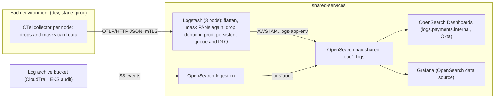

# Logging

## What it is

One central OpenSearch domain, `pay-shared-euc1-logs` in shared-services, holds the application logs of every environment and the audit trail. It runs over 3 AZs with dedicated masters, hot data nodes and UltraWarm, encrypted with KMS, VPC only, with fine-grained access control.

## How it works

### Application logs

- The collector on every node reads container logs and Kubernetes events, removes card data attributes, masks PAN-like digit runs and sends OTLP/HTTP as JSON to `central.logs_otlp_endpoint` (port 8443, client certificate required).
- Logstash writes one document per log record: `@timestamp`, `body`, `severity.text`, `resource.*` (environment, cluster, namespace, pod, service), `attributes.*`, `traceId`, `spanId`. It masks Luhn-valid 13-19 digit numbers a second time, drops debug and trace records of prod, and writes the data stream `logs-app-<env>` with its IRSA role.
- A persistent queue per pod (24 GB) holds about an hour of the busiest hour of all environments while OpenSearch is unreachable. Records without a service name and mapping rejections go to the dead letter queue. See the [Logstash runbook](../../runbooks/data/logstash.md).

### Audit trail

OpenSearch Ingestion reads the new CloudTrail and EKS audit objects of the log archive bucket (announced on SQS) and writes them to `logs-audit`. The log archive bucket stays the source of truth.

### Shards and retention

| Data stream | Shards | Rollover | Hot | UltraWarm | Deleted |
|---|---|---|---|---|---|
| `logs-app-<env>` | 3 primaries, 1 replica | 30 GB per primary shard or 1 day | 7 days | until day 30 | after day 30 |
| `logs-audit` | 3 primaries, 1 replica | 10 GB per primary shard or 1 day | 30 days | until day 365 | after day 365 |

Templates and ISM policies are in `infra/modules/opensearch-indices`; shard sizes stay between 10 and 50 GB.

### Rotation everywhere

| Where | Rule |
|---|---|
| Container logs on nodes | kubelet rotates at 50 MiB and keeps 5 files (`container_log_max_size`, `container_log_max_files` of `infra/modules/eks` and `karpenter`) |
| CloudWatch log groups | every group has a retention; `infra/tests/log-retention` fails a group without one |
| Log buckets | lifecycle expiration on every bucket with `log` in its name, enforced by the same test |
| Sentry | events kept 30 days (nightly cleanup); the file store bucket keeps objects 90 days |
| Logstash, ClickHouse of Sentry | console logs only; ClickHouse system tables keep 7 days |

## Reading logs

1. Open https://logs.payments.internal and sign in through Okta.
2. Create the index patterns `logs-app-*` and `logs-audit` once (time field `@timestamp`), then use Discover. Filter by `resource.deployment.environment.name`, `resource.k8s.namespace.name`, `resource.service.name` and `severity.text`; `traceId` is the id of the trace in Tempo.
3. Grafana shows the same logs through its OpenSearch data source, next to metrics and traces; there `traceId` opens the trace in Tempo.

| Okta group | OpenSearch role | Sees |
|---|---|---|
| admin | `all_access`, `security_manager` | everything |
| sre | `logs_sre` | application logs and audit trail |
| security | `logs_security` | application logs and audit trail |
| engineering | `logs_engineering` | application logs only, read only |

Grafana searches `logs-app-*` with its Pod Identity role, mapped to `logs_grafana`.

The admin AI agent reads `logs-app-<env>` only, through the VPC endpoint of its environment ([AI](../delivery/ai.md)).

## Looking at shards

In Dashboards, Dev Tools:

- `GET _cat/indices?v&s=index&h=health,index,pri,rep,docs.count,store.size,pri.store.size`: every backing index with health and size.
- `GET _cat/shards?v&s=store:desc&h=index,shard,prirep,state,docs,store,node,unassigned.reason`: every shard and its node.
- `GET _cat/allocation?v`: shards and disk per node.
- `GET _plugins/_ism/explain/.ds-logs-app-*`: the ISM state of each backing index.

Sizing and repair steps: [shard operations](../../runbooks/data/opensearch-shards.md); alerts: [central logs runbooks](../../runbooks/data/logs-opensearch.md).

## Where in the repo

| Path | What |
|---|---|
| `infra/modules/opensearch`, `infra/live/shared-services/eu-central-1/logs/opensearch` | The domain |
| `infra/modules/opensearch-indices` | Data streams, ISM, roles |
| `infra/modules/log-ingestion` | Logstash and exporter roles, audit pipelines |
| `infra/modules/opensearch-endpoint` | VPC endpoint of the domain in each environment |
| `deploy/platform/logstash`, `deploy/platform/opensearch-dashboards` | Pipeline and Dashboards |
| `deploy/platform/otel-collector/values-logs.yaml` | Collector log pipeline |
| `infra/tests/log-retention` | Retention test |
