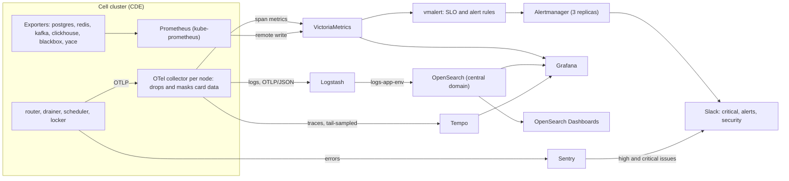

# Observability and alerting

## What it is

Metrics, logs, traces and errors from every cluster flow into one central stack in the shared-services account, outside the CDE. SLOs, alerts, dashboards and routing are code in `observability/`.

## Why

On-call needs one place to see the platform, and auditors need proof that card data never leaves the CDE in telemetry. Code makes every alert testable and every dashboard reproducible.

## How it works

### Card data stays in the CDE

The collector runs inside each cluster and cleans telemetry before it leaves: it deletes attributes such as `card_number`, `pan` and `card_expiry`, replaces digit runs that look like a PAN with `[REDACTED-PAN]` in log bodies and span attributes, and deletes identifiers that must not become labels. Sentry scrubs on three layers: SDK settings, server defaults and an organization-wide PII config.

### Logs

Application logs of every environment and the audit trail live in one OpenSearch domain in shared-services, `pay-shared-euc1-logs`. Logstash receives the collector output, masks PANs again and writes `logs-app-<env>`; OpenSearch Ingestion writes `logs-audit` from the log archive. People read logs in OpenSearch Dashboards at `logs.payments.internal` (Okta) or in Grafana. Flow, shards, retention and rotation: [Logging](logging.md).

### Errors

Sentry keeps events 30 days. Two issue alert rules on every project, `critical` (level fatal) and `high` (level error, high priority), post to the Slack channel `#payments-sentry-critical` through Sentry's Slack integration. The rules are Terraform (`infra/modules/sentry-alerts`); the integration needs a one-time Slack OAuth install in Sentry, and its workspace id goes to `central.sentry_slack_workspace_id`.

### SLOs

| SLO | Target |
|---|---|
| Authorization availability | 99.99% without a 5xx on our side (budget 4.3 min per 30 days) |
| Platform overhead latency | p99 under 150 ms for 99.9% of requests |
| Payment status read | p99 under 50 ms, 99.95% |
| Merchant webhook delivery | delivered within 60 s, 99.9% |

`observability/slo/generate.py` turns the SLO files into multi-window burn-rate rules. Each SLO has a runbook in `docs/runbooks/slo/`.

### Alerts

- Rules live in `observability/alerts/<layer>/`: application, backup-dr, compute, data, meta, network, security-pci. Every rule has a `runbook_url` to `docs/runbooks/<layer>/` and a failure mode id.
- `observability/coverage/alert_coverage.py` measures which known failure modes have an alert. It reports coverage per layer against the targets in `observability/coverage/targets.yaml`: 80% for network and compute, 90% for data, application, security-pci and backup-dr.
- Alertmanager routes `critical` to the payments critical channel, `warning` to the alerts channel, `team=security` and `severity=security` to the security channel. A `Watchdog` alert feeds a dead man's switch; a fallback webhook catches failing notifications. Inhibitions keep noise down: `RegionDown` silences the alerts it explains, and `PSPDegraded` silences the authorization and latency alerts of that PSP.
- `promtool` unit tests in `observability/tests/` prove each rule fires and stays quiet when it should.

### Dashboards

| Level | Folder | Content |
|---|---|---|
| L0 | `l0-overview` | Platform overview, SLO overview |
| L1 | `l1-services` | Payments, router, drainer, scheduler, locker, slow requests |
| L2 | `l2-platform` | Cells, Kubernetes |
| L3 | `l3-data`, `l3-edge` | Data stores, central logs (OpenSearch and Logstash), backup, DR switch; edge |
| FinOps | `finops` | Cost |

Dashboards are built by `observability/lib/build.py` and cannot be changed in the UI. Grafana access is split by organization: on-call, security and admins see everything; engineering, finance and audit see only their folders.

### Slow requests view

The L1 dashboard "Slow requests" answers three questions: which requests are slow, where, and which traces show why.

- A request is slow when it passes the threshold of its type: status reads over 50 ms; create, confirm, capture and refund over 1,150 ms total (150 ms own time plus a 1,000 ms PSP allowance); other routes over 300 ms. Thresholds live in `observability/slo/config/slow-requests.yaml`.
- The collector turns the router's server spans into slow-request metrics by route, service and cell. A table ranks groups by lost time (count x mean duration) and links to their traces.
- Tail sampling keeps every error trace and every slow trace in Tempo for 14 days. The trace table shows the last 100 slow traces and, for each, the PSP call span, so own time and PSP time can be told apart.
- The slow share is guidance (1% and 5%), not an alert; the latency SLOs page.

## Where in the repo

| Path | What |
|---|---|
| `observability/slo/`, `observability/alerts/`, `observability/alertmanager/` | SLOs, rules, routing; `alerts/data/logs.yaml` for the log domain and Logstash |
| `observability/dashboards/`, `observability/lib/` | Dashboards and their builder |
| `observability/otel/collector.yaml` | Collector pipeline, redaction, span metrics, tail sampling (tested) |
| `observability/exporters/`, `observability/coverage/` | Exporters, alert coverage |
| `deploy/platform/` (`victoria-metrics`, `vmalert`, `alertmanager`, `grafana`, `logstash`, `opensearch-dashboards`, `tempo`, `sentry`, `otel-collector`, `kube-prometheus`, `exporters`) | Deployment |
| `infra/modules/observability-storage` | Buckets: Tempo 14 days, Sentry file store 90 days, vmbackup |
| `infra/modules/opensearch`, `opensearch-indices`, `log-ingestion` | Central log domain, data streams and ISM, writers ([Logging](logging.md)) |
| `infra/modules/sentry-alerts` | Sentry issue alert rules to Slack |
| `docs/runbooks/` | One runbook per alert |
