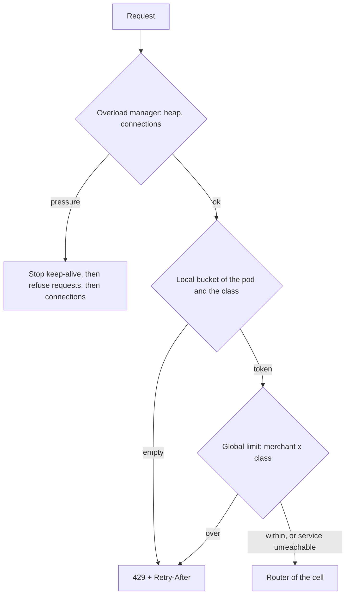

# Rate limiting and load shedding

## What it is

Three layers at the `payments-edge` Gateway decide which requests to refuse when there are too many:

1. the Envoy overload manager, which protects the proxy itself,
2. a local limit per gateway pod and request class,
3. a global limit per merchant and request class (the `ratelimit` service).

## Why

One merchant must not take the capacity of the others, and under overload the platform should refuse the cheapest work first. A list or a report can be asked again later; a payment should get through.

## How it works

### Request classes

The Lua filter sets `x-payments-class`:

| Class | Matches | Shed |
|---|---|---|
| `list` | `/payments/list`, `/refunds/list`, `/payments/filter`, `/reports` | first |
| `read` | `GET` or `HEAD` under `/payments`, `/refunds` | second |
| `payments` | everything else | last |

### The three layers

The filters run in this order: Lua (cell guard and class), local limit, global limit, then the router filter.

- Global: `envoyproxy/ratelimit` (3 to 9 pods across zones) with its own small Redis, not the cell MemoryDB. Descriptors are `merchant` (header `x-payments-rate-key`) then `request_class`. The edge sets `x-payments-rate-key` itself and drops any value sent by the client: it is a hash of the caller's credential (secret or publishable API key, else the `Authorization` token), or of the route and client IP for keyless calls such as PSP webhooks, so no caller can spend another merchant's budget. Limits come from `rateLimit` values: defaults, tiers, and overrides listed by rate key (computed when a key is issued, see the chart README). The client is fail-open with a 100 ms timeout: a limiter outage never blocks a payment.
- Local: token buckets per pod, 2,000 requests per second in total, of which at most 200 for lists and 800 for reads. Runtime keys allow shadow mode without a rollout.
- Overload manager: refreshes every 250 ms. At 85% of heap or connections the proxy stops keep-alive; at 92% heap or 95% connections it stops accepting requests; at 95% heap or 98% connections it stops accepting connections.
- Every 429 carries `Retry-After` (1 second by default).
- New limits can roll out in shadow mode (`rateLimit.shadowMode: true`) to count would-be rejections first.

### Signals

The service exports `ratelimit_service_rate_limit_*` metrics. Alerts in `observability/alerts/network/rate-limit.yaml` cover merchants at their limit (`RateLimitHitsMerchant`), shedding (`LoadSheddingActive`, `LoadSheddingReadsActive`), the limiter itself (`RateLimitServiceDown`, `RateLimitServiceErrors`) and the overload manager (`EdgeOverloadManagerActive`); runbooks are `docs/runbooks/network/load-shedding-active.md`, `edge-overload-manager-active.md` and `rate-limit-warnings.md`.

## Where in the repo

| Path | What |
|---|---|
| `deploy/charts/payments-edge/values.yaml` (`classes`, `rateLimit`, `overload`) | Classes and limits |
| `deploy/charts/payments-edge/templates/envoyfilter.yaml` | Filters and overload manager |
| `deploy/platform/ratelimit/` | Global rate limit service and its limits per merchant |
| `tests/chaos/hot-merchant.js`, `tests/load/scenarios/shedding.js` | Proof under load |
