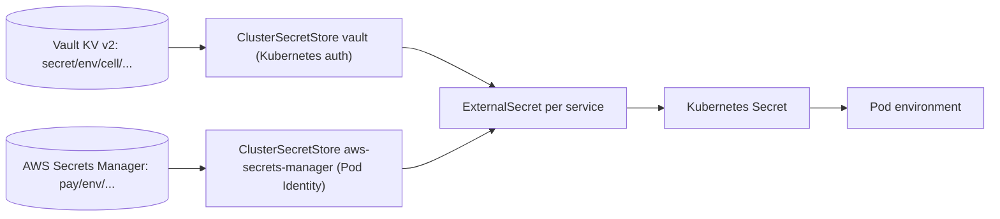

# Services, configuration and secrets

## What it is

The payment services are Hyperswitch components built from `vendor/` and packaged as Helm charts. Their settings come from Helm values; their secrets come from Vault and AWS Secrets Manager through External Secrets Operator.

## Why

Settings in Git are reviewed and versioned. Secrets never enter Git: only their names do.

## How it works

### Services

| Service | Role | CDE | Chart |
|---|---|---|---|
| router | Public API, inbound PSP webhooks, payment state in MemoryDB | yes | `router` in `payments-cell` |
| drainer | Redis stream to Aurora, in batches | yes | `drainer` in `payments-cell` |
| scheduler | Delayed jobs: PSP sync, outgoing webhooks to merchants | connected | `scheduler` in `payments-cell` |
| locker | Card vault, the only place a PAN lives; shared by all cells | yes | `locker` in `payments-locker` |
| migrations | Schema change Job before a rollout | yes | `migrations` in both umbrellas |
| control-center | Merchant dashboard | no | `control-center` |

All service charts build on the `platform-common` library: probes, PodDisruptionBudget, NetworkPolicy default deny, Istio sidecar, ServiceMonitor, restricted security context.

Rules the services follow:

- A charge is never repeated automatically. A PSP timeout is the unknown state; the scheduler settles it by sync with our reference id.
- Every mutating merchant request carries an idempotency key.
- Card fields in Rust use `Secret<T>`; card data never reaches logs, traces or metric labels.
- The locker accepts mTLS from the router identity only (Istio PeerAuthentication STRICT and AuthorizationPolicy). It encrypts every record with its KMS key alias `alias/pay-<env>-<region-short>-locker`, which only the locker role may use.

### Where settings come from

Non-secret settings are Helm values, layered per environment, region and cell (see [delivery](../foundation/kubernetes-delivery.md#values-layering)). The locker renders its `config` section as `LOCKER__<SECTION>__<KEY>` variables; the schema rejects secret keys there.

### Secrets

- Vault runs HA (3 pods, one per AZ, Raft storage, auto-unseal with a regional KMS key) in the cluster named by `vault.cell` in `config/platform.yaml`; the other clusters reach it at `https://vault.<zone>:8200`.
- A bootstrap Job initialises Vault once: it stores only the recovery keys in Secrets Manager, enables the audit device, KV v2, Raft autopilot, the policies and the Kubernetes auth roles, then revokes the root token. Keys and token are never logged.
- Each cell service has a read-only Vault policy `pay-<cell>-<service>` and a role bound to its service account.
- Paths: `secret/<env>/<cell>/{router,drainer,scheduler}/{database,redis}`, `secret/<env>/<cell>/shared/app`, `secret/<env>/<cell>/shared/locker`, `secret/<env>/locker/...`.
- The admin tools of the central cluster read `pay/shared-services/...` from Secrets Manager, including their Okta client secrets.
- Pods read secrets at start, so a rotation is: write the new version, wait for the ExternalSecret refresh, restart the deployment.
- Hourly Raft snapshots go to a locked bucket replicated to both recovery regions. Break-glass access is described in `deploy/platform/vault/README.md`.

## Where in the repo

| Path | What |
|---|---|
| `vendor/hyperswitch`, `vendor/card-vault`, `docker/` | Upstream code and the service images |
| `deploy/charts/` | Service charts and umbrellas |
| `deploy/envs/<env>/` | Values per environment, region and cell |
| `deploy/platform/vault`, `deploy/platform/external-secrets` | Vault and External Secrets |
| `infra/modules/vault-platform`, `central-secrets`, `secrets-replica`, `iam-workloads` | AWS side: unseal key, roles, secret shells, replicas |
