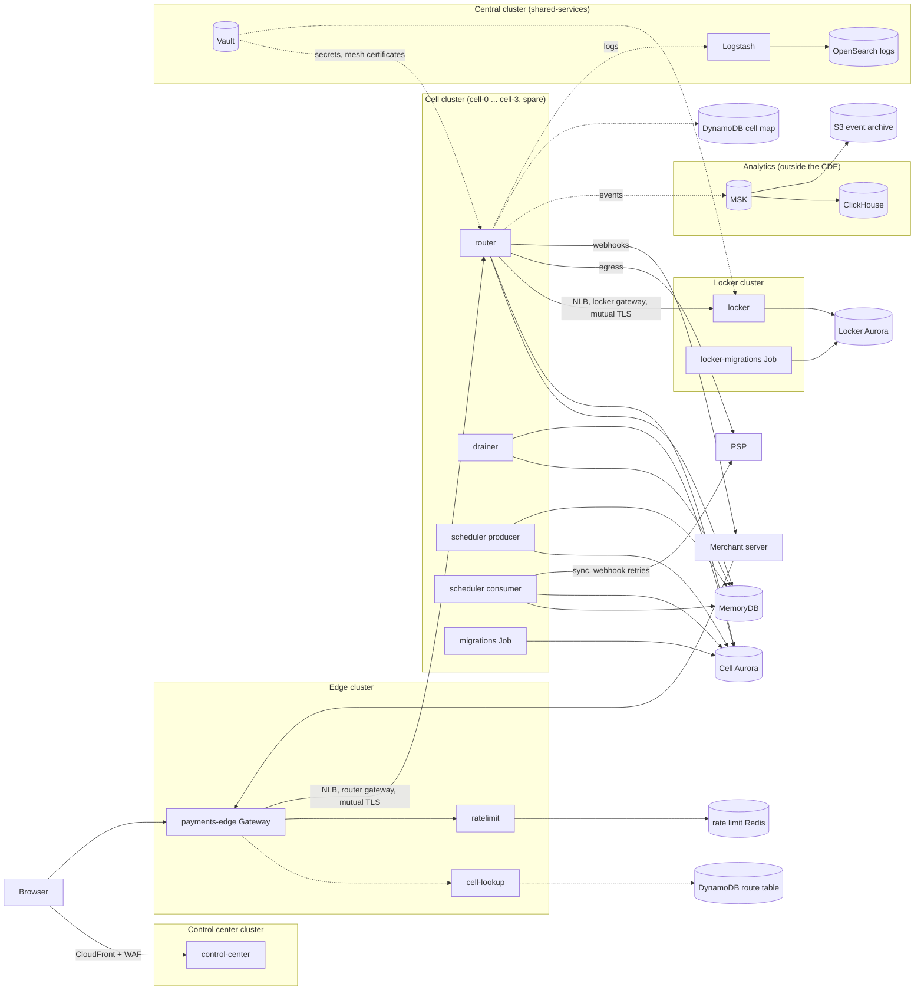

# Services and stores

What each service, database and store of the platform is responsible for. Start with the map and the table, then open the page of the service you need. Terms follow [the glossary](../../glossary.md); the request path as infrastructure is in the [architecture overview](../README.md).

## Map

## Services

| Service | Purpose | Owner team | CDE | Scales |
|---|---|---|---|---|
| [payments-edge](payments-edge.md) | TLS, request class, rate limits and the cell choice for every API call | `platform` | connected | Gateway proxy 3 to 12 pods on CPU 70%; ratelimit 3 to 9 on CPU 60% |
| [router](router.md) | Public API of a cell: payments, refunds, PSP calls, incoming webhooks, first webhook delivery | `payments-core` | yes | HPA 20 to 90 pods on CPU 70%, canary rollout |
| [drainer](drainer.md) | Moves payment state from the MemoryDB streams to the cell Aurora (write-behind) | `payments-core` | yes | KEDA 3 to 6 pods on stream backlog |
| [scheduler](scheduler.md) | Producer queues due tasks; consumer runs PSP sync and webhook retries | `payments-core` | connected | producer 2 pods fixed, one active; consumer KEDA 3 to 12 |
| [locker](locker.md) | Card vault, the only place a PAN lives; shared by all cells | `payments-core` | yes | HPA 5 to 24 pods on CPU 70%, canary rollout |
| [control-center](control-center.md) | Merchant dashboard; the browser calls the router API itself | `platform` | no | HPA 3 to 6 pods on CPU 70% |
| [migrations](migrations.md) | Snapshot, then expand-only schema change before each rollout | `payments-core` | yes | one Job per rollout |
| [analytics consumers](analytics-consumers.md) | MSK, ClickHouse and the S3 sink, fed one way from the cells | `data` | no | MSK 3 brokers, ClickHouse 2 x 2 in prod |

## Stores

| Store | Holds | Written by | Read by | Page |
|---|---|---|---|---|
| MemoryDB (per cell) | hot payment state, drainer and scheduler streams | router, scheduler | router, drainer, scheduler | [MemoryDB](data-stores.md#memorydb) |
| Cell Aurora (per cell) | payments, merchants, keys, connector accounts, `process_tracker` | drainer, router, scheduler, migrations | router, scheduler | [Cell Aurora](data-stores.md#cell-aurora) |
| Locker Aurora | encrypted cards | locker | locker | [Locker Aurora](data-stores.md#locker-aurora) |
| DynamoDB cell map | `merchant_id -> cell` | `scripts/cells/migrate-merchant.py` | router, scheduler (IAM read) | [DynamoDB cell map](data-stores.md#dynamodb-cell-map) |
| S3 buckets | backups, event archive, Vault snapshots, Terraform state | AWS Backup, MSK sink, CronJobs, CI | restores | [S3 buckets](data-stores.md#s3-buckets) |
| MSK | payment events, 7 days | router, scheduler | ClickHouse, S3 sink | [MSK](data-stores.md#msk) |
| ClickHouse | analytics tables | its Kafka engine | analytics queries | [ClickHouse](data-stores.md#clickhouse) |
| OpenSearch (central, shared-services) | application logs of every environment, audit trail | Logstash, OpenSearch Ingestion | operators, Grafana, the admin AI agent | [OpenSearch](data-stores.md#opensearch), [Logging](../runtime/logging.md) |
| Vault (central, shared-services) | application secrets, mesh PKI | operators | External Secrets | [Vault](data-stores.md#vault) |
| Secrets Manager | proxy logins, rate limit Redis, recovery keys, admin tool secrets | operators | RDS Proxy, External Secrets | [Secrets Manager](data-stores.md#secrets-manager) |

## Pages

- [Walkthrough: one card payment](card-payment-walkthrough.md), from the merchant's call to the webhook.
- [Data stores](data-stores.md): consistency, retention, backup, keys and sizes of every store.
- One page per service, linked in the table above. Each page has the same sections: what it does, requests and calls, data, configuration and secrets, scaling, failure modes, metrics and alerts, where in the repo.

## Common to every service

- Charts build on the `platform-common` library: probes, PodDisruptionBudget, a default-deny NetworkPolicy, the Istio sidecar, a ServiceMonitor, a restricted security context.
- Images are built once per merge and deployed by digest from `deploy/envs/<env>/images.yaml`.
- Secrets come from Vault or Secrets Manager through External Secrets and are read at pod start; see [services, configuration and secrets](../runtime/services-secrets.md).
- Alerts carry `team`, `service` and `runbook_url` labels; the runbooks are in `docs/runbooks/`.
