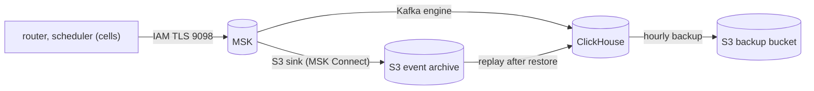

# analytics consumers

The services that take payment events off the payment path and make them queryable: MSK as the event bus, ClickHouse as the analytics database, and the MSK S3 sink as the event archive. Owner team: `data` (tag `team`), on call as `data-platform` (alert label). CDE: no; analytics is outside the CDE.

## What it does and why it exists

Merchant reports, dashboards and the authorization rate per PSP need queries over millions of payments. Running them on the cell Aurora would compete with live payments and would bring the analytics tools into the CDE. Instead, events flow one way out of the cells into a separate analytics stack:

- **MSK** keeps the events for 7 days and decouples producers from consumers.
- **ClickHouse** reads the topics with its Kafka engine and stores them in replicated tables for queries.
- **The S3 sink** writes every event to the event archive (prefix `events/`), which is the long-term copy and the source for rebuilding Kafka or ClickHouse.

Logs are not analytics: they go to the central OpenSearch domain of shared-services ([Logging](../runtime/logging.md)).

Nothing card-related flows here: events carry tokens and masked values only, and telemetry passes the OpenTelemetry collector, which removes card fields first.

Producers: the router and scheduler roles hold the MSK producer policy (`infra/modules/iam-workloads`, `kafka_producers`). The router publishes to MSK when `global.hyperswitch.events.kafka` is `true` in the cell layer; with the default `false` it writes its events to the log stream (`ROUTER__EVENTS__SOURCE=logs`). `deploy/charts/platform-common/templates/hyperswitch/_defaults.tpl` records why the default is off: the upstream Kafka client sets only `bootstrap.servers`, without TLS or IAM, which MSK requires.

## Requests it takes and calls it makes

| Component | In | Out |
|---|---|---|
| MSK | producers on 9098 (IAM, `SASL_SSL`, `OAUTHBEARER`) from the cell and analytics node security groups only | n/a |
| ClickHouse | queries from the analytics cluster | MSK 9098 (Kafka engine); S3 for backups and archive reads |
| S3 sink | n/a | MSK (read), event archive bucket (write) |

## Data it reads and writes

| Component | Reads | Writes |
|---|---|---|
| ClickHouse | MSK topics; on restore, the event archive after the last backup | analytics tables; backups under the backup bucket prefix |
| S3 sink | MSK topics | `pay-<env>-euc1-event-archive`, prefix `events/` |

Topics watched by the Kafka exporter: `payment-events`, `payment-dlq`, `audit-events` (`observability/exporters/kafka.yaml`). The router's own topic names are `<topicPrefix>-<name>-events` (`platform-common`). Store details are on [data stores](data-stores.md#msk).

## Configuration and secrets

| Item | Where |
|---|---|
| MSK cluster, retention 168 h, IAM only | `infra/modules/msk`, `infra/live/<env>/eu-central-1/analytics/msk` |
| Who may reach the brokers | `infra/live/<env>/eu-central-1/analytics/msk-access` |
| Producer client settings (bootstrap, port 9098, `SASL_SSL`, `OAUTHBEARER`) | output `client_settings` of `infra/modules/msk` |
| S3 sink role | `<msk name>-s3-sink`, trusted by `kafkaconnect.amazonaws.com` |
| ClickHouse backup role | Pod Identity role `<name>-backup` (`infra/modules/clickhouse`): write and read its backup prefix, read the archive prefix, no delete |
| ClickHouse metrics exporter | `deploy/argocd/templates/addons/exporters/clickhouse.yaml`, `observability/exporters/clickhouse.yaml` |

MSK uses IAM authentication, so no Kafka password exists. No analytics component reads Vault.

## Scaling and resources

| Component | prod | dev |
|---|---|---|
| MSK | 3 brokers `kafka.m7g.large`, 1,000 GB each | 3 brokers `kafka.m7g.large`, 100 GB |
| ClickHouse | 2 shards x 2 replicas on `r7g.2xlarge`, plus 3 Keeper nodes | 1 shard x 1 replica |
| Analytics cluster node caps (Karpenter) | `stateful` 48 vCPU, `workers` 32 vCPU | `stateful` 16, `workers` 8 |

Stage runs the dev sizes outside a `prod-size` window and the prod sizes inside one; its MSK volumes are 500 GB. Sources: the `analytics` block of `infra/live/<env>/env.hcl` and `config/environments/<env>.yaml`.

ClickHouse runs in the `stateful` node pool of the analytics cluster; in stage and dev that pool may use Spot.

## Failure modes and what the user sees

| Failure | Effect | User sees |
|---|---|---|
| MSK unavailable | producers buffer and retry until `delivery.timeout.ms` (`kafka-producer` policy); payments are unaffected | dashboards and reports fall behind |
| ClickHouse consumer behind | lag grows; `KafkaConsumerLagHigh` above 100,000 messages | reports show recent payments late |
| ClickHouse lost | restore the last hourly backup, replay the archive (RPO 15 minutes, RTO 4 hours) | reports unavailable until the restore ends |

The payment path never depends on analytics: an analytics outage never fails a payment.

## Metrics and alerts

| Alert | Severity | Runbook |
|---|---|---|
| `KafkaConsumerLagHigh`, `KafkaUnderReplicatedPartitions`, `KafkaBrokerDiskHigh` | warning | [data warnings](../../runbooks/data/warnings.md#kafka-consumer-lag-high) |
| `ClickHouseReplicationLag`, `ClickHouseMergeBacklog`, `ClickHouseDiskLow` | warning | [data warnings](../../runbooks/data/warnings.md#click-house-replication-lag) |

CloudWatch alarms from `infra/modules/clickhouse`: no successful backup for the allowed number of intervals, restore above 80% of the RTO, archive catch-up lag above the RPO.

## Where in the repo

| Path | What |
|---|---|
| `infra/live/<env>/eu-central-1/analytics/` | Analytics cluster, MSK, ClickHouse and their access stacks |
| `infra/modules/msk`, `clickhouse` | Modules |
| `infra/live/<env>/eu-central-1/s3-event-archive` | Event archive bucket |
| `observability/alerts/data/kafka.yaml`, `stores.yaml` | Alerts |
| `observability/exporters/kafka.yaml`, `clickhouse.yaml` | Exporters |
