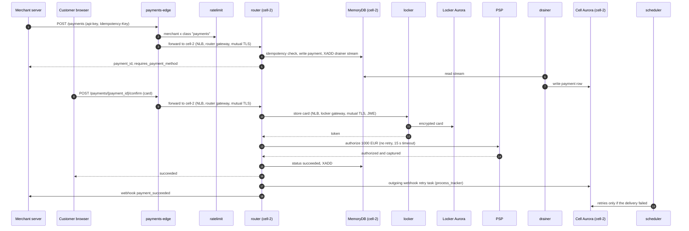

# Walkthrough: one card payment

One card payment of 10.00 EUR with automatic capture, from the merchant's first call to the webhook that tells the merchant it succeeded. Every step names the service and the store it touches. The business view of the same payment is in [Payments in 10 minutes](../domain/README.md#one-card-payment-through-the-platform); this page is the platform view.

The merchant lives in `cell-2`. Prod values are used throughout.

## 1. The merchant creates the payment

The merchant's server sends `POST /payments` with `{"amount": 1000, "currency": "EUR", "capture_method": "automatic"}`, its secret API key in the `api-key` header and an `Idempotency-Key`.

1. **Route 53** answers `api.payments.example.com` with the working region (Frankfurt) while its health check on `/health/deep` passes.
2. **Regional NLB** passes the TCP connection to the [payments-edge](payments-edge.md) proxy in the edge cluster.
3. **payments-edge** terminates TLS on 443, then:
   - removes any client-sent `x-payments-rate-key` and `x-payments-class`, and sets the rate key to a hash of the API key;
   - checks that the request's `x-payments-cell: cell-2` names a cell in `routing.cells`, else answers `503` (the [cell-lookup](payments-edge.md#cell-lookup) service is specified to set this header from the API key instead of the caller);
   - sets the request class `payments`;
   - takes a token from the pod's local bucket;
   - asks **ratelimit** (gRPC 8081) whether the merchant is within its `payments` limit; ratelimit counts in its **rate limit Redis**.
4. **payments-edge** forwards the request to `router.payments.svc.cell-2.<cluster_domain>`: the internal NLB of `cell-2` (`cell-endpoint`) in front of the router gateway of the cell on port 8443. The edge presents its `edge-client` certificate; the gateway admits only that identity and passes the request to the [router](router.md) on port 8080 inside Istio mTLS.
5. **router** checks the API key: it hashes it with `api_keys_hash_key` and finds the key of this merchant in the **cell Aurora** (through RDS Proxy) or its cache.
6. **router** looks up the idempotency key in **MemoryDB**. It is new, so it goes on.
7. **router** writes the payment intent to **MemoryDB** and appends it to one of the 64 `{shard_N}_drainer_stream` streams. MemoryDB acknowledges after its multi-AZ log has the write.
8. **router** answers `200` with a `payment_id` and status `requires_payment_method`.
9. **drainer** reads the stream entry within a loop of 500 ms, writes the row to the **cell Aurora** and trims the entry from the stream. The [drain lag](../../glossary.md#data-path) SLO is p99 under 5 s.

## 2. The customer confirms with a card

The customer types the card into the payment page. The page is the Hyperswitch payment SDK, so the card goes from the browser to the platform, never through the merchant's server.

1. The browser sends `POST /payments/{payment_id}/confirm` with the publishable key. It passes the same **edge** steps as above (`x-payments-cell: cell-2`, class `payments`, both limits).
2. **router** of `cell-2` reads the payment from **MemoryDB**.
3. **router** sends the card to the [locker](locker.md) in the locker cluster: `locker.payments.svc.locker.<cluster_domain>:3001`, through the internal NLB of `locker-endpoint` to the locker gateway, with mutual TLS (`router-client` certificate) and a JWE-encrypted payload inside. The locker gateway admits only the router identity.
4. **locker** encrypts the card with the tenant's master key (itself decrypted at start with KMS key `alias/pay-prod-euc1-locker`) and writes it to the **locker Aurora**. It returns a token. From here on only the token moves inside the platform; the CVV is passed through for this one authorization and never stored.
5. **router** chooses a PSP: it reads the profile's routing algorithm and the merchant connector account (PSP credentials, stored encrypted by the router; the data keys are wrapped by the cell key `alias/pay-prod-euc1-cell-2`) from the **cell Aurora** or its cache.

## 3. The router calls the PSP

1. **router** sends the authorization with our reference id through the egress path: the Istio mesh exit, the transit gateway, **Network Firewall** (only PSP domains are allowed) and **NAT** with static Elastic IPs that the PSP allowlists.
2. The PSP passes it through the acquirer and the card network to the issuer, which approves. Because capture is automatic, the PSP answers "captured".
3. **router** writes the new status `succeeded` and the payment attempt to **MemoryDB** and the drainer stream, and answers the browser with `succeeded`.
4. **drainer** writes the updated payment and the attempt to the **cell Aurora**.

**If the PSP does not answer within 15 s**, the router does not send the charge again (`psp-authorize` `max_attempts: 0` in `policy/resilience/policy.yaml`). The payment stays `processing`, which the platform calls the [unknown state](../domain/payment-lifecycle.md#why-a-charge-is-never-retried), and the router inserts a `PAYMENTS_SYNC` task into `process_tracker` in the **cell Aurora**. The [scheduler](scheduler.md) producer puts it on `SCHEDULER_STREAM` in **MemoryDB**, and a consumer asks the PSP for the status by our reference id (5 s timeout, up to 4 retries with backoff) and writes the result back. The final status then reaches the merchant as a webhook, exactly as below.

## 4. The merchant gets the webhook

1. **router** creates the event `payment_succeeded` with an `event_id`, inserts an `OutgoingWebhookRetryWorkflow` task into `process_tracker` in the **cell Aurora**, and sends the first delivery itself, in the background, to the webhook URL of the merchant's profile. The call leaves through the same egress path as the PSP call.
2. The merchant's endpoint answers `200`. The task is marked done; the scheduler has nothing to do.
3. If the endpoint fails, the **scheduler** consumer retries on the schedule 1 min, 5 min, 30 min, 2 h, 12 h (20% jitter, 10 s timeout per call), then parks the event in the dead-letter queue (`DlqNotEmpty`). The merchant ignores repeats by `event_id`. SLO: 99.9% of webhooks delivered within 60 s.

## 5. After the payment

- **Telemetry.** Router, drainer and scheduler send traces and metrics to the OpenTelemetry collector on port 4317, which removes card fields before anything leaves the cell for the central observability cluster.
- **Analytics.** With `global.hyperswitch.events.kafka` on, the router publishes the payment events to **MSK**; **ClickHouse** reads them for reports, and the **S3 sink** copies them to the **event archive**. See [analytics consumers](analytics-consumers.md).
- **Backups.** The payment row in the **cell Aurora** is covered by point-in-time recovery (35 days) and hourly snapshots copied to us-east-1, and the Aurora Global Database secondary of the us-east-1 hot standby has it within seconds; the card in the **locker Aurora** the same way. See [data stores](data-stores.md).

## Everything this payment touched

| Step | Services | Stores |
|---|---|---|
| Create | payments-edge, ratelimit, router, drainer | rate limit Redis, MemoryDB, cell Aurora |
| Confirm | payments-edge, ratelimit, router, locker | MemoryDB, locker Aurora, cell Aurora, KMS (cell and locker keys) |
| PSP call | router | MemoryDB, cell Aurora (via drainer) |
| Webhook | router, scheduler (only on failure) | cell Aurora (`process_tracker`) |
| Afterwards | OpenTelemetry collector, MSK consumers | MSK, ClickHouse, S3 event archive, backups |
