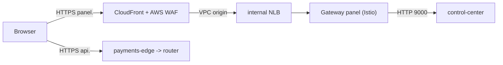

# control-center

The merchant dashboard: the Hyperswitch control center (TypeScript, image `docker/control-center/Dockerfile`). Owner team: `platform` (team tag of its edge, `infra/live/_envcommon/edge/panel-edge.hcl`). CDE: no.

## What it does and why it exists

Merchants use the dashboard to see payments, refunds and disputes, manage API keys, set up PSP accounts ([merchant connector accounts](../domain/platform-concepts.md#merchant-connector-accounts)) and routing rules. The control center is a thin web server that serves the dashboard to the browser. The browser then calls the router API directly and signs in with the router's user JWT, so the control center itself holds no secret and sees no card data. That is why it can run outside the CDE.

It runs in its own cluster `pay-<env>-<region-short>-control-center`, namespace `control-center` (`deploy/argocd/templates/applicationset-shared.yaml`).

## Requests it takes and calls it makes

| Direction | Peer | Port and protocol | Purpose |
|---|---|---|---|
| in | Gateway `panel` (HTTPRoute `panel`) | 443 HTTPS at the Gateway, 9000 HTTP to the pod | dashboard assets and config |
| out | none at runtime | n/a | the browser calls `api.<zone>` itself |

The panel Gateway's certificate comes from `ClusterIssuer` `acme-dns01` (public ACME with DNS-01), so CloudFront can verify the origin. The origin NLB admits only the CloudFront VPC origin, so AWS WAF cannot be bypassed (see [edge](../runtime/edge.md#panel-and-sdk)).

## Data it reads and writes

None. The NetworkPolicy opens no data ports (`dataPorts: []`). All merchant data is read and written by the browser through the router API of the merchant's cell, under the router's authorization.

## Configuration and secrets

Overrides of the upstream dashboard `config.toml` as environment variables (`container.env`):

| Variable | Default | prod |
|---|---|---|
| `default__endpoints__api_url` | `https://api.invalid` | `https://api.payments.example.com` |
| `default__endpoints__sdk_url` | empty | empty |
| `default__features__email` | `false` | `false` |
| `default__features__totp` | `true` | `true` |
| `default__features__is_live_mode` | `false` | `true` |
| `default__features__test_live_toggle` | `false` | `false` |

Per environment: `deploy/envs/<env>/<region>/control-center/values.yaml` (hostname, API URL, live mode). The image digest comes from `deploy/envs/<env>/images.yaml` through the ApplicationSet. No Vault path. Secrets Manager has a `pay-<env>-<region-short>-control-center` secret (`infra/live/_envcommon/data/secrets.hcl`); the chart reads nothing from it (`envFromSecrets: []`).

## Scaling and resources

- HPA from 3 to 6 pods on CPU 70%.
- 250m CPU and 256 MiB per pod, memory limit 256 MiB.
- `workers` node pool. Rolling update with `maxUnavailable: 0`; PDB `maxUnavailable: 10%`.

## Failure modes and what the user sees

| Failure | Merchant sees |
|---|---|
| Control center pods down | the dashboard does not load; the payments API and payments are unaffected |
| CloudFront or WAF problem | the dashboard does not load or is blocked; `CloudFront5xxHigh` or `WafBlockedRequestsHigh` fires |
| Router of the merchant's cell down | the dashboard loads but shows errors for that merchant's data |

## Metrics and alerts

The chart creates no ServiceMonitor (`serviceMonitor.enabled: false`), so the pods are not scraped. Signals come from the edge in front of it:

| Alert | Severity | Runbook |
|---|---|---|
| `CloudFront5xxHigh` | warning | [cloud-front5xx-high](../../runbooks/network/warnings.md#cloud-front5xx-high) |
| `WafBlockedRequestsHigh` | warning | [waf-blocked-requests-high](../../runbooks/network/warnings.md#waf-blocked-requests-high) |

## Where in the repo

| Path | What |
|---|---|
| `docker/control-center/Dockerfile` | Image |
| `deploy/charts/control-center/` | Chart, including `templates/gateway/` (Gateway, HTTPRoute, Certificate) |
| `deploy/envs/<env>/<region>/control-center/values.yaml` | Hostname and API URL per environment |
| `infra/modules/panel-edge`, `infra/modules/waf-edge` | CloudFront, VPC origin, WAF |
