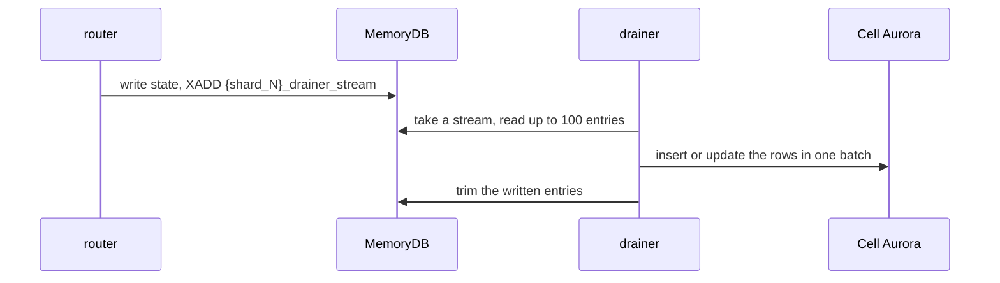

# drainer

The write-behind worker of one cell: the Hyperswitch drainer built from `vendor/hyperswitch/crates/drainer`. Owner team: `payments-core`. CDE: yes.

## What it does and why it exists

The [router](router.md) answers the merchant as soon as MemoryDB has the payment state, and appends each change to a Redis stream. The drainer reads those streams and writes the rows to the cell Aurora in batches. This is [write-behind](../../glossary.md#data-path): the hot path never waits for PostgreSQL, and PostgreSQL still becomes the system of record a few seconds later.

The time from the stream write to the row in PostgreSQL is the drain lag. SLO: p99 under 5 s.

## Requests it takes and calls it makes

| Direction | Peer | Port and protocol | Purpose |
|---|---|---|---|
| in | kubelet, Prometheus | 8080 HTTP | `/health`, `/health/ready`, `/metrics` |
| out | MemoryDB of the cell | 6379 TLS, ACL user `<cell>-drainer` | read and trim stream entries |
| out | Cell Aurora through RDS Proxy | 5432 TLS `verify-full`, login `hs_app` | batch writes |
| out | OpenTelemetry collector | 4317 gRPC | traces and metrics |

It takes no business requests: the Istio AuthorizationPolicy is disabled because no service calls it.

## Data it reads and writes

| Store | Reads | Writes |
|---|---|---|
| [MemoryDB](data-stores.md#memorydb) | 64 streams `{shard_0}_drainer_stream` ... `{shard_63}_drainer_stream` (`DRAINER_STREAM`, `numPartitions: 64`) | `XTRIM` of written entries; the `_in_use` marker of the stream it holds |
| [Cell Aurora](data-stores.md#cell-aurora) | nothing beyond what an upsert needs | payment intents, attempts, refunds and the other KV-mode tables |

A new router may write stream fields that only a new drainer understands, so the drainer is rolled out first (the router is sync wave 1).

## Configuration and secrets

| Setting | Value | Where |
|---|---|---|
| Config file | `/app/config/deployments/drainer.toml` | `hyperswitch.configFile` |
| Read size and loop | 100 entries every 500 ms; shutdown interval 1,000 ms | `DRAINER__DRAINER__*` in `deploy/charts/drainer/values.yaml` |
| Database pool | 4 per pod | `hyperswitch.poolSize` |
| Stream name, partitions | `DRAINER_STREAM`, 64 | `global.hyperswitch.drainer` (cell-wide) |
| MemoryDB address for KEDA | `REDIS_ADDRESS` | `deploy/envs/<env>/<region>/<cell>/values.yaml` |

Secrets through ExternalSecret `drainer-vault`:

| Variable | Vault path | Field |
|---|---|---|
| `DRAINER__MASTER_DATABASE__PASSWORD` | `secret/<env>/<cell>/drainer/database` | `password` |
| `DRAINER__REDIS__PRIMARY_PASSWORD` | `secret/<env>/<cell>/drainer/redis` | `password` |

The drainer's Vault policy `pay-<env>-<cell>-drainer` reads only `drainer/*`; it cannot read the shared application keys. Sentry DSN: `<prefix>/<env>/sentry/drainer-dsn` in Secrets Manager when set.

## Scaling and resources

- KEDA `ScaledObject` from 3 to 6 pods with a `redis-streams` trigger on `{shard_0}_drainer_stream` (consumer group `drainer_group`, threshold 10,000 pending entries); the chart comment expects the region layer to add one trigger per shard stream.
- 500m CPU and 512 MiB per pod (memory limit 512 MiB). The chart's planning figure is 1,500 rows per second per pod.
- Runs on the `workers` node pool. Rolling update with `maxUnavailable: 0`; PDB `maxUnavailable: 10%`.
- Grace period 60 s with a 15 s pre-stop, so a pod finishes its current batch before it stops.

## Failure modes and what the user sees

| Failure | Effect | Merchant sees |
|---|---|---|
| Drainer slow or down | streams grow; rows reach Aurora late | nothing at first: the router answers from MemoryDB. Lists and reports, which read PostgreSQL, show recent payments late |
| Aurora writer down | batches fail and the entries stay in the stream; they are written after failover | as above |
| Streams fill MemoryDB | `noeviction` makes router writes fail | `5xx` on payment writes in that cell |
| A batch cannot be written | entries stay pending; the alert on stream length fires | as above |

## Metrics and alerts

Metrics: `drain_lag_seconds`, `redis_stream_length` (by stream), the standard pod metrics.

| Alert | Condition | Severity | Runbook |
|---|---|---|---|
| `DrainLagHigh` | `drain_lag_seconds` above 5 s | critical | [drain-lag-high](../../runbooks/application/drain-lag-high.md) |
| `RedisStreamBacklog` | a stream above 50,000 entries | critical | [redis-stream-backlog](../../runbooks/application/redis-stream-backlog.md) |
| `MemoryDbMemoryCritical` | MemoryDB memory above 85% | critical | [memory-db-memory-critical](../../runbooks/data/memory-db-memory-critical.md) |
| `AuroraWriterUnavailable` | writer down | critical | [aurora-writer-unavailable](../../runbooks/data/aurora-writer-unavailable.md) |

## Where in the repo

| Path | What |
|---|---|
| `vendor/hyperswitch/crates/drainer` | Upstream drainer code |
| `docker/drainer/Dockerfile` | Image |
| `deploy/charts/drainer/` | Chart (Deployment, KEDA ScaledObject, NetworkPolicy) |
| `deploy/charts/payments-cell/` | Umbrella per cell |
| `observability/alerts/application/components.yaml` | Drain alerts |
