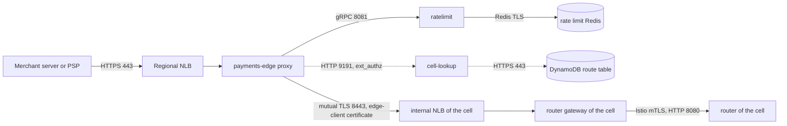

# payments-edge

The front door of the payments API: the `payments-edge` Gateway with its Envoy proxies, the global rate limit service `ratelimit`, and the cell lookup service `cell-lookup`. Owner team: `platform` (alert label `team: platform`). PCI scope: `connected` (tags of the edge stacks in `infra/live/_envcommon/edge/`). The proxy terminates TLS and re-encrypts to the router gateway of each cell with mutual TLS; it stores no card data.

## What it does and why it exists

Every merchant call and every PSP webhook enters here. The edge exists so that the routers only see traffic that is authentic in shape, within limits and addressed to a known cell.

- **Gateway** (`deploy/charts/payments-edge`): a Gateway API `Gateway` of class `istio`. It terminates TLS, removes headers a client must not set, gives each request a [request class](../domain/platform-concepts.md#the-edge-and-request-classes), applies the limits and forwards the request to the router of one cell.
- **ratelimit** (`deploy/platform/ratelimit`): the global limit per merchant and request class, so one merchant cannot spend the capacity of the others.
- **cell-lookup** (`services/cell-lookup`): picks the cell from the caller's credential, so the edge does not have to trust a header sent by the client. Today the caller sends `x-payments-cell` (`routing.cellHeader`) and the cell guard checks it against `routing.cells`; the `ext_authz` filter that lets cell-lookup set the header is specified in `services/cell-lookup/INTEGRATION.md` section 7. The dashed lines below are that path.

The edge runs in its own cluster `pay-<env>-<region-short>-edge`, namespace `payments-edge` (`deploy/argocd/templates/applicationset-shared.yaml`). Each cell runs in another cluster, so the edge reaches it across clusters: an internal NLB per cell (`infra/modules/cell-endpoint`) in front of the mutual-TLS router gateway of the cell.

## Requests it takes and calls it makes

| Direction | Peer | Port and protocol | Purpose |
|---|---|---|---|
| in | merchant servers, PSPs | 443 HTTPS, TLS 1.2 or newer, hosts from `gateway.hosts` | the payments API `api.<zone>` |
| out | `ratelimit.ratelimit.svc` | 8081 gRPC, mTLS | global limit, 100 ms timeout, fail-open |
| out | `cell-lookup.payments-edge.svc` | 9191 HTTP (`ext_authz`), mTLS | cell for the request, per `services/cell-lookup/INTEGRATION.md` section 7 |
| out | router gateway of each cell, `router.payments.svc.<cell>.<cluster_domain>` (`routing.cells`, `routing.cellPort`) | 8443, mutual TLS with the `edge-client` certificate (DestinationRule `cell-<name>`) | the request itself, 20 s route timeout; the gateway admits only the edge SPIFFE ID and forwards to the router on 8080 |

### Filter order in the proxy

1. **Header trust** (`payments-edge.header-trust`): drops any client-sent `x-payments-rate-key` and `x-payments-class` and sets the rate key from the caller's credential. The rate key is a hash, never the credential.
2. **Cell guard** (Lua): returns 503 when `x-payments-cell` is missing or names a cell that is not in `routing.cells`; sets `x-payments-class`.
3. **Local limit**: token buckets per pod.
4. **Global limit**: a call to `ratelimit`.
5. **Router**: one `HTTPRoute` per cell matches `x-payments-cell` and sends the request to the router gateway of that cell.

The classes, buckets and overload thresholds are explained in [rate limiting and load shedding](../runtime/rate-limiting.md).

### ratelimit

`envoyproxy/ratelimit`, pinned by tag `62db6639` and digest. Domain `payments-edge`, descriptors `merchant` (the edge-set rate key) then `request_class`. It answers on gRPC 8081, serves HTTP on 8080 and metrics on 9090. Its NetworkPolicy admits only the proxy pods of Gateway `payments-edge`, and its AuthorizationPolicy admits only the principal `cluster.local/ns/payments-edge/sa/payments-edge-istio`.

### cell-lookup

A Rust service with two sub-commands (`services/cell-lookup/README.md`):

- `serve` runs in the edge cluster as the Envoy `ext_authz` server: listener `0.0.0.0:9191`, admin listener `0.0.0.0:9090` (`/healthz`, `/readyz`, `/metrics`).
- `sync` runs in every cell cluster and copies that cell's API keys and merchants into the route table.

How `serve` resolves a request:

1. Read the credential in the order the rate key uses: `api-key` header, then `Authorization` (API key fields, SDK authorization, `Bearer` JWT).
2. Hash the key with every cell's `api_keys_hash_key` (BLAKE3 keyed hash, as Hyperswitch does) and look the hash up in the route table.
3. When there is no usable credential, find the merchant id in the path (PSP webhooks, redirects, payment links), in `x-merchant-id`, or in the JWT claim, and use that merchant's cell.
4. Answer `200` with `x-payments-cell`, or `403` (`CL_01`, unknown or expired credential), `404` (`CL_02`, nothing names a merchant), `503` (`CL_03`, table unreadable and no cache answer, with `retry-after: 1`).

The whole route table is loaded into memory every 30 s (`CELL_LOOKUP_REFRESH_SECONDS`); keys missing from the snapshot are read with `BatchGetItem` and cached 60 s (hit) or 10 s (miss). The `ext_authz` wiring, its chart, table and IAM roles are specified in `services/cell-lookup/INTEGRATION.md`.

## Data it reads and writes

| Component | Reads | Writes |
|---|---|---|
| Gateway | nothing persistent | nothing |
| ratelimit | counters in the [rate limit Redis](data-stores.md#rate-limit-redis) | the same counters |
| cell-lookup `serve` | route table `pay-<env>-euc1-cell-lookup` (`Scan`, `BatchGetItem`) | nothing |
| cell-lookup `sync` | the cell Aurora, read-only login `cell_lookup_ro` with column grants on `api_keys` and `merchant_account` | items of its own cell in the route table |

No card data is stored anywhere at the edge.

## Configuration and secrets

| Item | Where |
|---|---|
| Hosts, cells and router hosts per region | `deploy/envs/<env>/<region>/edge/values.yaml` |
| Classes, local limits, global limit client, overload manager | `deploy/charts/payments-edge/values.yaml` (`classes`, `rateLimit`, `overload`) |
| TLS certificate | cert-manager `Certificate` from `ClusterIssuer` `payments-ca`, 90 days, renewed 30 days before expiry, secret `payments-edge-tls` |
| Client certificate to the cells | `edgeClient` in `deploy/charts/payments-edge/values.yaml`: Vault mesh PKI `pki-mesh`, role `edge-client`, URI SAN `spiffe://payments-platform/ns/payments-edge/sa/edge`, 72 h, refreshed every 24 h, secret `edge-client-tls`; Vault login on the jwt mount of the edge cluster |
| Merchant limits, tiers, overrides | `deploy/platform/ratelimit/values.yaml` (`rateLimit.defaults`, `tiers`, `overrides`) |
| Rate limit Redis endpoint | `deploy/platform/ratelimit/envs/<env>/<region>.yaml` |
| Rate limit Redis password | Secrets Manager `pay/<env>/ratelimit/redis`, JSON key `auth`, through ExternalSecret `ratelimit-redis` |
| cell-lookup hash keys | one `CELL_LOOKUP_HASH_KEY_<CELL>` per cell, from the cell's `api_keys_hash_key` in Vault `secret/<env>/<cell>/shared/app` |
| cell-lookup sync database password | Vault `secret/<env>/<cell>/cell-lookup/database`, field `password` |

Default merchant limits: `payments` 100, `read` 200, `list` 20 requests per second; tier `enterprise` 400/800/60; tier `hot` 1,600/1,600/100.

## Scaling and resources

| Component | Replicas | Scales on | Requests |
|---|---|---|---|
| Gateway proxy | 3 to 12 | CPU 70% | set by Istio |
| ratelimit | 3 to 9, PDB `maxUnavailable: 1` | CPU 60% | 250m CPU, 128 MiB (limit 1 CPU, 256 MiB) |
| cell-lookup `serve` | 3 to 12, PDB `minAvailable: 2` (`INTEGRATION.md`) | CPU 60% | 100m CPU, 128 MiB (limit 512 MiB) |

Each proxy pod also has a local budget of 2,000 requests per second, of which at most 200 for lists and 800 for reads, and an overload manager capped at 1 GiB heap and 50,000 connections.

## Failure modes and what the user sees

| Failure | What happens | What the caller sees |
|---|---|---|
| `x-payments-cell` missing or unknown | cell guard refuses the request | `503` |
| Merchant over its global limit | ratelimit says over limit | `429` with `Retry-After: 1` |
| Proxy pod over its local budget | local bucket empty; lists are refused first, then reads | `429` with `Retry-After` |
| Proxy under memory or connection pressure | overload manager stops keep-alive, then refuses requests, then connections | connection resets or `503` |
| ratelimit down or slow | client fails open after 100 ms | nothing; the request goes on without the global limit |
| cell-lookup table unreadable (`INTEGRATION.md` section 7) | the last snapshot keeps serving; with no answer in cache | `503` `CL_03` with `retry-after: 1` |
| Router of the cell unavailable | Envoy cannot reach the upstream | `503` for that cell's merchants only |

## Metrics and alerts

Metrics: Envoy `envoy_*` from the proxy, `ratelimit_service_rate_limit_*` from ratelimit, `cell_lookup_lookups_total`, `cell_lookup_lookup_duration_seconds`, `cell_lookup_refreshes_total`, `cell_lookup_snapshot_entries` and `cell_lookup_snapshot_age_seconds` from cell-lookup.

| Alert | Severity | Runbook |
|---|---|---|
| `LoadSheddingActive` | critical | [load-shedding-active](../../runbooks/network/load-shedding-active.md) |
| `EdgeOverloadManagerActive` | critical | [edge-overload-manager-active](../../runbooks/network/edge-overload-manager-active.md) |
| `LoadSheddingReadsActive`, `RateLimitHitsMerchant`, `MerchantShareOfCellHigh`, `RateLimitServiceDown`, `RateLimitServiceErrors` | warning | [rate-limit-warnings](../../runbooks/network/rate-limit-warnings.md) |
| `RegionDown`, `Route53HealthCheckFailing`, `GlobalAcceleratorEndpointUnhealthy` | critical | [network runbooks](../../runbooks/network/region-down.md) |
| `CertificateExpiryCritical` | critical | [certificate-expiry-critical](../../runbooks/network/certificate-expiry-critical.md) |

Rules: `observability/alerts/network/rate-limit.yaml`, `edge.yaml`, `certificates.yaml`.

## Where in the repo

| Path | What |
|---|---|
| `deploy/charts/payments-edge/` | Gateway, routes, Lua filters, limits, overload manager, edge client certificate |
| `deploy/charts/payments-cell/templates/router-gateway.yaml`, `infra/modules/cell-endpoint` | Cross-cluster entry of each cell |
| `deploy/envs/<env>/<region>/edge/values.yaml` | Hosts and cells per region |
| `deploy/platform/ratelimit/` | Global rate limit service and merchant limits |
| `services/cell-lookup/` | Cell lookup service and its integration notes |
| `deploy/platform/istio/`, `deploy/platform/cert-manager/` | Mesh and certificates |
| `infra/modules/dns-routing`, `global-accelerator` | Route 53 failover record and anycast addresses |
| `docs/runbooks/network/` | Edge runbooks |
