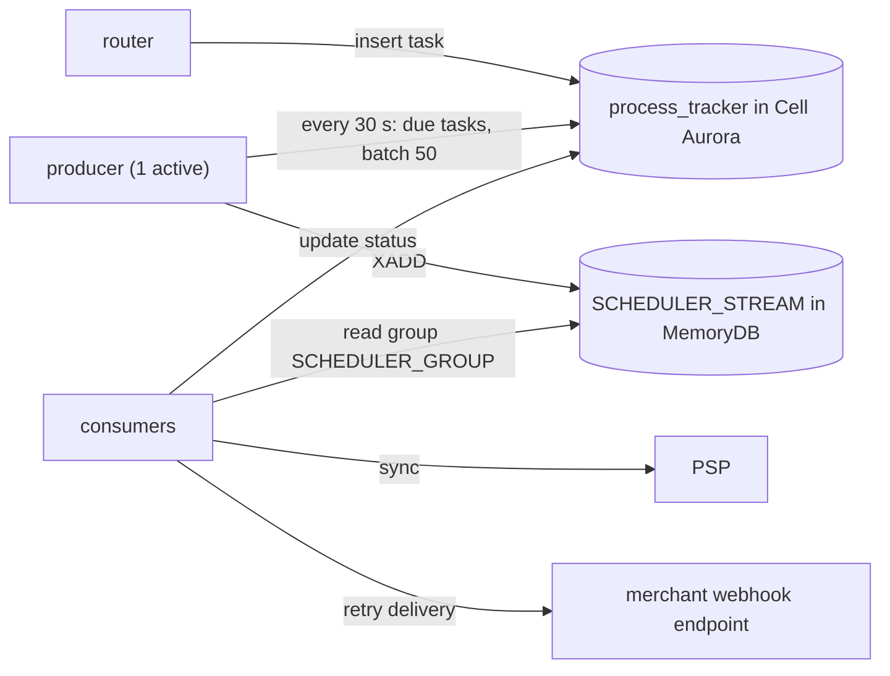

# scheduler

Delayed work of one cell: the Hyperswitch scheduler built from `vendor/hyperswitch/crates/scheduler` and `crates/router/src/bin/scheduler.rs`, run as two deployments, the producer and the consumer. Owner team: `payments-core`. CDE: connected (`manifests/project.yaml`).

## What it does and why it exists

Some work must happen later, or again, and must not hold up the merchant's request:

- **PSP sync** (`PaymentsSyncWorkflow`): after a PSP timeout the router queues a `PAYMENTS_SYNC` task. The scheduler asks the PSP for the payment's status by our reference id until it gets an answer. This is how the [unknown state](../domain/payment-lifecycle.md#why-a-charge-is-never-retried) is settled without repeating a charge.
- **Outgoing webhook retries** (`OutgoingWebhookRetryWorkflow`): the router makes the first delivery itself and queues a retry task. When the merchant's endpoint fails, the scheduler retries.
- Other workflows registered in `ProcessTrackerRunner`, among them `RefundWorkflowRouter`, `DisputeListWorkflow`, `ApiKeyExpiryWorkflow`, `PaymentMethodStatusUpdateWorkflow` and `DeleteTokenizeDataWorkflow` (removes temporary card data from the locker).

Tasks are rows in the `process_tracker` table of the cell Aurora.

- **Producer**: every 30 s (`LOOP_INTERVAL: 30000`) it takes a lock in Redis (`producer_locking_key`, TTL 160 s), reads up to 50 due tasks and puts them on `SCHEDULER_STREAM`. Two replicas run, but only the lock holder produces.
- **Consumer**: every 3 s it reads the stream as group `SCHEDULER_GROUP`, runs each task and writes the result back to `process_tracker`.

## Requests it takes and calls it makes

| Direction | Peer | Port and protocol | Purpose |
|---|---|---|---|
| in | kubelet, Prometheus | 3000 HTTP | `/health`, `/metrics` |
| out | MemoryDB of the cell | 6379 TLS, ACL user `<cell>-scheduler` | producer lock, `SCHEDULER_STREAM` |
| out | Cell Aurora through RDS Proxy | 5432 TLS `verify-full`, login `hs_app` | `process_tracker`, payments |
| out | PSPs (consumer) | 443 HTTPS through the egress path | sync |
| out | merchant webhook endpoints (consumer) | 443 HTTPS through the egress path | webhook retries |
| out | OpenTelemetry collector | 4317 gRPC | traces and metrics |

## Data it reads and writes

| Store | Reads | Writes |
|---|---|---|
| [Cell Aurora](data-stores.md#cell-aurora) | due tasks in `process_tracker`, payments, connector accounts | task status and retry counts, payment status after sync |
| [MemoryDB](data-stores.md#memorydb) | `SCHEDULER_STREAM` | producer lock, stream entries, payment state |
| [DynamoDB cell map](data-stores.md#dynamodb-cell-map) | read access granted by IAM | never |

## Configuration and secrets

The scheduler uses the router's configuration prefix (`ROUTER__`) and the same `platform-common` environment as the [router](router.md#configuration-and-secrets), with `SCHEDULER_FLOW` set to `producer` or `consumer`.

| Setting | Producer | Consumer |
|---|---|---|
| `ROUTER__SCHEDULER__LOOP_INTERVAL` | 30,000 ms | 3,000 ms |
| Batch size | 50 | n/a |
| Lock | `producer_locking_key`, TTL 160 s | n/a |
| Stream, group | `SCHEDULER_STREAM`, `SCHEDULER_GROUP` | same |
| Graceful shutdown | 60,000 ms | 60,000 ms |
| Database pool | 5 (replica 2) | 5 (replica 2) |

Retry policy of the deliveries (`policy/resilience/policy.yaml`):

| Dependency | Timeout | Attempts | Schedule |
|---|---|---|---|
| `psp-sync` | 5 s | 4 retries, backoff from 1 s to 30 s | any error is retried |
| `outgoing-webhooks` | 10 s | 5 | 1 min, 5 min, 30 min, 2 h, 12 h with 20% jitter, then dead-letter queue |

Secrets through ExternalSecret `scheduler-vault`, under `secret/<env>/<cell>/`:

| Variable | Path | Field |
|---|---|---|
| `ROUTER__MASTER_DATABASE__PASSWORD` and the replica and analytics passwords | `scheduler/database` | `password` |
| `ROUTER__REDIS__PRIMARY_PASSWORD` | `scheduler/redis` | `password` |
| `ROUTER__SECRETS__*`, `ROUTER__API_KEYS__HASH_KEY`, `ROUTER__USER_AUTH_METHODS__ENCRYPTION_KEY` | `shared/app` | as for the router |
| `ROUTER__JWEKEY__*` | `shared/locker` | as for the router |

Vault policy `pay-<env>-<cell>-scheduler` reads `scheduler/*` and `shared/*`; it is bound to service accounts `scheduler-producer` and `scheduler-consumer`.

## Scaling and resources

| Deployment | Replicas | Scales on | Node pool | Requests |
|---|---|---|---|---|
| producer | 2, strategy `Recreate`, no autoscaling | fixed; one holds the lock | `payments` | 500m CPU, 512 MiB |
| consumer | 3 to 12 | KEDA `redis-streams` on `SCHEDULER_STREAM` pending entries, threshold 2,000 | `workers` | 500m CPU, 512 MiB |

Both: memory limit 512 MiB, PDB `maxUnavailable: 10%`, grace period 60 s.

## Failure modes and what the user sees

| Failure | Effect | Merchant sees |
|---|---|---|
| Producer down or lock lost | no new tasks reach the stream; the lock expires after 160 s and the other replica takes over | sync and webhook retries start late |
| Consumers behind | tasks wait | payments stay `processing` longer; webhook retries arrive late |
| PSP sync keeps failing | retries with backoff; the payment stays in the unknown state | `processing` until the PSP answers |
| Merchant endpoint down | five retries over about 15 hours, then dead-letter queue | webhooks arrive late, or not at all until an operator replays the queue |

## Metrics and alerts

Metrics: `scheduler_queue_oldest_task_age_seconds`, `webhook_queue_oldest_age_seconds`, `dlq_depth`, `payments_unknown_state_stale`, `reconciliation_amount_mismatch_total`, `retry_budget_exhausted_total`.

| Alert | Condition | Severity | Runbook |
|---|---|---|---|
| `SchedulerQueueDelayHigh` | oldest task older than 600 s | critical | [scheduler-queue-delay-high](../../runbooks/application/scheduler-queue-delay-high.md) |
| `PaymentsWebhookDeliveryBurnFast`, `...Slow` | webhook SLO (99.9% within 60 s) burning | critical, warning | [merchant-webhook-delivery](../../runbooks/slo/merchant-webhook-delivery.md) |
| `WebhookBacklogOld` | oldest webhook older than 300 s | warning | [webhook-backlog-old](../../runbooks/application/warnings.md#webhook-backlog-old) |
| `DlqNotEmpty` | dead-letter queue not empty | warning | [dlq-not-empty](../../runbooks/application/warnings.md#dlq-not-empty) |
| `UnknownStatePaymentsStale` | payments in the unknown state for more than 15 minutes | warning | [unknown-state-payments-stale](../../runbooks/application/warnings.md#unknown-state-payments-stale) |
| `ReconciliationMismatch` | daily amount mismatch with a PSP | warning | [reconciliation-mismatch](../../runbooks/application/warnings.md#reconciliation-mismatch) |
| `RetryBudgetExhausted` (`psp-sync`) | sync retry budget used up | critical | [retry-budget-exhausted](../../runbooks/application/retry-budget-exhausted.md) |

## Where in the repo

| Path | What |
|---|---|
| `vendor/hyperswitch/crates/scheduler`, `vendor/hyperswitch/crates/router/src/workflows` | Upstream scheduler and workflows |
| `docker/scheduler/Dockerfile` | Image |
| `deploy/charts/scheduler/` (`templates/producer`, `templates/consumer`) | Chart |
| `policy/resilience/policy.yaml` | Sync and webhook retry policy |
| `observability/alerts/application/components.yaml`, `payments.yaml` | Alerts |
