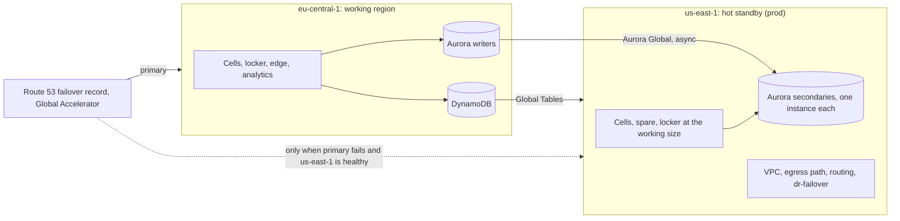

# Disaster recovery

## What it is

The platform survives the loss of one Availability Zone with no action. Prod also survives the loss of the whole working region by switching to us-east-1. The platform has two regions: eu-central-1 writes, and us-east-1 is a hot standby for prod. It runs the prod cells at the working size all the time and can take the whole load at any moment. Stage and dev run in eu-central-1 alone.

## Why

Payments must keep working when a region fails. But if one payment is written in two regions at once, the conflicts cannot be resolved safely for money. So only one region writes at a time, and us-east-1 takes over only when the working region is gone. The owner requires the standby to be ready at any moment, so nothing is built or scaled during a switch ([ADR-0019](../adr/0019-hot-standby-recovery-region.md)).

## How it works

### Regions

| Region | Runs all the time | Data |
|---|---|---|
| eu-central-1 | All cells, locker, edge, analytics, in three AZs | Aurora writers, MemoryDB, DynamoDB, MSK, ClickHouse |
| us-east-1 (prod) | Per cell and the spare: EKS with the working-region node pools and the workloads at their working floors, MemoryDB with the working shard count, one Aurora instance per global secondary with the writer class of its working cluster, RDS Proxy. Also the VPC, its own egress path (egress VPC, Network Firewall, transit gateway) with its own static IPs, `edge-dns-routing`, `dr-failover` and the panel edge | Aurora Global secondaries, DynamoDB replicas, S3 replicas, backup copies, Secrets Manager, ECR and KMS replicas |

Stage and dev have no standby region. Their us-east-1 holds only the panel edge (`panel-edge`, `waf-edge`) and their KMS keys.

- `standby.compute_enabled: true` in `config/environments/prod.yaml` keeps the us-east-1 compute running. The cells sync from `deploy/envs/prod/us-east-1/`. Those values point at the local Aurora secondaries through RDS Proxy, so promotion changes no values.
- Until promotion, us-east-1 cannot write. The Aurora instances there are readers of the global secondaries, and an IAM policy plus an SCP deny DynamoDB writes in the standby region.
- MemoryDB is not replicated across regions. The us-east-1 MemoryDB runs but stays cold, and payment data comes from Aurora behind the 75% warm-up gate (D8).
- Analytics is not mirrored. MSK is rebuilt from the S3 event archive (D7).
- Migrations run only where the writer is. They stay off in us-east-1 until after promotion.
- Capacity at the switch is not a risk: the standby already runs at the working size. Node pools still allow several instance families and both CPU architectures, for scale-out after the switch.

### Recovery objectives

| Event | RPO | RTO |
|---|---|---|
| Loss of one AZ | 0 | 1 minute |
| Loss of the working region (prod) | Aurora Global lag (alarm above 5 s, budget 10 s) plus the drain lag | 60 minutes target, critical path 32 minutes |
| Logical error (bad migration, wrong delete) | at most 5 minutes (point-in-time recovery) | 30 minutes into prepared capacity |
| Analytics | 15 minutes | 4 hours |
| Kubernetes state | 0 (Git) | from Git by Argo CD |

The timed scenario `tests/chaos/region-switch/scenario.json` sets the critical path:

1. Detection and confirmation: 10 minutes.
2. Fencing of Frankfurt: 2 minutes.
3. Aurora promotion, the only point of no return: 3 minutes.
4. Cache warm-up of the priority keys from Aurora (D8): 15 minutes.
5. Traffic switch: 2 minutes.

That is 32 minutes against the 60-minute target. PSP reconciliation (5 minutes) follows after the RTO.

The data lost in a region switch is the data that had not reached us-east-1. That is the Aurora Global lag at the moment of promotion, plus the stream entries the drainer had not yet written in Frankfurt. The `reconcile-window` log event and the `OrphanPaymentWebhooks` alert show charges in that window. People decide refunds.

## Pages

- [Failover and failback steps](failover.md)
- [Drills](drills.md)
- Decision record: [ADR-0019](../adr/0019-hot-standby-recovery-region.md), which supersedes [ADR-0017](../adr/0017-recovery-region-data-replication.md)
- Runbooks: `docs/runbooks/meta/promote-standby-region.md`, `docs/runbooks/network/region-down.md`, `docs/runbooks/backup-dr/`

## Where in the repo

| Path | What |
|---|---|
| `infra/live/prod/us-east-1/` | Hot-standby stacks |
| `infra/modules/dr-failover`, `dns-routing` | Automatic promotion, failover DNS |
| `scripts/dr/failover.py`, `scripts/dr/lambda_handler.py` | Failover and failback logic: fence, lock, promotion, DynamoDB writes |
| `config/environments/prod.yaml` (`standby`) | Standby compute and Aurora instances |
| `deploy/envs/prod/us-east-1/` | Values of the standby cells |
| `tests/chaos/region-switch/` | Timed switch scenario and its runner |
| `observability/alerts/backup-dr/`, `observability/dashboards/l3-data/dr-switch.json` | Lag and drill alerts, switch dashboard |
