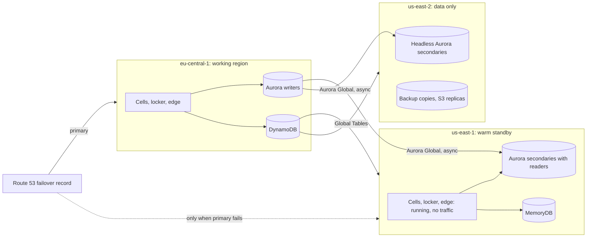

# Disaster recovery

## What it is

The platform survives the loss of an Availability Zone without action and the loss of the whole working region by switching to a warm standby in us-east-1. A second recovery region, us-east-2, keeps copies of the data and backups.

## Why

Payments must keep working when a region fails, but writing one payment in two regions at once creates conflicts that cannot be resolved safely for money. So one region writes at a time, and the standby takes over only when the working region is gone.

## How it works

### Regions

| Region | Runs | Data |
|---|---|---|
| eu-central-1 | All cells, locker, edge, analytics, in three AZs | Aurora writers, MemoryDB, DynamoDB, MSK, ClickHouse |
| us-east-1 (stage and prod) | Per cell: EKS cluster, Karpenter pools with CPU caps, MemoryDB, Aurora readers; locker; edge; its own egress path with its own static IPs | Aurora Global secondaries, DynamoDB replicas, S3 replicas, backup copies, Secrets Manager and ECR replicas, KMS replicas |
| us-east-2 | No compute | Headless Aurora secondaries, DynamoDB replicas, backup copies, ECR and KMS replicas, restore tests |

dev has no recovery regions.

- The standby runs the same image digests as Frankfurt. Its database settings already point at the local Aurora secondaries through RDS Proxy, so promotion changes no values. Its values are generated by `tools/config/render_standby.py`.
- Until promotion the standby cannot write: Aurora secondaries are read-only, and an IAM policy plus an SCP deny DynamoDB writes in recovery regions.
- MemoryDB is not replicated across regions. After a switch the standby MemoryDB holds new state only; payment data comes from Aurora.
- Migrations run only where the writer is; they are off in the standby until after promotion.

### Recovery objectives

| Event | RPO | RTO |
|---|---|---|
| Loss of one AZ | 0 | 1 minute |
| Loss of the working region | Aurora Global lag (alarm above 5 s, budget 10 s) plus the drain lag | 60 minutes target; plan B to us-east-2 75 minutes |
| Logical error (bad migration, wrong delete) | at most 5 minutes (point-in-time recovery) | 30 minutes into prepared capacity |
| Analytics | 15 minutes | 4 hours |
| Kubernetes state | 0 (Git) | from Git by Argo CD |

With the warm standby, detection takes five failing one-minute health check periods; promotion and traffic shift then need no compute to be created. The data lost in a region switch is what had not reached us-east-1: the Aurora Global lag at the moment of promotion plus stream entries the drainer had not yet written in Frankfurt. The `reconcile-window` log event and the `OrphanPaymentWebhooks` alert show charges in that window; refunds are decided by people.

## Pages

- [Failover and failback steps](failover.md)
- [Drills](drills.md)
- Decision record: `docs/adr/drafts/0018-warm-standby-region.md`
- Runbooks: `docs/runbooks/meta/promote-standby-region.md`, `docs/runbooks/network/region-down.md`, `docs/runbooks/backup-dr/`

## Where in the repo

| Path | What |
|---|---|
| `infra/live/<env>/us-east-1/`, `infra/live/<env>/us-east-2/` | Standby and data-only stacks |
| `infra/modules/dr-failover`, `dns-routing` | Automatic promotion, failover DNS |
| `scripts/dr/failover.py`, `scripts/dr/lambda_handler.py` | Failover and failback logic |
| `config/environments/<env>.yaml` (`standby`) | Standby on or off, readers, node pool caps |
| `deploy/envs/<env>/us-east-1/` | Generated standby values |
| `observability/alerts/backup-dr/`, `observability/dashboards/l3-data/dr-switch.json` | Lag and drill alerts, switch dashboard |
