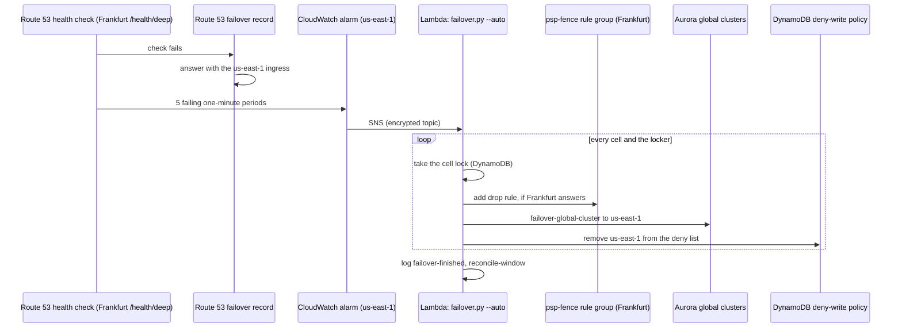

# Failover and failback

## Failover: automatic



1. **Detect.** Route 53 checks `/health/deep` of each region's ingress. When Frankfurt fails, Route 53 answers `api.<zone>` with the us-east-1 ingress by itself. Confirm a real outage with `RegionDown` (two of three probe points).
2. **Start.** After five failing one-minute periods the alarm in us-east-1 publishes to an SNS topic encrypted with a customer managed key, and the Lambda of `infra/modules/dr-failover` runs `scripts/dr/failover.py --auto`. Missing health check data never starts it.
3. **Fence.** For each cell and the locker the script adds a drop rule to the `psp-fence` Network Firewall rule group of Frankfurt, so the old region can no longer reach PSPs, as far as Frankfurt's control plane answers. `fence-unverified` in the log means it did not; Aurora still keeps the old writer from rejoining as a writer.
4. **Promote.** `failover-global-cluster` makes the us-east-1 secondary the writer, and us-east-1 is removed from the DynamoDB deny-write policy (the previous policy version is saved for failback). A lock record per cell and a single concurrent run keep a second alarm from promoting twice.
5. **Check.** Read the Lambda log: `failover-finished` with a result per cell. Exit code 3 means another run holds the lock. Re-run a failed cell with the same alarm event, or by hand with `--cell <cell> --confirmed-by <approver>`.
6. **Reconcile.** The log event `reconcile-window` gives the five minutes before promotion. `OrphanPaymentWebhooks` lists PSP webhooks for payments the promoted database does not know. People decide refunds.
7. **Migrations.** Enable `migrations.enabled` in the standby values only after the writer is stable and a migration is due.

On-call: the primary acknowledges within 5 minutes, the secondary is paged at 5 minutes, the incident commander at 15. The promotion itself needs no confirmation.

### Plan B: us-east-2

If us-east-1 has no capacity for 10 minutes, the switch goes to us-east-2. That region has data only, so compute is created from Terraform first; the RTO target is 75 minutes. The steps are in `tests/chaos/region-switch/plan-b.json`.

## Failback: planned

Never during the incident. Only after Frankfurt is rebuilt and has rejoined each Aurora global cluster as a replicating secondary.

```
scripts/dr/failover.py --mode failback --cell <cell> --confirmed-by <approver> \
  --name-prefix <prefix> --env <env> --source-region <working> --target-region <standby> --deny-policy-arn <arn>
```

Per cell and the locker the script refuses unless the lag to Frankfurt is at most 1 second, then switches Aurora over without data loss, restores the saved DynamoDB deny-write policy version, removes the `psp-fence` drop rule and releases the lock. Without `--confirmed-by` it refuses; an alarm never starts it.

## Where in the repo

| Path | What |
|---|---|
| `docs/runbooks/meta/promote-standby-region.md` | The runbook on-call follows |
| `scripts/dr/` | Script, Lambda handler, tests |
| `infra/modules/dr-failover` | Alarm, topic, Lambda, lock table |
| `infra/modules/dns-routing` | Failover records and health checks |
