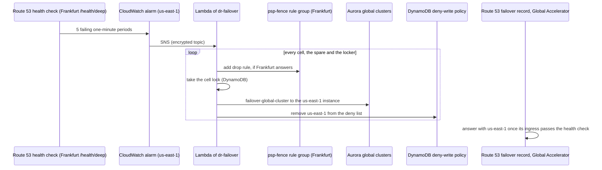

# Failover and failback

us-east-1 is the hot standby of prod ([ADR-0019](../adr/0019-hot-standby-recovery-region.md)). Its cells already run at the working size. The failover fences Frankfurt, promotes Aurora, warms the cache and moves traffic. Nothing is built or scaled.

## Failover: automatic



The Lambda (`scripts/dr/lambda_handler.py`) runs `scripts/dr/failover.py --auto` for every cell. The script runs its steps in this order: `confirm`, `fence`, `acquire_lock`, `start_compute_build`, `add_writer`, `wait_writer`, `promote_aurora`, `allow_dynamodb_writes`, `reconcile` and `wait_compute_build`. With the hot standby, every secondary already has its instance, so `add_writer` skips it and `wait_writer` finds it available. The compute build runs only when the `compute_build` input of `dr-failover` is set. Both steps stay as a fallback for a standby that has lost its compute.

1. **Detect.** Route 53 checks `/health/deep` of each region's ingress. Confirm a real outage with `RegionDown`: two of three probe points (`use1` in us-east-1, and the external providers `ext` and `ext2`) cannot reach Frankfurt. Detection and confirmation have a 10-minute budget in the timed scenario.
2. **Start.** After five failing one-minute periods, the alarm in us-east-1 publishes to an SNS topic encrypted with a customer managed key and invokes the Lambda of `infra/modules/dr-failover`. Missing health check data never starts it.
3. **Fence.** For each cell and the locker, the script adds a drop rule to the `psp-fence` Network Firewall rule group of Frankfurt, as far as Frankfurt's control plane answers. After that, the old region can no longer reach PSPs. `fence-unverified` in the log means Frankfurt did not answer. Aurora still keeps the old writer from rejoining as a writer. A lock record per cell and a single concurrent run keep a second alarm from switching twice. Budget: 2 minutes.
4. **Promote.** `failover-global-cluster` makes the us-east-1 instance of each cluster the writer. us-east-1 is removed from the DynamoDB deny-write policy, and the previous policy version is saved for failback. Promotion is the only point of no return. Budget: 3 minutes.
5. **Warm.** The us-east-1 MemoryDB runs but is cold. A cell takes traffic when 75% of its priority hot keys are warm from Aurora (D8). After 5 minutes it takes traffic anyway, with a non-paging alert. Budget: 15 minutes.
6. **Move traffic.** The `traffic-switch` step gives the us-east-1 endpoint group of Global Accelerator the traffic weight. Route 53 answers `api.<zone>` with us-east-1 when its ingress passes its own health check while Frankfurt's still fails. Until then, DNS keeps answering with Frankfurt. Budget: 2 minutes.
7. **Check.** Read the Lambda log: `failover-finished`, with a result per cell. Exit code 3 means another run holds the lock. Exit code 4 means a step is still pending, and the Lambda retry resumes the same switch under the same run ids. Re-run a failed cell by hand with `--cell <cell> --confirmed-by <approver>`.
8. **Reconcile.** The log event `reconcile-window` gives the five minutes before promotion. `OrphanPaymentWebhooks` lists PSP webhooks for payments the promoted database does not know. People decide refunds.
9. **Migrations.** Enable `migrations.enabled` in the us-east-1 values only after the writer is stable and a migration is due.

The critical path is 32 minutes against the 60-minute RTO ([drills](drills.md)).

On-call: the primary acknowledges within 5 minutes, the secondary is paged at 5 minutes, the incident commander at 15. The promotion itself needs no confirmation.

## Failback: planned

Failback never happens during the incident. It runs only after Frankfurt is rebuilt and has rejoined each Aurora global cluster as a replicating secondary.

```
scripts/dr/failover.py --mode failback --cell <cell> --confirmed-by <approver> \
  --name-prefix <prefix> --env <env> --source-region <working> --target-region <standby> --deny-policy-arn <arn>
```

For each cell and the locker, the script refuses unless the lag to Frankfurt is at most 1 second. It then switches Aurora over without data loss, restores the saved DynamoDB deny-write policy version, removes the `psp-fence` drop rule and releases the lock. Without `--confirmed-by` it refuses, and an alarm never starts it. After failback, us-east-1 is the hot standby again: its instances become readers of the global secondaries, and its cells keep running at the working size.

## Where in the repo

| Path | What |
|---|---|
| `docs/runbooks/meta/promote-standby-region.md` | The runbook on-call follows |
| `scripts/dr/` | Script, Lambda handler, tests |
| `infra/modules/dr-failover` | Alarm, topic, Lambda, lock table |
| `infra/modules/dns-routing`, `infra/modules/global-accelerator` | Failover records, health checks, endpoint groups |
| `tests/chaos/region-switch/` | Step budgets and their order |
