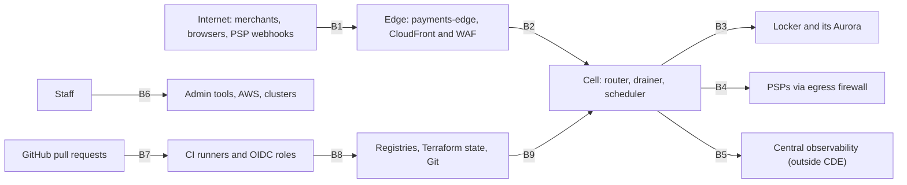
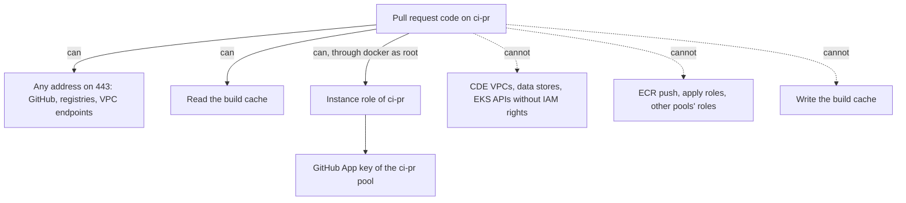

# Threat model

## Scope and method

Assets, trust boundaries, and for each boundary the threats (STRIDE), the controls that answer them, the owner and the risk that remains. Controls are described in [security controls](README.md).

Assets, most valuable first:

1. PANs and the locker keys.
2. Credentials that can change the platform: Terraform apply roles, the ECR push role, Argo CD, Vault.
3. Payment state and payment rows (MemoryDB, Aurora), the merchant-to-cell map.
4. Merchant API keys, PSP credentials, webhook signing keys.
5. Audit evidence: CloudTrail, Config, flow logs, Vault audit.

## Trust boundaries

| Id | Boundary | Main threats | Mitigations | Owner | Residual risk |
|---|---|---|---|---|---|
| B1 | Internet to edge | Spoofed merchant, DDoS, one merchant exhausting capacity, injection through the panel | API keys stored hashed; TLS 1.2+; local, global and overload limits with class shedding; WAF managed and rate rules on panel and SDK; CloudFront VPC origin with an internal NLB; PSP webhooks verified by signature | Platform team | The server-to-server API has no WAF; volumetric attacks rely on AWS edge protection and the limits |
| B2 | Edge to cell | Request routed to a wrong cell, a caller choosing another cell | Lua guard answers 503 for a missing or unknown cell; mTLS; router AuthorizationPolicy admits the edge proxy identity; each cell's router authenticates the API key against its own database, so a key is valid only in its own cell | Platform team | The edge takes `x-payments-cell` from the request and does not overwrite it, so a caller can send requests to any known cell. They fail authentication there, but they spend that cell's capacity and its global limit budget; deriving the header at the edge from the merchant-to-cell map closes this |
| B3 | Cell to locker | PAN disclosure, key misuse | Router identity only; locker pod security group is the only path to the locker Aurora proxy; KMS key usable only by the locker role; no `exec` into CDE pods | Security team | A compromised router can request tokenization and detokenization within its own rights |
| B4 | Cell to PSP | Data exfiltration, calls to unknown hosts | Network Firewall admits PSP domains only (SNI and Host); static Elastic IPs; no internet gateway in workload VPCs | Platform team | Exfiltration through an allowed PSP domain is not blocked by the firewall |
| B5 | Cell to central observability | Card data in logs, traces or errors | Collector in the cell deletes and masks card fields; Sentry scrubbing; Macie on CDE buckets; alert `PanDetectedInLogs` | Security team | A PAN in an unexpected format can pass the regex; Macie and the alert are the backstop |
| B6 | Staff to admin plane | Stolen credentials, standing privilege, insider change | Okta with two factors and phishing-resistant factor for admins; no IAM users; CDE access only by 1-hour JIT grant approved by a second SRE; read-only cluster access; alerts on root login, break-glass, IAM change outside Terraform, SCP change | Security team | An open session keeps working until its one hour ends; JIT revocation lags up to 15 minutes |
| B7 | Pull request to CI | Malicious code in a pull request | See [CI pull request perimeter](#ci-pull-request-perimeter) | Repository owner and platform team | See that section |
| B8 | CI to registries, state and Git | Image tampering, unauthorized apply | Images built once on `main`, signed, SBOM attached; push role trusts only `main` and `release/*`; apply roles per component, `main` and `release/*` only; rulesets on `main` | Platform team | A compromised trusted runner on `main` could push a signed image; review and promotion PRs remain the gate |
| B9 | Git to clusters | Unreviewed change reaching prod | Argo CD syncs from Git only; prod pinned to a release tag without auto sync; Kyverno admits only signed images by digest | Platform team | A merged malicious change reaches dev and stage automatically |

## CI pull request perimeter

This section covers the runner pools, the GitHub OIDC roles and what code from a pull request can and cannot reach.

### Runner pools

Runners are EC2 Auto Scaling groups of arm64 Spot instances in the shared-services account, one group per kind of job. There is no Kubernetes runner namespace. Instances are long-lived: one job at a time, replaced by Spot or a new image.

| Pool | Used by | Instance role may | Network |
|---|---|---|---|
| `ci-build` | image builds on `main` | read and write the build cache, pull from ECR | own security group, outbound 443 only |
| `ci-test` | heavy tests | read the cache, pull from ECR | same |
| `ci-light` | small jobs, plans | read the cache, assume the stage plan role | same |
| `ci-pr` | every pull request job | read the cache; read its own GitHub App secret; set scale-in protection on its own group; explicit deny on `sts:AssumeRole` and `ecr:*` | own security group, outbound 443 only, no inbound |

Every instance: IMDSv2 with hop limit 1, encrypted root volume, no public IP, no SSH (Session Manager only). On `ci-pr` an iptables rule blocks the `runner` user from the metadata service. The cache bucket policy denies writes to every role except the cache writers, so a pull request cannot poison the cache.

### GitHub OIDC roles

| Role | Trusted subject | Grants |
|---|---|---|
| `pay-<env>-glob-tf-plan` (each account) | `repo:<org>/<repo>:pull_request` and `refs/heads/main` | read-only describe calls, read the Terraform state of its environment, write lock files only; explicit deny on secret values |
| `pay-<env>-glob-tf-apply-<component>` | `main` and `release/*` only | named actions on named resources, own state prefix |
| ECR push (`pay-ci-ecr-push`) | `main` and `release/*` only | push to the platform repositories |
| ECR read | `main` only | read images |
| AI review | `repo:<org>/<repo>:environment:ai-review` | invoke one EU inference profile with the guardrail |

The jobs in `ci.yml` and `security.yml` request no `id-token`; a pull request run gets no cloud credentials from the workflow as written.

### What a malicious pull request can and cannot reach

Threat actors: a fork pull request from an outside contributor; a same-repository pull request from a collaborator or a stolen collaborator token; malicious dependency code that runs during a build or test.

| Threat | Actor | Mitigation | Owner | Residual risk |
|---|---|---|---|---|
| Steal the instance role credentials | any | iptables block for the `runner` user, hop limit 1, explicit deny of `sts:AssumeRole` and `ecr:*` on the role | Platform team | The `runner` user is in the `docker` group. A root container with host networking is not the `runner` user and not an extra hop, so it can likely reach the metadata service and get the `ci-pr` role. That role then reads the cache and the pool's GitHub App secret. |
| Abuse the GitHub App key | any, after the step above | One app per pool; the key is read once at boot and not kept on disk | Repository owner | Registering a repository runner needs the repository Administration permission, which covers more than runners. With the key an attacker could register a rogue runner with trusted labels (`ci-build`, `ci-light`) and pick up `main` jobs that request OIDC tokens for the push or plan roles. |
| Persist on a runner | any | Instances are replaced by Spot and image changes | Platform team | Runners are not ephemeral: code left behind can observe later pull request jobs on the same instance. |
| Move sideways in the network | any | Security group allows outbound 443 only; data stores admit only their cluster nodes; EKS endpoints are private and need IAM; admin tools need Okta | Platform team | `ci-pr` shares the private subnets of the trusted pools (`untrusted_subnet_ids` is not set), and shared-services has no Network Firewall of its own, so outbound 443 is open to any address. |
| Read Terraform state | same-repository PR | Plan role is read-only and denied secret values; apply roles trust only `main` and `release/*` | Platform team | A same-repository PR can edit its own workflow to request `id-token: write` and assume the plan role of any account. State of some stacks holds secret values (for example Okta client secrets and generated passwords in shared-services). |
| Run on a trusted pool | same-repository PR | `runs-on` labels in the workflows | Repository owner | A PR can change `runs-on` to a trusted pool label and use that pool's role, for example cache write. |
| Steal repository secrets | fork PR | GitHub withholds secrets and `id-token` from fork pull requests; AI review skips forks before asking for credentials | Repository owner | Workflows of outside contributors run without approval unless the repository setting requires it. |
| Abuse runner capacity (mining, exhausting CI) | any | `max_size` per pool (20 instances for `ci-pr`), Spot only, one job per instance, job timeouts in the workflows; Bedrock spend has its own budget | Platform team | Within `max_size` a pull request can keep `ci-pr` busy and delay other pull requests; there is no budget alarm on runner spend |
| Tamper with the AI review | same-repository PR | Review code runs from the base commit; head is read as data | Repository owner | The workflow file comes from the PR (`pull_request` trigger), so it can be edited. |

### Recommended fixes

| Fix | Closes | Owner |
|---|---|---|
| Run `ci-pr` jobs without the docker group (rootless Docker or a dedicated build VM per job) and register runners with `--ephemeral` | instance role theft, persistence | Platform team |
| Keep the GitHub App keys out of the `ci-pr` role: a registration service in a trusted account hands out one-time registration tokens | rogue runner registration | Platform team |
| Give `ci-pr` its own subnets without routes to other networks (`untrusted_subnet_ids`) and an egress allowlist for GitHub and package registries | lateral movement | Platform team |
| Restrict the plan role trust to `main` (drop the `pull_request` subject) or run PR plans through a separate role without state access to secret-holding stacks | state read | Platform team |
| Require approval for workflows from outside contributors and protect self-hosted labels with runner groups where the account type allows | fork abuse, label hijack | Repository owner |

## Where in the repo

| Path | What |
|---|---|
| `infra/modules/ci-runners`, `infra/live/shared-services/eu-central-1/ci-runners` | Runner pools |
| `infra/modules/ci-oidc-roles`, `infra/modules/bedrock-access` | OIDC roles |
| `.github/workflows/` | Jobs, permissions, `runs-on` |
| `policy/opa/github` | Workflow rules (permissions per job, `id-token` only for AWS) |
