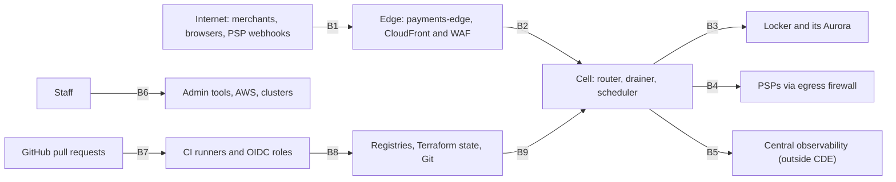
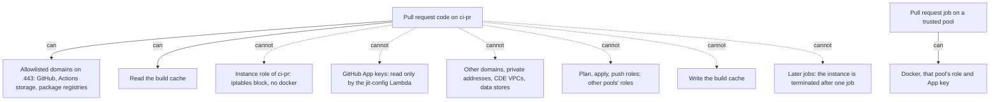

# Threat model

## Scope and method

Assets, trust boundaries, and for each boundary the threats (STRIDE), the controls that answer them, the owner and the risk that remains. Controls are described in [security controls](README.md).

Assets, most valuable first:

1. PANs and the locker keys.
2. Credentials that can change the platform: Terraform apply roles, the ECR push role, Argo CD, Vault.
3. Payment state and payment rows (MemoryDB, Aurora), the merchant-to-cell map.
4. Merchant API keys, PSP credentials, webhook signing keys.
5. Audit evidence: CloudTrail, Config, flow logs, Vault audit.

## Trust boundaries

| Id | Boundary | Main threats | Mitigations | Owner | Residual risk |
|---|---|---|---|---|---|
| B1 | Internet to edge | Spoofed merchant, DDoS, one merchant exhausting capacity, injection through the panel | API keys stored hashed; TLS 1.2+; local, global and overload limits with class shedding; WAF managed and rate rules on panel and SDK; CloudFront VPC origin with an internal NLB; PSP webhooks verified by signature | Platform team | The server-to-server API has no WAF; volumetric attacks rely on AWS edge protection and the limits |
| B2 | Edge to cell | Request routed to a wrong cell, a caller choosing another cell | Lua guard answers 503 for a missing or unknown cell; mTLS; router AuthorizationPolicy admits the edge proxy identity; each cell's router authenticates the API key against its own database, so a key is valid only in its own cell | Platform team | The rate-limit identity is set by the edge from the caller's credential, so no caller can spend another merchant's limit. The cell is still chosen by the `x-payments-cell` header: a caller can aim requests at another cell, where they fail authentication but cost that cell's capacity; per-credential limits cap this, and a merchant-to-cell lookup at the edge removes it |
| B3 | Cell to locker | PAN disclosure, key misuse | Router identity only; locker pod security group is the only path to the locker Aurora proxy; KMS key usable only by the locker role; no `exec` into CDE pods | Security team | A compromised router can request tokenization and detokenization within its own rights |
| B4 | Cell to PSP | Data exfiltration, calls to unknown hosts | Network Firewall admits PSP domains only (SNI and Host); static Elastic IPs; no internet gateway in workload VPCs | Platform team | Exfiltration through an allowed PSP domain is not blocked by the firewall |
| B5 | Cell to central observability | Card data in logs, traces or errors | Collector in the cell deletes and masks card fields; Sentry scrubbing; Macie on CDE buckets; alert `PanDetectedInLogs` | Security team | A PAN in an unexpected format can pass the regex; Macie and the alert are the backstop |
| B6 | Staff to admin plane | Stolen credentials, standing privilege, insider change | Okta with two factors and phishing-resistant factor for admins; no IAM users; CDE access only by 1-hour JIT grant approved by a second SRE; read-only cluster access; alerts on root login, break-glass, IAM change outside Terraform, SCP change | Security team | An open session keeps working until its one hour ends; JIT revocation lags up to 15 minutes |
| B7 | Pull request to CI | Malicious code in a pull request | See [CI pull request perimeter](#ci-pull-request-perimeter) | Repository owner and platform team | See that section |
| B8 | CI to registries, state and Git | Image tampering, unauthorized apply | Images built once on `main`, signed, SBOM attached; push role trusts only `main` and `release/*`; apply roles per component, `main` and `release/*` only; rulesets on `main` | Platform team | A compromised trusted runner on `main` could push a signed image; review and promotion PRs remain the gate |
| B9 | Git to clusters | Unreviewed change reaching prod | Argo CD syncs from Git only; prod pinned to a release tag without auto sync; Kyverno admits only signed images by digest | Platform team | A merged malicious change reaches dev and stage automatically |

## CI pull request perimeter

This section covers the runner pools, the GitHub OIDC roles and what code from a pull request can and cannot reach.

### Runner pools

Runners are EC2 Auto Scaling groups of arm64 Spot instances in the shared-services account, one group per kind of job. There is no Kubernetes runner namespace. The trusted pools are persistent: an instance runs one job at a time and is replaced by Spot or a new image. Every `ci-pr` instance runs exactly one job and is then terminated.

| Pool | Used by | Instance role may | Network |
|---|---|---|---|
| `ci-build` | image builds on `main` | read and write the build cache, pull from ECR, read its own GitHub App secret | private tier; security group outbound 443 only; Network Firewall CI allowlist plus the AWS API allowlist |
| `ci-test` | heavy tests | read the cache, pull from ECR, read its own GitHub App secret | same |
| `ci-light` | small jobs, plans | read the cache, assume the stage plan role, read its own GitHub App secret | same |
| `ci-pr` | every pull request job | read the cache; read and delete the one-time runner configs of its own pool; set scale-in protection on its own group; explicit deny on `sts:AssumeRole`, `ecr:*` and `secretsmanager:*` | untrusted tier; security group outbound 443 to public addresses and the VPC interface endpoints only, no inbound; Network Firewall CI allowlist only |

Every instance: IMDSv2 with hop limit 1, encrypted root volume, no public IP, no SSH (Session Manager only). The cache bucket policy denies writes to every role except the cache writers, so a pull request cannot poison the cache.

A `ci-pr` instance differs from the trusted pools in four ways:

- No Docker. The boot script installs no Docker daemon and the `runner` user is in no `docker` group, so a job that needs Docker (service containers, image builds) cannot run on `ci-pr`; such pull-request jobs (component tests, the migration round trip) run on GitHub-hosted runners, a fresh VM per job with no AWS access.
- An iptables rule blocks the `runner` user from the metadata service. It is set in the boot script before the runner service starts, so no job runs without it.
- No GitHub App key. A launch lifecycle hook calls the `<prefix>-ci-jit-config` Lambda. That function is the only principal the secret resource policy lets read the pool's App key. It asks GitHub for a just-in-time runner config with labels fixed by Terraform and stores it as a one-time SecureString `/<prefix>/ci/jit/ci-pr/<instance-id>`. The instance reads the parameter, deletes it, runs one job and powers off, and the group terminates it. If no config is stored, the hook abandons the launch and the instance is terminated.
- Own subnets. The untrusted tier has its own route tables: the only routes out are the transit gateway to the egress VPC, where the Network Firewall applies the CI domain allowlist, and the S3 gateway endpoint for cache reads. The trusted pools leave the VPC through the same firewall and also pass a short allowlist of AWS API domains that have no interface endpoint.

### GitHub OIDC roles

| Role | Trusted subject | Grants |
|---|---|---|
| `pay-<env>-glob-tf-plan` (each account) | `refs/heads/main` only (nightly drift check) | read-only describe calls, read the Terraform state of its environment, write lock files only; explicit deny on secret values |
| `pay-<env>-glob-tf-apply-<component>` | `main` and `release/*` only | named actions on named resources, own state prefix |
| ECR push (`pay-ci-ecr-push`) | `main` and `release/*` only | push to the platform repositories |
| ECR read | `main` only | read images |
| AI review | `repo:<org>/<repo>:environment:ai-review` | invoke one EU inference profile with the guardrail |

None of the plan, apply and ECR roles trusts the `pull_request` subject; a test of the `ci-oidc-roles` module enforces it. Pull requests check Terraform with `terraform test` and mock providers. The jobs in `ci.yml` and `security.yml` request no `id-token`.

### What a malicious pull request can and cannot reach

The last line is the open path: it applies to any pull request job that runs on a trusted pool (see "Run on a trusted pool" below).

Threat actors: a fork pull request from an outside contributor; a same-repository pull request from a collaborator or a stolen collaborator token; malicious dependency code that runs during a build or test.

| Threat | Actor | Mitigation | Owner | Residual risk |
|---|---|---|---|---|
| Steal the instance role credentials | any | No Docker and no `docker` group on `ci-pr`; iptables block for the `runner` user set before the runner starts; hop limit 1; explicit deny of `sts:AssumeRole`, `ecr:*` and `secretsmanager:*` on the role | Platform team | Only a process that escalates to root on the instance reaches the role. The role can then read the cache and read or delete the pending one-time runner configs of the whole `ci-pr` pool (the parameter path is per pool, not per instance). With another instance's config an attacker can take that runner's place or stop it from registering, and so see or block other pull request jobs. The labels are fixed, so such a runner only receives `ci-pr` jobs |
| Abuse the GitHub App key | any | `ci-pr` instances never hold a key: only the jit-config Lambda reads it (secret resource policy denies every other principal); the Lambda runs outside the VPC; the installation token is limited to one repository and the Administration permission; labels and repository come from Terraform, not from the instance | Repository owner | Anyone who can change the Lambda, its role or the secret policy (an apply in shared-services or an administrator) can read the key. The trusted pools still read their own keys at boot; see "Run on a trusted pool" |
| Persist on a runner | any | `ci-pr` runs one job per instance with a just-in-time config, then powers off and is terminated; nothing carries over to the next job | Platform team | The trusted pools are persistent; code that reaches them through a trusted label can observe later jobs on the same instance |
| Move sideways in the network | any | Untrusted subnets whose only routes out are the transit gateway and the S3 gateway endpoint; security group allows 443 to public addresses and the interface endpoints only; data stores admit only their cluster nodes; EKS endpoints are private and need IAM; admin tools need Okta | Platform team | The VPC-local route cannot be removed, so the security group is what keeps `ci-pr` off private addresses in the VPC |
| Exfiltrate code or data | any | Network Firewall CI allowlist: GitHub, Actions storage, the Auto Scaling API and the package registries of the jobs; every other domain is dropped | Platform team | Data can still leave through an allowed domain: any repository on `github.com`, any Azure storage account under `.blob.core.windows.net`, a package registry. The firewall matches the TLS SNI and HTTP Host the client sends and does not decrypt TLS. DNS queries to the VPC resolver are not filtered |
| Read Terraform state | same-repository PR | No OIDC role trusts `pull_request`; the plan role trusts `main` only and is denied secret values; apply roles trust only `main` and `release/*`; pull requests use `terraform test` with mock providers | Platform team | A pull request cannot get state credentials. Code merged to `main` runs the nightly plan with read access to state |
| Run on a trusted pool | same-repository PR | `runs-on` labels in the workflows; the trusted pools use the GitHub App of their own pool | Repository owner | A pull request job reaches a trusted pool when its workflow sends it there or when the pull request edits `runs-on` to a trusted label. On a trusted pool the metadata service is not blocked for the `runner` user, so the job gets that pool's role (for example cache write on `ci-build`) and can read the pool's GitHub App secret; it also has Docker and the `docker` group, and the instance is persistent. Pull request jobs that need Docker therefore need their own isolation rather than a trusted pool |
| Steal repository secrets | fork PR | GitHub withholds secrets and `id-token` from fork pull requests; AI review skips forks before asking for credentials | Repository owner | Workflows of outside contributors run without approval unless the repository setting requires it |
| Abuse runner capacity (mining, exhausting CI) | any | `max_size` per pool (20 instances for `ci-pr`), Spot only, one job per instance, job timeouts in the workflows; the jit-config Lambda has a reserved concurrency of 10; Bedrock spend has its own budget | Platform team | Within `max_size` a pull request can keep `ci-pr` busy and delay other pull requests; there is no budget alarm on runner spend |
| Tamper with the AI review | same-repository PR | Review code runs from the base commit; head is read as data | Repository owner | The workflow file comes from the PR (`pull_request` trigger), so it can be edited |

### Recommended fixes

| Fix | Closes | Owner | Status |
|---|---|---|---|
| Run `ci-pr` jobs without Docker and the `docker` group, one job per instance | instance role theft, persistence | Platform team | Done |
| Keep the GitHub App keys out of the `ci-pr` role: a bootstrap function behind a secret resource policy hands each instance a one-time just-in-time config | rogue runner registration | Platform team | Done |
| Give `ci-pr` its own subnets routed only through the Network Firewall CI allowlist | lateral movement, exfiltration to arbitrary hosts | Platform team | Done |
| Restrict the plan role trust to `main` | state read | Platform team | Done |
| Require approval for workflows from outside contributors, keep every pull request job on `ci-pr`, and restrict trusted labels to `main` with runner groups where the account type allows | fork abuse, label hijack | Repository owner | Open |
| Scope the one-time config path per instance, for example with an instance-ID condition on the parameter, so a root process on one instance cannot read another's config | JIT config theft | Platform team | Open |
| Add DNS Firewall on the CI VPC with the same domain allowlist | DNS exfiltration | Platform team | Open |

## Where in the repo

| Path | What |
|---|---|
| `infra/modules/ci-runners`, `infra/live/shared-services/eu-central-1/ci-runners` | Runner pools, the jit-config Lambda (`functions/jit-config`), boot script |
| `infra/modules/vpc`, `infra/live/shared-services/eu-central-1/vpc` | Untrusted subnet tier and its route tables |
| `infra/modules/network-firewall`, `infra/modules/egress-routing`, `infra/live/shared-services/eu-central-1/{tgw,egress-vpc,firewall,egress-routing}` | CI egress path and allowlists |
| `infra/modules/ci-oidc-roles`, `infra/modules/bedrock-access` | OIDC roles |
| `.github/workflows/` | Jobs, permissions, `runs-on` |
| `policy/opa/github` | Workflow rules (permissions per job, `id-token` only for AWS) |
